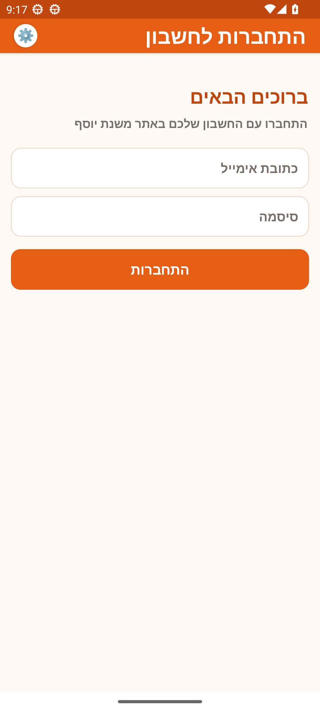
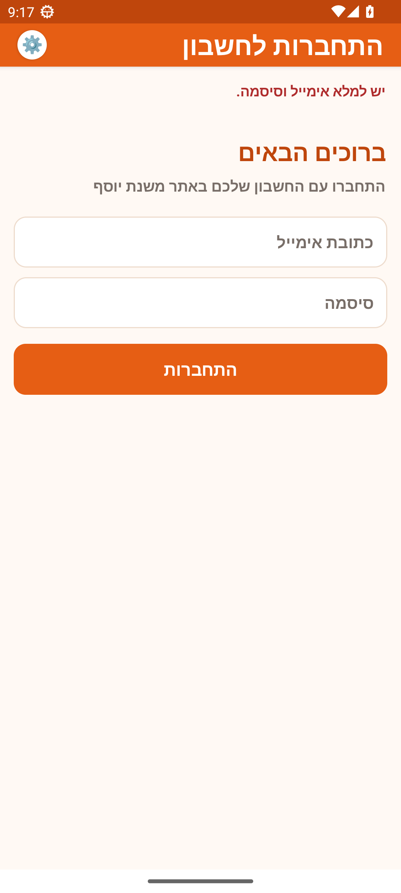
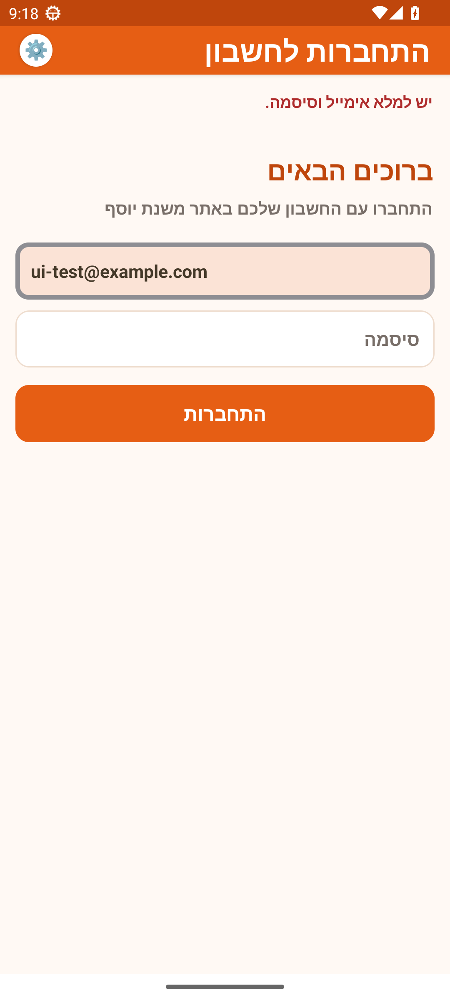
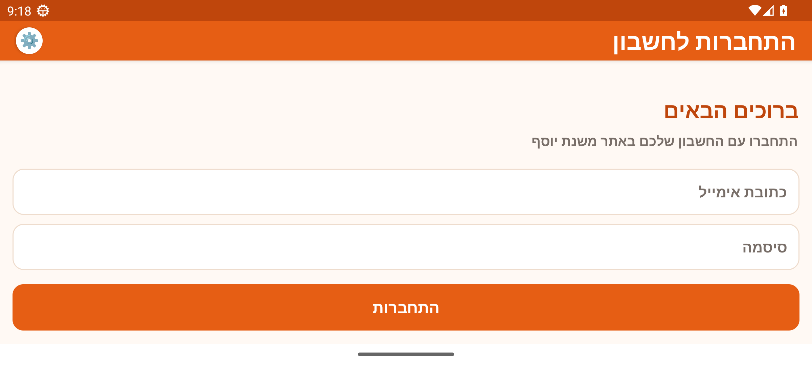

# UI test — mishnat-yosef (scenario)

**Result:** ✅ PASSED  
**Package:** `org.mishnatyosef.mobile`  
**Device:** sdk_gphone64_x86_64 · Android 13 (API 33) · 1080x2400  
**Duration:** 57.0s

## Steps

| # | Action | Detail | Result | Time |
|---|---|---|---|---|
| 1 | clear_data |  | ✅ | 0.48s |
| 2 | shell | cmd='pm grant org.mishnatyosef.mobile android.permission.POST_NOTIFICATIONS', ignore_error | ✅ | 0.22s |
| 3 | shell | cmd='appops set org.mishnatyosef.mobile SCHEDULE_EXACT_ALARM allow', ignore_errors=True | ✅ | 0.22s |
| 4 | launch |  | ✅ | 3.79s |
| 5 | wait_for | text='ברוכים הבאים' | ✅ | 2.82s |
| 6 | back | close an update/notice dialog if one opened over the login screen | ✅ | 1.13s |
| 7 | assert_foreground |  | ⚠️ — foreground app is com.google.android.apps.nexuslauncher, expected org.mishnatyosef.mobile | 0.48s |
| 8 | launch | restart=False | ✅ | 3.58s |
| 9 | screenshot | name='login' | ✅ | 3.05s |
| 10 | assert_text | text='התחברות לחשבון' | ✅ | 2.13s |
| 11 | assert_text | text='התחברו עם החשבון שלכם' | ✅ | 2.45s |
| 12 | assert_visible | email + password fields | ✅ | 2.34s |
| 13 | tap | submit the empty form | ✅ | 3.66s |
| 14 | assert_text | text='יש למלא אימייל וסיסמה' | ✅ | 2.49s |
| 15 | screenshot | name='empty-form-validation' | ✅ | 2.76s |
| 16 | type | class='EditText' | ✅ | 5.4s |
| 17 | assert_text | text='ui-test@example.com' | ✅ | 2.85s |
| 18 | screenshot | name='email-typed' | ✅ | 2.87s |
| 19 | rotate | to='landscape' | ✅ | 2.17s |
| 20 | assert_text | text='ברוכים הבאים' | ✅ | 3.1s |
| 21 | screenshot | name='landscape' | ✅ | 2.69s |
| 22 | rotate | to='portrait' | ✅ | 1.84s |
| 23 | assert_foreground |  | ✅ | 0.2s |
| 24 | screenshot | name='back-to-portrait' | ✅ | 2.8s |

## Screenshots

**001-login.png**

**002-empty-form-validation.png**

**003-email-typed.png**

**004-landscape.png**

**005-back-to-portrait.png**

