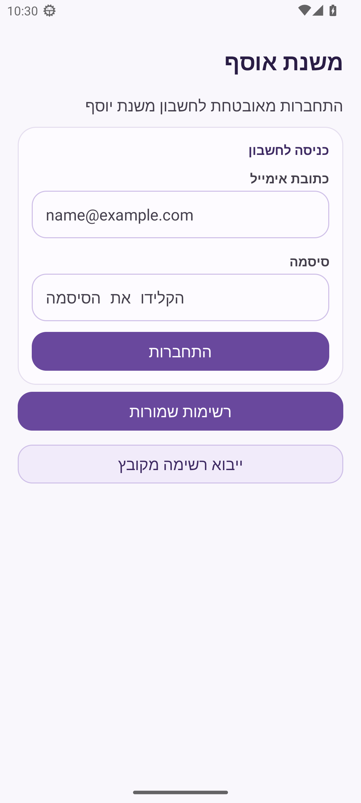
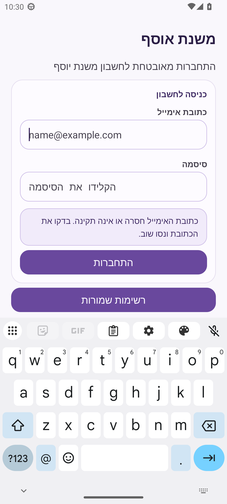
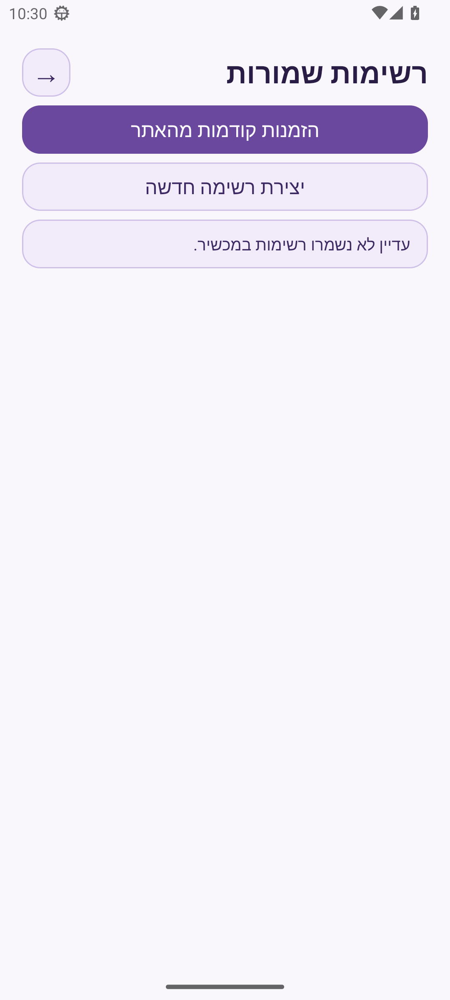
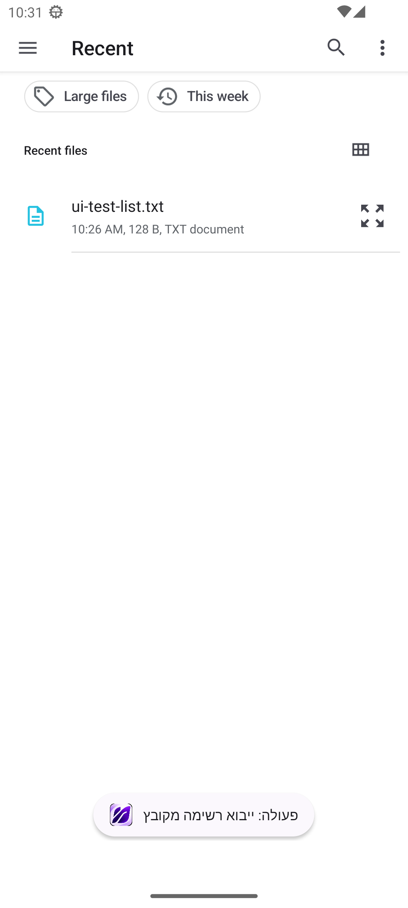
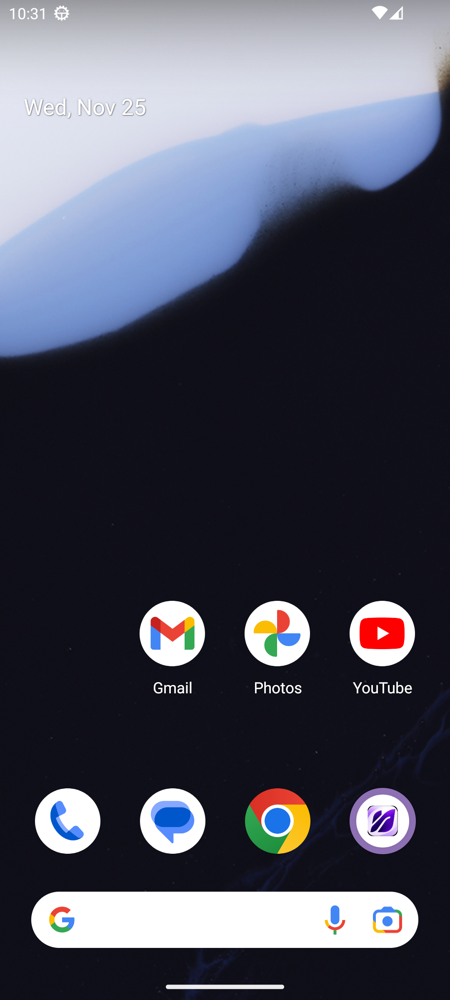

# UI test — mishnat-pickup (explore)

**Result:** ✅ PASSED  
**Package:** `org.mishnatyosef.pickup`  
**Device:** sdk_gphone64_x86_64 · Android 13 (API 33) · 1080x2400  
**Duration:** 90.3s

## Steps

| # | Action | Detail | Result | Time |
|---|---|---|---|---|
| 1 | explore-tap | name@example.com | ✅ | 1.33s |
| 2 | explore-tap | הקלידו את הסיסמה | ✅ | 1.25s |
| 3 | explore-tap | התחברות | ✅ | 1.27s |
| 4 | explore-tap | name@example.com | ✅ | 1.25s |
| 5 | explore-tap | הקלידו את הסיסמה | ✅ | 1.24s |
| 6 | explore-tap | התחברות | ✅ | 1.28s |
| 7 | explore-tap | רשימות שמורות | ✅ | 1.24s |
| 8 | explore-tap | → / חזרה | ✅ | 1.25s |
| 9 | explore-tap | רשימות שמורות | ✅ | 1.24s |
| 10 | explore-tap | יצירת רשימה חדשה | ✅ | 1.25s |
| 11 | explore-tap | ייבוא רשימה מקובץ | ✅ | 1.26s |
| 12 | explore | left app to com.google.android.documentsui | ✅ | 0s |

## Notes

- explore: 3 distinct screens, 11 elements tapped, 6 relaunches, 83s

## Screenshots

**001-screen-1.png**

**002-screen-2.png**

**003-screen-3.png**

**004-left-app-to-com-google-android-documentsui.png**

**005-final.png**

