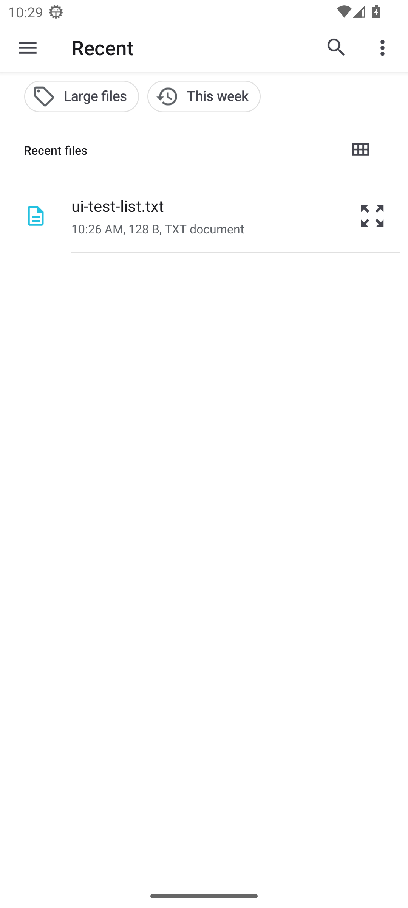
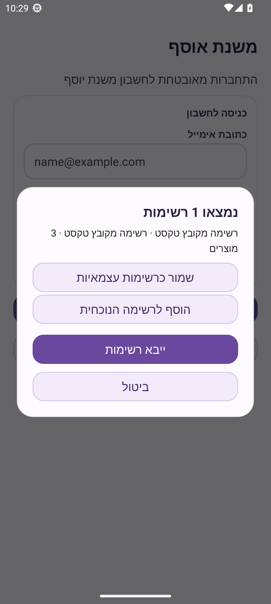
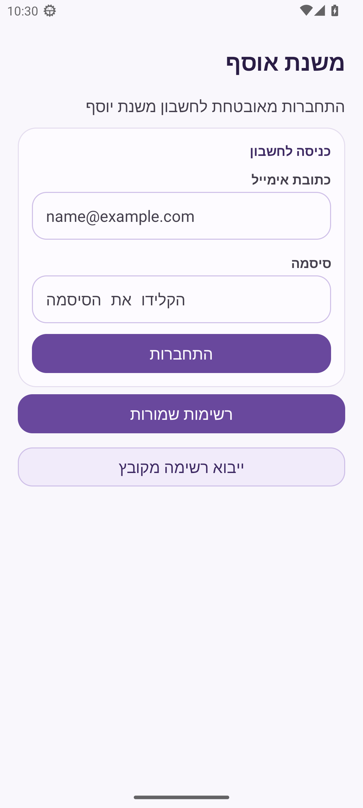

# UI test — mishnat-pickup (scenario)

**Result:** ❌ FAILED  
**Package:** `org.mishnatyosef.pickup`  
**Device:** sdk_gphone64_x86_64 · Android 13 (API 33) · 1080x2400  
**Duration:** 101.0s

## Steps

| # | Action | Detail | Result | Time |
|---|---|---|---|---|
| 1 | clear_data |  | ✅ | 0.57s |
| 2 | push | src='fixtures/ui-test-list.txt', dest='/sdcard/Download/ui-test-list.txt' | ✅ | 23.11s |
| 3 | launch |  | ✅ | 4.05s |
| 4 | wait_for | text='כניסה לחשבון' | ✅ | 2.66s |
| 5 | screenshot | name='login' | ✅ | 2.83s |
| 6 | assert_text | text='משנת אוסף' | ✅ | 2.37s |
| 7 | assert_text | text='רשימות שמורות' | ✅ | 2.13s |
| 8 | scroll_to | text='ייבוא רשימה מקובץ' | ✅ | 2.11s |
| 9 | tap | text='ייבוא רשימה מקובץ' | ✅ | 4.26s |
| 10 | wait | seconds=3 | ✅ | 3.06s |
| 11 | screenshot | name='file-picker' | ✅ | 3.11s |
| 12 | tap | file shown directly (Recent) | ✅ | 3.44s |
| 13 | tap | otherwise open the picker drawer | ⚠️ — element not found within 3s: desc='Show roots' | 4.85s |
| 14 | tap | text='Downloads' | ⚠️ — element not found within 4s: text='Downloads' | 5.11s |
| 15 | tap | text='ui-test-list' | ⚠️ — element not found within 8s: text='ui-test-list' | 10.02s |
| 16 | wait_for | text='נמצאו 1 רשימות' | ✅ | 2.16s |
| 17 | screenshot | name='import-summary' | ✅ | 2.7s |
| 18 | tap | text='ייבא רשימות' | ✅ | 3.34s |
| 19 | wait_for | text='נאספו 0 מתוך 6' | ❌ — element not found within 10s: text='נאספו 0 מתוך 6' | 12.66s |

## Screenshots

**001-login.png**

**002-file-picker.png**

**003-import-summary.png**

**004-step19-wait_for-FAILED.png**

**005-final.png**

