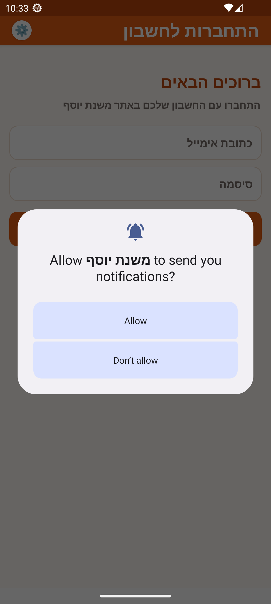
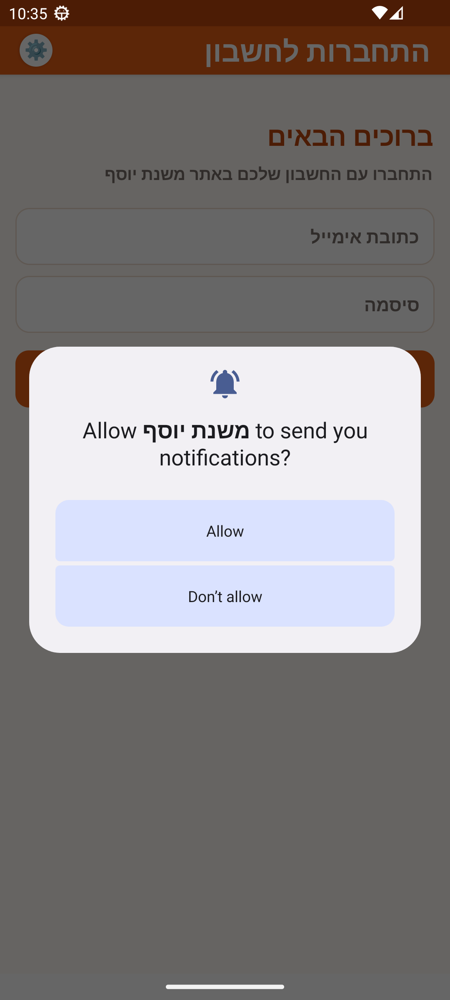

# UI test — mishnat-yosef (scenario)

**Result:** ❌ FAILED  
**Package:** `org.mishnatyosef.mobile`  
**Device:** sdk_gphone64_x86_64 · Android 13 (API 33) · 1080x2400  
**Duration:** 199.7s

## Steps

| # | Action | Detail | Result | Time |
|---|---|---|---|---|
| 1 | clear_data |  | ✅ | 0.21s |
| 2 | shell | cmd='appops set org.mishnatyosef.mobile SCHEDULE_EXACT_ALARM allow', ignore_errors=True | ✅ | 0.06s |
| 3 | launch |  | ✅ | 3.16s |
| 4 | wait_for | text='ברוכים הבאים' | ❌ — element not found within 30s: text='ברוכים הבאים' | 31.54s |
| 5 | tap | desc='פתיחת הגדרות ופעולות' | ❌ — element not found within 10s: desc='פתיחת הגדרות ופעולות' | 10.05s |
| 6 | wait_for | text='פעולות מהירות' | ❌ — element not found within 8s: text='פעולות מהירות' | 9.97s |
| 7 | screenshot | name='day-dialog' | ✅ | 2.36s |
| 8 | tap | text='מצב לילה' | ❌ — element not found within 10s: text='מצב לילה' | 12.61s |
| 9 | wait | seconds=1.5 | ✅ | 1.53s |
| 10 | assert_text | button label flipped | ❌ — element not found within 5s: text='מצב יום' | 7.34s |
| 11 | assert_text | dialog still open | ❌ — element not found within 5s: text='פעולות מהירות' | 7.34s |
| 12 | screenshot | name='night-dialog' | ✅ | 2.35s |
| 13 | tap | desc='סגירת חלון הפעולות' | ❌ — element not found within 10s: desc='סגירת חלון הפעולות' | 10.04s |
| 14 | assert_not_visible | text='פעולות מהירות' | ✅ | 2.52s |
| 15 | screenshot | name='night-login-screen' | ✅ | 2.39s |
| 16 | tap | desc='פתיחת הגדרות ופעולות' | ❌ — element not found within 10s: desc='פתיחת הגדרות ופעולות' | 12.66s |
| 17 | wait_for | text='פעולות מהירות' | ❌ — element not found within 8s: text='פעולות מהירות' | 10.02s |
| 18 | screenshot | name='night-dialog-reopened' | ✅ | 2.36s |
| 19 | tap | text='מצב יום' | ❌ — element not found within 10s: text='מצב יום' | 12.66s |
| 20 | wait | seconds=1.5 | ✅ | 1.53s |
| 21 | assert_text | text='מצב לילה' | ❌ — element not found within 5s: text='מצב לילה' | 7.31s |
| 22 | screenshot | name='back-to-day-dialog' | ✅ | 2.37s |
| 23 | tap | desc='סגירת חלון הפעולות' | ❌ — element not found within 10s: desc='סגירת חלון הפעולות' | 12.63s |
| 24 | assert_foreground |  | ❌ — foreground app is com.google.android.permissioncontroller, expected org.mishnatyosef.mobile | 0.03s |

## Screenshots

**001-step4-wait_for-FAILED.png**

**002-step5-tap-FAILED.png**

**003-step6-wait_for-FAILED.png**

**004-day-dialog.png**

**005-step8-tap-FAILED.png**

**006-step10-assert_text-FAILED.png**

**007-step11-assert_text-FAILED.png**

**008-night-dialog.png**

**009-step13-tap-FAILED.png**

**010-night-login-screen.png**

**011-step16-tap-FAILED.png**

**012-step17-wait_for-FAILED.png**

**013-night-dialog-reopened.png**

**014-step19-tap-FAILED.png**

**015-step21-assert_text-FAILED.png**

**016-back-to-day-dialog.png**

**017-step23-tap-FAILED.png**

**018-step24-assert_foreground-FAILED.png**

**019-final.png**

