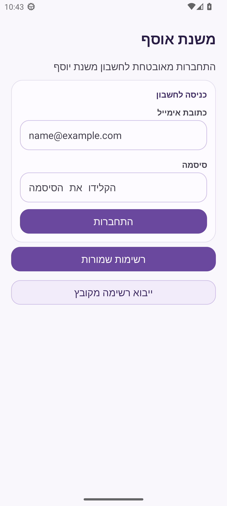
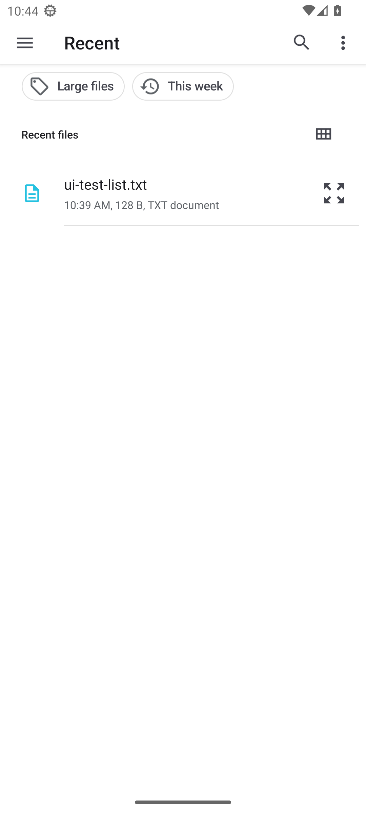
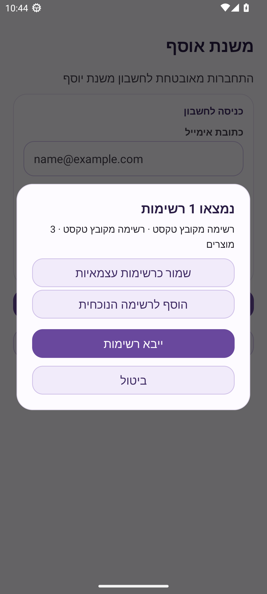
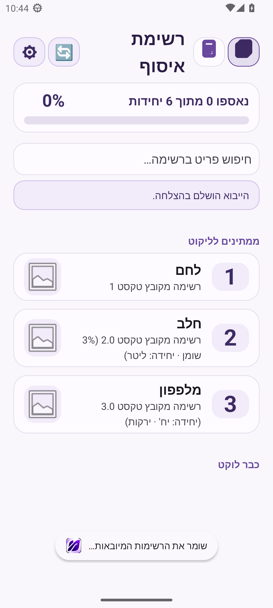
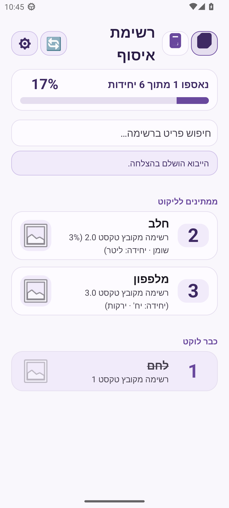
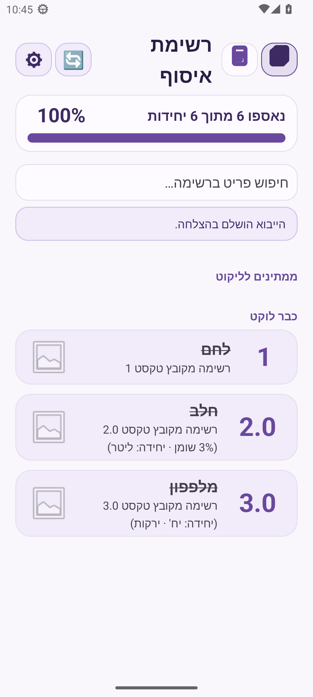

# UI test — mishnat-pickup (scenario)

**Result:** ❌ FAILED  
**Package:** `org.mishnatyosef.pickup`  
**Device:** sdk_gphone64_x86_64 · Android 13 (API 33) · 1080x2400  
**Duration:** 131.9s

## Steps

| # | Action | Detail | Result | Time |
|---|---|---|---|---|
| 1 | clear_data |  | ✅ | 0.26s |
| 2 | push | src='fixtures/ui-test-list.txt', dest='/sdcard/Download/ui-test-list.txt' | ✅ | 30.77s |
| 3 | launch |  | ✅ | 3.97s |
| 4 | wait_for | text='כניסה לחשבון' | ✅ | 2.52s |
| 5 | screenshot | name='login' | ✅ | 2.61s |
| 6 | assert_text | text='משנת אוסף' | ✅ | 2.35s |
| 7 | assert_text | text='רשימות שמורות' | ✅ | 2.44s |
| 8 | scroll_to | text='ייבוא רשימה מקובץ' | ✅ | 2.79s |
| 9 | tap | text='ייבוא רשימה מקובץ' | ✅ | 5.13s |
| 10 | wait | seconds=3 | ✅ | 3.15s |
| 11 | screenshot | name='file-picker' | ✅ | 4.48s |
| 12 | tap | file shown directly (Recent) | ✅ | 4.41s |
| 13 | tap | otherwise open the picker drawer | ⚠️ — element not found within 3s: desc='Show roots' | 5.94s |
| 14 | tap | text='Downloads' | ⚠️ — element not found within 4s: text='Downloads' | 5.59s |
| 15 | tap | text='ui-test-list' | ⚠️ — element not found within 8s: text='ui-test-list' | 10.77s |
| 16 | wait_for | text='נמצאו 1 רשימות' | ✅ | 2.19s |
| 17 | screenshot | name='import-summary' | ✅ | 2.51s |
| 18 | tap | text='ייבא רשימות' | ✅ | 4.19s |
| 19 | wait_for | text='נאספו 0 מתוך 6' | ✅ | 3.14s |
| 20 | screenshot | name='list-imported' | ✅ | 2.63s |
| 21 | tap | text='לחם' | ✅ | 3.14s |
| 22 | assert_text | text='נאספו 1 מתוך 6' | ✅ | 2.25s |
| 23 | screenshot | name='one-collected' | ✅ | 2.65s |
| 24 | tap | text='חלב' | ✅ | 3.35s |
| 25 | assert_text | text='נאספו 3 מתוך 6' | ✅ | 2.08s |
| 26 | tap | text='מלפפון' | ✅ | 2.41s |
| 27 | wait_for | text='הידד' | ❌ — element not found within 6s: text='הידד' | 8.13s |

## Screenshots

**001-login.png**

**002-file-picker.png**

**003-import-summary.png**

**004-list-imported.png**

**005-one-collected.png**

**006-step27-wait_for-FAILED.png**

**007-final.png**

