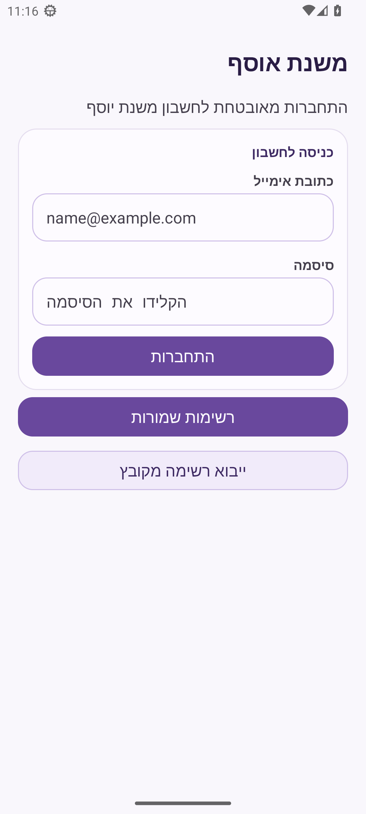
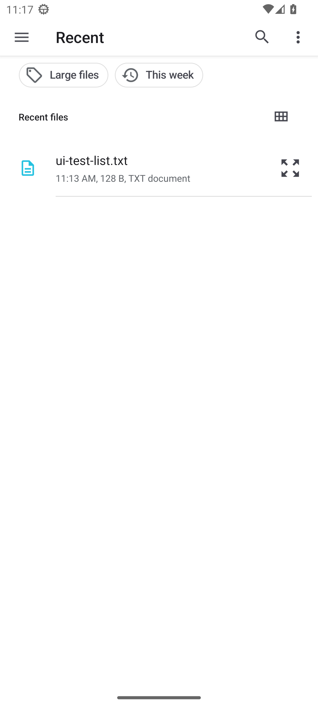
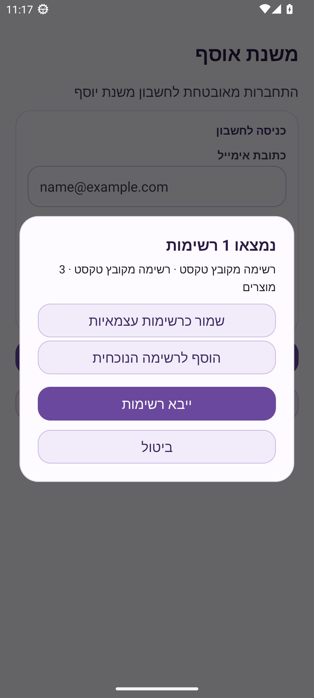
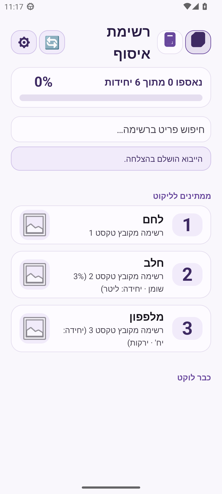
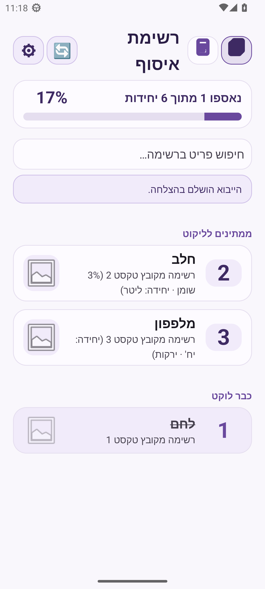
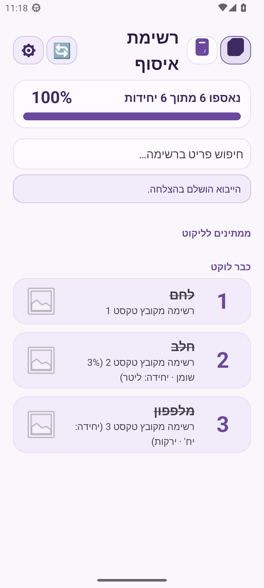
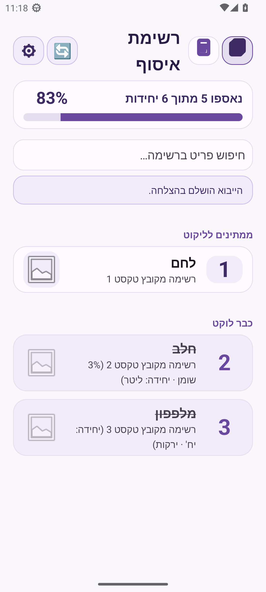

# UI test — mishnat-pickup (scenario)

**Result:** ✅ PASSED  
**Package:** `org.mishnatyosef.pickup`  
**Device:** sdk_gphone64_x86_64 · Android 13 (API 33) · 1080x2400  
**Duration:** 148.8s

## Steps

| # | Action | Detail | Result | Time |
|---|---|---|---|---|
| 1 | clear_data |  | ✅ | 0.25s |
| 2 | push | src='fixtures/ui-test-list.txt', dest='/sdcard/Download/ui-test-list.txt' | ✅ | 39.63s |
| 3 | launch |  | ✅ | 4.09s |
| 4 | wait_for | text='כניסה לחשבון' | ✅ | 3.08s |
| 5 | screenshot | name='login' | ✅ | 2.52s |
| 6 | assert_text | text='משנת אוסף' | ✅ | 2.16s |
| 7 | assert_text | text='רשימות שמורות' | ✅ | 2.54s |
| 8 | scroll_to | text='ייבוא רשימה מקובץ' | ✅ | 2.5s |
| 9 | tap | text='ייבוא רשימה מקובץ' | ✅ | 4.0s |
| 10 | wait | seconds=3 | ✅ | 3.19s |
| 11 | screenshot | name='file-picker' | ✅ | 4.42s |
| 12 | tap | file shown directly (Recent) | ✅ | 3.87s |
| 13 | tap | otherwise open the picker drawer | ⚠️ — element not found within 3s: desc='Show roots' | 5.45s |
| 14 | tap | text='Downloads' | ⚠️ — element not found within 4s: text='Downloads' | 4.87s |
| 15 | tap | text='ui-test-list' | ⚠️ — element not found within 8s: text='ui-test-list' | 8.23s |
| 16 | wait_for | text='נמצאו 1 רשימות' | ✅ | 2.15s |
| 17 | screenshot | name='import-summary' | ✅ | 2.47s |
| 18 | tap | text='ייבא רשימות' | ✅ | 3.4s |
| 19 | wait_for | text='נאספו 0 מתוך 6' | ✅ | 2.46s |
| 20 | assert_text | TXT quantity shown as 2, not 2.0 | ✅ | 2.29s |
| 21 | assert_not_visible | text='2.0' | ✅ | 2.7s |
| 22 | screenshot | name='list-imported' | ✅ | 2.55s |
| 23 | tap | text='לחם' | ✅ | 3.33s |
| 24 | assert_text | text='נאספו 1 מתוך 6' | ✅ | 2.3s |
| 25 | screenshot | name='one-collected' | ✅ | 2.87s |
| 26 | tap | text='חלב' | ✅ | 3.17s |
| 27 | assert_text | text='נאספו 3 מתוך 6' | ✅ | 2.03s |
| 28 | tap | text='מלפפון' | ✅ | 2.91s |
| 29 | screenshot | celebration animation lasts ~1.5s; uiautomator cannot read the screen while it animates, s | ✅ | 2.33s |
| 30 | screenshot | name='celebration' | ✅ | 2.3s |
| 31 | wait | seconds=5 | ✅ | 5.06s |
| 32 | assert_text | text='נאספו 6 מתוך 6' | ✅ | 2.02s |
| 33 | screenshot | name='all-collected' | ✅ | 2.29s |
| 34 | tap | tap again returns it to pending | ✅ | 3.05s |
| 35 | assert_text | text='נאספו 5 מתוך 6' | ✅ | 2.06s |
| 36 | screenshot | name='one-returned' | ✅ | 2.45s |

## Screenshots

**001-login.png**

**002-file-picker.png**

**003-import-summary.png**

**004-list-imported.png**

**005-one-collected.png**

**006-celebration.png**

**007-celebration.png**

**008-all-collected.png**

**009-one-returned.png**

