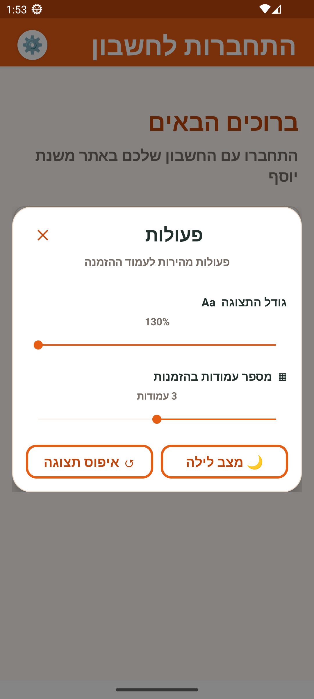
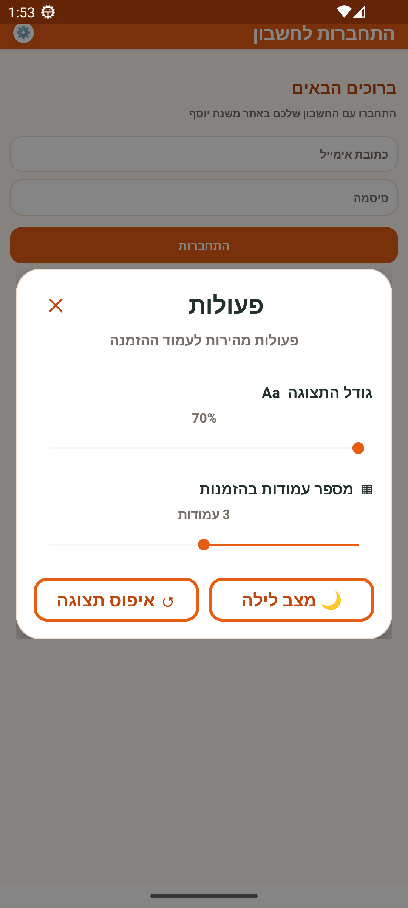
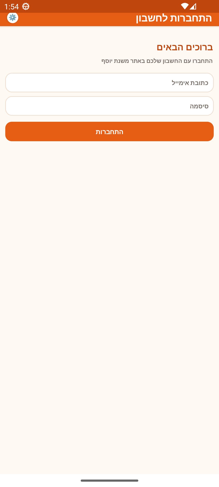
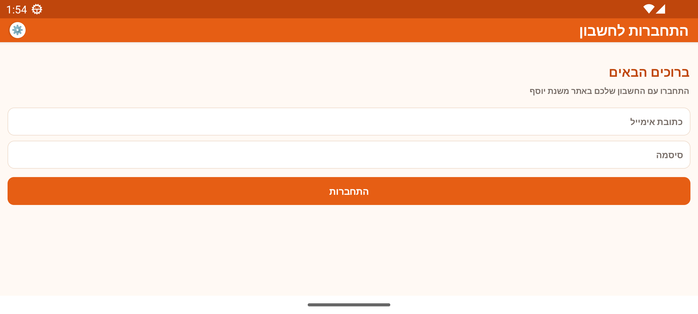
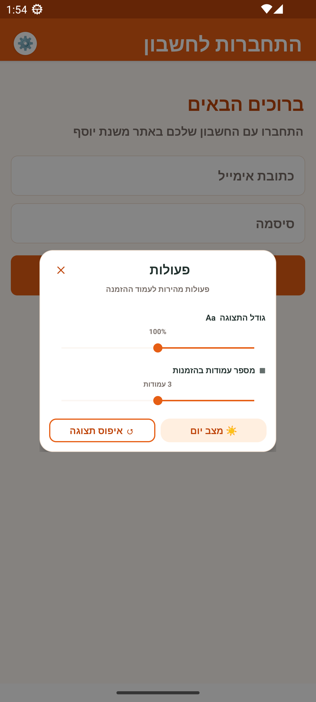

# UI test — mishnat-yosef (scenario)

**Result:** ✅ PASSED  
**Package:** `org.mishnatyosef.mobile`  
**Device:** sdk_gphone64_x86_64 · Android 13 (API 33) · 1080x2400  
**Duration:** 77.2s

## Steps

| # | Action | Detail | Result | Time |
|---|---|---|---|---|
| 1 | clear_data |  | ✅ | 0.13s |
| 2 | shell | cmd='pm grant org.mishnatyosef.mobile android.permission.POST_NOTIFICATIONS', ignore_error | ✅ | 0.12s |
| 3 | shell | cmd='appops set org.mishnatyosef.mobile SCHEDULE_EXACT_ALARM allow', ignore_errors=True | ✅ | 0.1s |
| 4 | launch |  | ✅ | 2.87s |
| 5 | wait_for | text='ברוכים הבאים' | ✅ | 2.33s |
| 6 | tap | desc='פתיחת הגדרות ופעולות' | ✅ | 3.05s |
| 7 | wait_for | text='פעולות מהירות' | ✅ | 2.04s |
| 8 | swipe | desc='גודל התצוגה' | ✅ | 3.66s |
| 9 | wait | seconds=3 | ✅ | 3.04s |
| 10 | screenshot | name='scale-left-end' | ✅ | 2.34s |
| 11 | assert_foreground |  | ✅ | 0.07s |
| 12 | wait_for | dialog reopens after the scale change | ✅ | 2.02s |
| 13 | swipe | desc='גודל התצוגה' | ✅ | 3.56s |
| 14 | wait | seconds=3 | ✅ | 3.04s |
| 15 | screenshot | name='scale-right-end' | ✅ | 2.35s |
| 16 | assert_foreground |  | ✅ | 0.06s |
| 17 | back |  | ✅ | 0.86s |
| 18 | screenshot | name='login-at-changed-scale' | ✅ | 2.33s |
| 19 | rotate | to='landscape' | ✅ | 1.59s |
| 20 | wait | seconds=2 | ✅ | 2.04s |
| 21 | screenshot | name='landscape-changed-scale' | ✅ | 2.35s |
| 22 | rotate | to='portrait' | ✅ | 1.62s |
| 23 | wait | seconds=2 | ✅ | 2.04s |
| 24 | tap | desc='פתיחת הגדרות ופעולות' | ✅ | 3.12s |
| 25 | wait_for | text='פעולות מהירות' | ✅ | 2.03s |
| 26 | rotate | to='landscape' | ✅ | 1.59s |
| 27 | wait | seconds=2 | ✅ | 2.04s |
| 28 | screenshot | name='dialog-landscape' | ✅ | 2.34s |
| 29 | rotate | to='portrait' | ✅ | 1.59s |
| 30 | wait | seconds=2 | ✅ | 2.04s |
| 31 | tap | desc='פתיחת הגדרות ופעולות' | ✅ | 3.05s |
| 32 | wait_for | text='פעולות מהירות' | ✅ | 2.03s |
| 33 | tap | text='איפוס תצוגה' | ✅ | 3.05s |
| 34 | wait | seconds=3 | ✅ | 3.04s |
| 35 | screenshot | name='after-reset' | ✅ | 2.37s |
| 36 | assert_text | text='100%' | ✅ | 2.04s |
| 37 | assert_foreground |  | ✅ | 0.06s |

## Screenshots

**001-scale-left-end.png**

**002-scale-right-end.png**

**003-login-at-changed-scale.png**

**004-landscape-changed-scale.png**

**005-dialog-landscape.png**

**006-after-reset.png**

**007-final.png**

