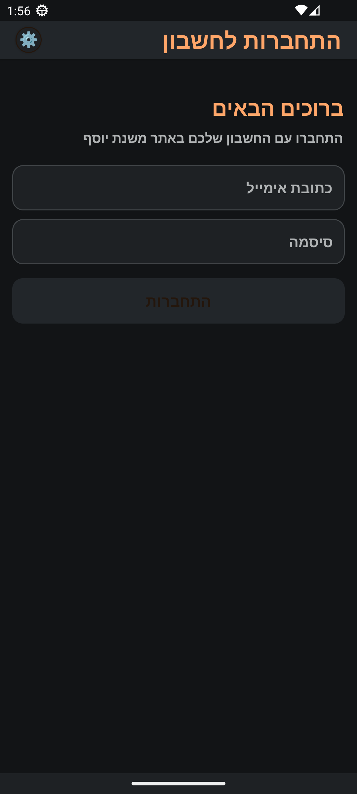
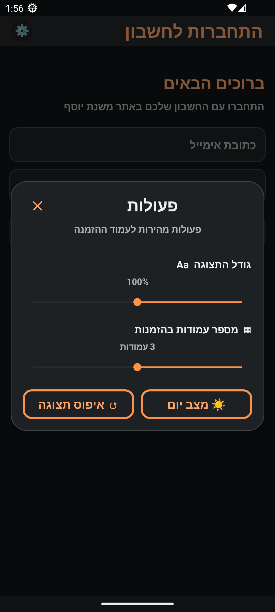
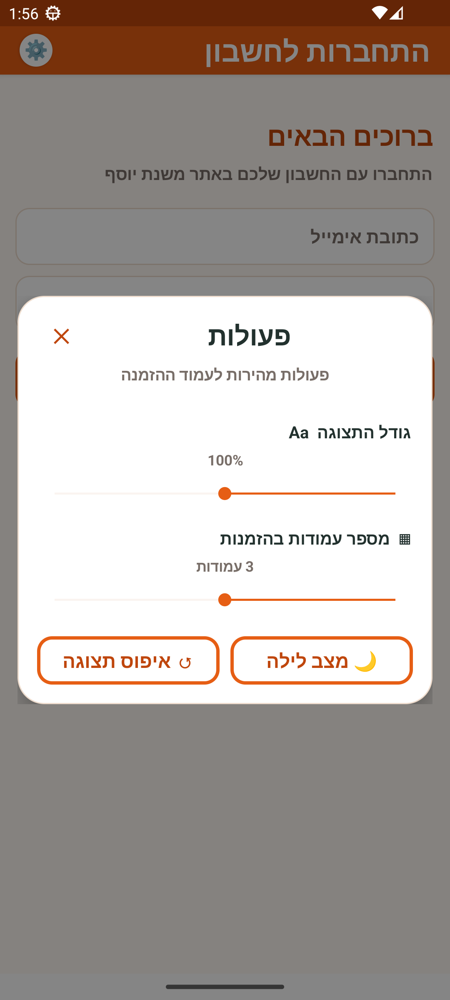
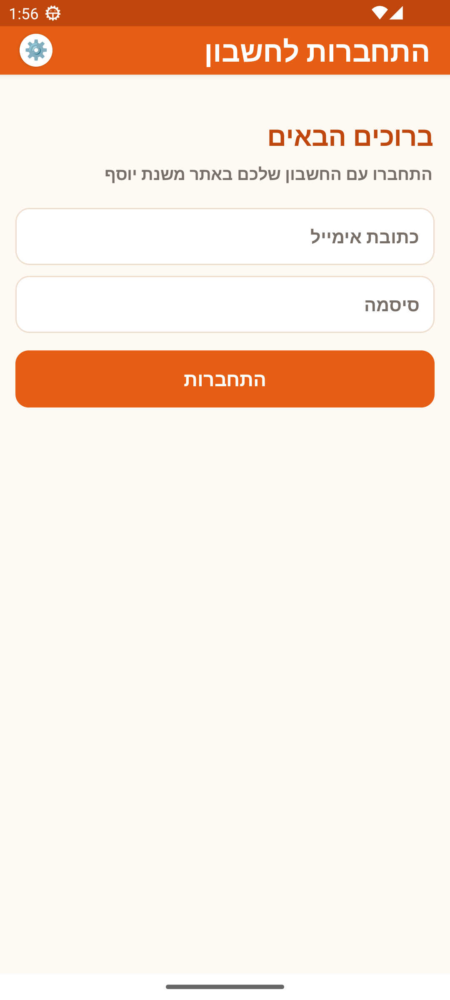

# UI test — mishnat-yosef (scenario)

**Result:** ✅ PASSED  
**Package:** `org.mishnatyosef.mobile`  
**Device:** sdk_gphone64_x86_64 · Android 13 (API 33) · 1080x2400  
**Duration:** 54.1s

## Steps

| # | Action | Detail | Result | Time |
|---|---|---|---|---|
| 1 | clear_data |  | ✅ | 0.1s |
| 2 | shell | cmd='pm grant org.mishnatyosef.mobile android.permission.POST_NOTIFICATIONS', ignore_error | ✅ | 0.06s |
| 3 | shell | cmd='appops set org.mishnatyosef.mobile SCHEDULE_EXACT_ALARM allow', ignore_errors=True | ✅ | 0.05s |
| 4 | launch |  | ✅ | 2.98s |
| 5 | wait_for | text='ברוכים הבאים' | ✅ | 2.03s |
| 6 | tap | desc='פתיחת הגדרות ופעולות' | ✅ | 3.05s |
| 7 | wait_for | text='פעולות מהירות' | ✅ | 2.06s |
| 8 | screenshot | name='day-dialog' | ✅ | 2.31s |
| 9 | tap | text='מצב לילה' | ✅ | 3.04s |
| 10 | wait | seconds=1.5 | ✅ | 1.54s |
| 11 | assert_text | button label flipped | ✅ | 2.02s |
| 12 | assert_text | dialog still open | ✅ | 2.03s |
| 13 | screenshot | name='night-dialog' | ✅ | 2.31s |
| 14 | tap | desc='סגירת חלון הפעולות' | ✅ | 3.05s |
| 15 | assert_not_visible | text='פעולות מהירות' | ✅ | 2.52s |
| 16 | screenshot | name='night-login-screen' | ✅ | 2.29s |
| 17 | tap | desc='פתיחת הגדרות ופעולות' | ✅ | 3.03s |
| 18 | wait_for | text='פעולות מהירות' | ✅ | 2.06s |
| 19 | screenshot | name='night-dialog-reopened' | ✅ | 2.31s |
| 20 | tap | text='מצב יום' | ✅ | 3.05s |
| 21 | wait | seconds=1.5 | ✅ | 1.54s |
| 22 | assert_text | text='מצב לילה' | ✅ | 2.02s |
| 23 | screenshot | name='back-to-day-dialog' | ✅ | 2.33s |
| 24 | tap | desc='סגירת חלון הפעולות' | ✅ | 3.06s |
| 25 | assert_foreground |  | ✅ | 0.06s |

## Screenshots

**001-day-dialog.png**

**002-night-dialog.png**

**003-night-login-screen.png**

**004-night-dialog-reopened.png**

**005-back-to-day-dialog.png**

**006-final.png**

