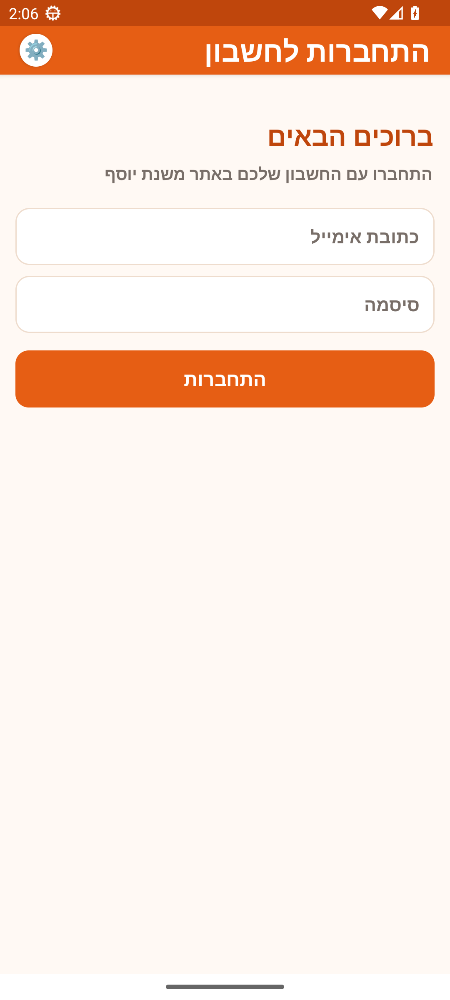
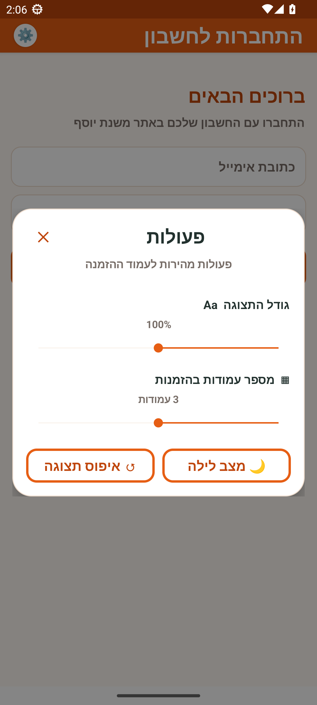
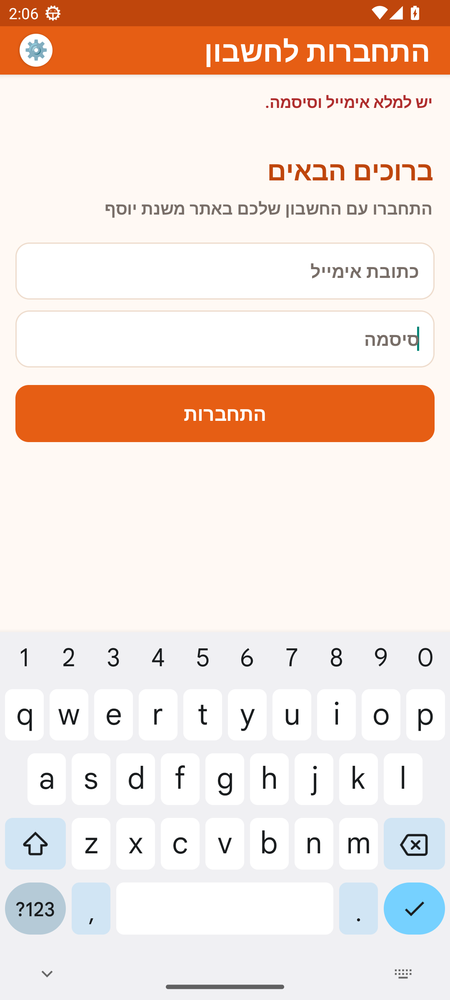
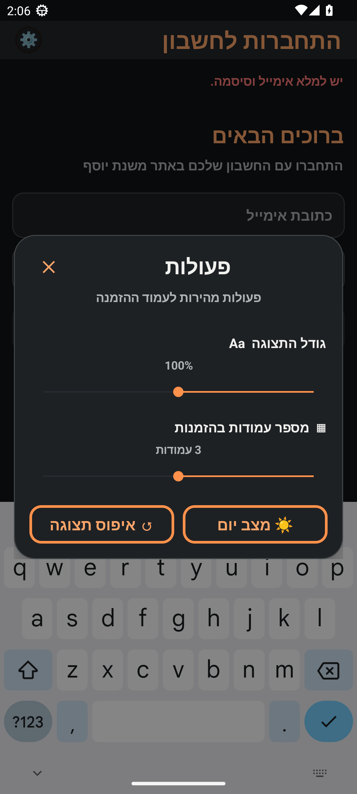
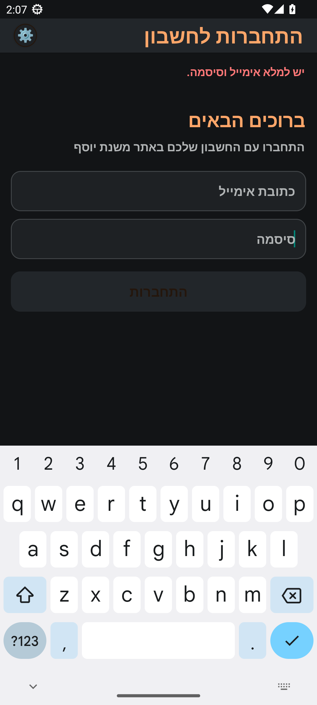

# UI test — mishnat-yosef (explore)

**Result:** ✅ PASSED  
**Package:** `org.mishnatyosef.mobile`  
**Device:** sdk_gphone64_x86_64 · Android 13 (API 33) · 1080x2400  
**Duration:** 77.7s

## Steps

| # | Action | Detail | Result | Time |
|---|---|---|---|---|
| 1 | explore-tap | ⚙️ / פתיחת הגדרות ופעולות | ✅ | 1.23s |
| 2 | explore-tap | ✕ / סגירת חלון הפעולות | ✅ | 1.23s |
| 3 | explore-tap | כתובת אימייל | ✅ | 1.24s |
| 4 | explore-tap | סיסמה | ✅ | 1.25s |
| 5 | explore-tap | התחברות | ✅ | 1.23s |
| 6 | explore-tap | ⚙️ / פתיחת הגדרות ופעולות | ✅ | 1.24s |
| 7 | explore-tap | 🌙 מצב לילה | ✅ | 1.24s |
| 8 | explore-tap | ✕ / סגירת חלון הפעולות | ✅ | 1.24s |
| 9 | explore-tap | כתובת אימייל | ✅ | 1.25s |
| 10 | explore-tap | סיסמה | ✅ | 1.24s |
| 11 | explore-tap | התחברות | ✅ | 1.24s |

## Notes

- explore: 4 distinct screens, 11 elements tapped, 3 relaunches, 72s

## Screenshots

**001-screen-1.png**

**002-screen-2.png**

**003-screen-3.png**

**004-screen-4.png**

**005-final.png**

