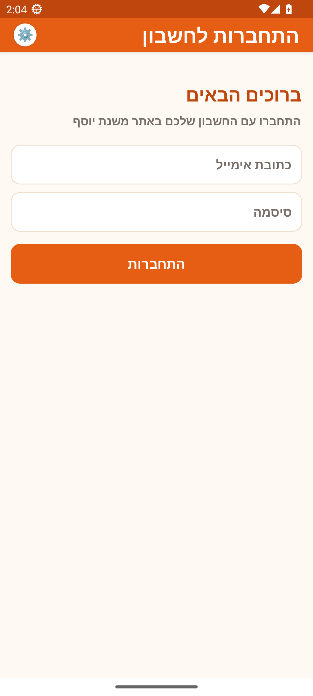
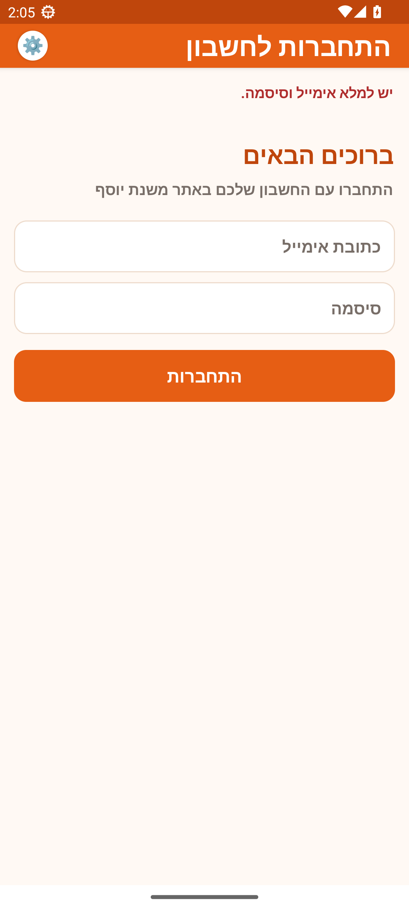
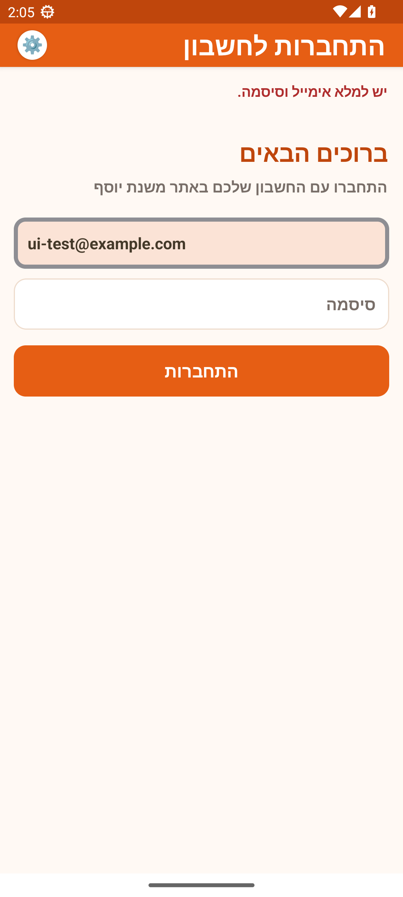
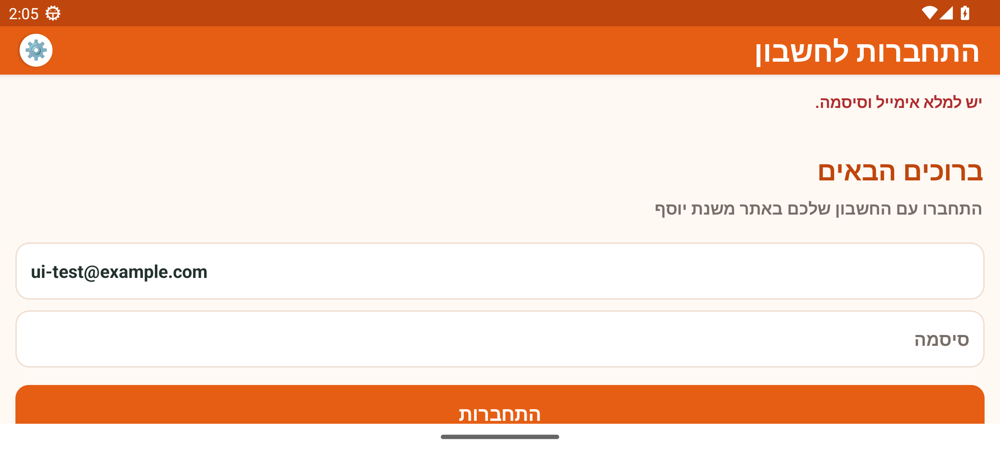
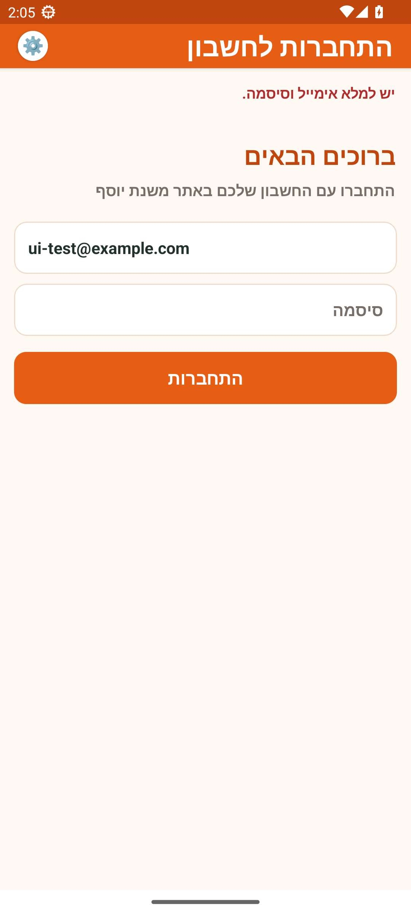

# UI test — mishnat-yosef (scenario)

**Result:** ✅ PASSED  
**Package:** `org.mishnatyosef.mobile`  
**Device:** sdk_gphone64_x86_64 · Android 13 (API 33) · 1080x2400  
**Duration:** 52.1s

## Steps

| # | Action | Detail | Result | Time |
|---|---|---|---|---|
| 1 | clear_data |  | ✅ | 0.22s |
| 2 | shell | cmd='pm grant org.mishnatyosef.mobile android.permission.POST_NOTIFICATIONS', ignore_error | ✅ | 0.16s |
| 3 | shell | cmd='appops set org.mishnatyosef.mobile SCHEDULE_EXACT_ALARM allow', ignore_errors=True | ✅ | 0.06s |
| 4 | launch |  | ✅ | 3.27s |
| 5 | wait_for | text='ברוכים הבאים' | ✅ | 2.55s |
| 6 | back | close an update/notice dialog if one opened over the login screen | ✅ | 0.89s |
| 7 | assert_foreground |  | ⚠️ — foreground app is com.google.android.apps.nexuslauncher, expected org.mishnatyosef.mobile | 0.03s |
| 8 | launch | restart=False | ✅ | 3.27s |
| 9 | screenshot | name='login' | ✅ | 2.18s |
| 10 | assert_text | text='התחברות לחשבון' | ✅ | 1.97s |
| 11 | assert_text | text='התחברו עם החשבון שלכם' | ✅ | 1.96s |
| 12 | assert_visible | email + password fields | ✅ | 1.96s |
| 13 | tap | submit the empty form | ✅ | 2.98s |
| 14 | assert_text | text='יש למלא אימייל וסיסמה' | ✅ | 1.97s |
| 15 | screenshot | name='empty-form-validation' | ✅ | 2.13s |
| 16 | type | class='EditText' | ✅ | 5.0s |
| 17 | assert_text | text='ui-test@example.com' | ✅ | 2.08s |
| 18 | screenshot | name='email-typed' | ✅ | 2.17s |
| 19 | rotate | to='landscape' | ✅ | 1.56s |
| 20 | assert_text | text='ברוכים הבאים' | ✅ | 1.96s |
| 21 | assert_text | typed email survives rotation | ✅ | 1.97s |
| 22 | assert_text | validation message survives rotation | ✅ | 2.0s |
| 23 | screenshot | name='landscape' | ✅ | 2.14s |
| 24 | rotate | to='portrait' | ✅ | 1.56s |
| 25 | assert_foreground |  | ✅ | 0.05s |
| 26 | assert_text | still there after rotating back | ✅ | 1.98s |
| 27 | screenshot | name='back-to-portrait' | ✅ | 2.14s |

## Screenshots

**001-login.png**

**002-empty-form-validation.png**

**003-email-typed.png**

**004-landscape.png**

**005-back-to-portrait.png**

