# UI test — mishnat-pickup (scenario)

**Result:** ✅ PASSED  
**Package:** `org.mishnatyosef.pickup`  
**Device:** sdk_gphone64_x86_64 · Android 13 (API 33) · 1080x2400  
**Duration:** 348.8s

## Steps

| # | Action | Detail | Result | Time |
|---|---|---|---|---|
| 1 | clear_data |  | ✅ | 0.2s |
| 2 | push | src='fixtures/ui-test-features.txt', dest='/sdcard/Download/ui-test-features.txt' | ✅ | 35.17s |
| 3 | launch |  | ✅ | 4.43s |
| 4 | wait_for | text='כניסה לחשבון' | ✅ | 3.04s |
| 5 | scroll_to | text='ייבוא רשימה מקובץ' | ✅ | 2.29s |
| 6 | tap | text='ייבוא רשימה מקובץ' | ✅ | 3.43s |
| 7 | tap | text='ui-test-features' | ✅ | 7.37s |
| 8 | wait_for | text='נמצאו 1 רשימות' | ✅ | 3.94s |
| 9 | tap | text='ייבא רשימות' | ✅ | 3.44s |
| 10 | wait_for | 1+2+3+4+1.5 units | ✅ | 3.81s |
| 11 | screenshot | name='imported-5-items' | ✅ | 3.24s |
| 12 | assert_text | decimal quantity kept | ✅ | 2.34s |
| 13 | tap | text='חיפוש פריט' | ✅ | 3.54s |
| 14 | type | value='Pasta', hide_keyboard=True | ✅ | 2.46s |
| 15 | wait | seconds=1 | ✅ | 1.5s |
| 16 | screenshot | name='search-pasta' | ✅ | 3.67s |
| 17 | assert_text | text='Pasta' | ✅ | 2.56s |
| 18 | assert_not_visible | search filters other items | ✅ | 3.35s |
| 19 | type | class='EditText' | ✅ | 4.44s |
| 20 | wait | seconds=1 | ✅ | 1.24s |
| 21 | assert_text | cleared search shows all items | ✅ | 3.23s |
| 22 | long_press | text='Pasta' | ✅ | 4.64s |
| 23 | wait_for | text='איסוף כמות חלקית' | ✅ | 2.23s |
| 24 | screenshot | name='partial-dialog' | ✅ | 2.98s |
| 25 | swipe | RTL slider: try to pick more units | ✅ | 3.63s |
| 26 | screenshot | name='partial-dialog-moved' | ✅ | 2.85s |
| 27 | tap | text='אישור הכמות' | ✅ | 3.24s |
| 28 | wait | seconds=1 | ✅ | 1.08s |
| 29 | scroll_to | the partial card sits in the collected section, below the fold | ✅ | 5.9s |
| 30 | screenshot | name='partial-collected' | ✅ | 2.8s |
| 31 | scroll_to | text='נאספו 1 מתוך' | ✅ | 2.1s |
| 32 | tap | desc='איפוס ליקוט' | ✅ | 3.05s |
| 33 | wait_for | text='להחזיר את כל המוצרים' | ✅ | 2.05s |
| 34 | screenshot | name='reset-confirm' | ✅ | 2.29s |
| 35 | tap | text='איפוס' | ✅ | 3.34s |
| 36 | wait_for | text='נאספו 0 מתוך 11.5' | ✅ | 2.04s |
| 37 | tap | desc='רשימה לפי חשבון' | ✅ | 3.1s |
| 38 | wait | seconds=1.5 | ✅ | 1.94s |
| 39 | screenshot | name='view-by-account' | ✅ | 3.18s |
| 40 | tap | desc='רשימה מאוחדת' | ✅ | 3.11s |
| 41 | wait | seconds=1.5 | ✅ | 1.56s |
| 42 | screenshot | name='view-combined' | ✅ | 2.33s |
| 43 | tap | text='גבינה' | ✅ | 3.06s |
| 44 | assert_text | text='נאספו 1.5 מתוך 11.5' | ✅ | 2.04s |
| 45 | rotate | to='landscape' | ✅ | 1.64s |
| 46 | wait | seconds=1.5 | ✅ | 1.56s |
| 47 | assert_text | progress survives rotation | ✅ | 2.08s |
| 48 | screenshot | name='landscape' | ✅ | 2.29s |
| 49 | rotate | to='portrait' | ✅ | 1.64s |
| 50 | wait | seconds=1.5 | ✅ | 1.57s |
| 51 | tap | desc='הגדרות' | ✅ | 3.05s |
| 52 | wait_for | text='סיכום מהיר' | ✅ | 2.05s |
| 53 | screenshot | name='settings-top' | ✅ | 2.3s |
| 54 | swipe | direction='up' | ✅ | 1.39s |
| 55 | screenshot | name='settings-middle' | ✅ | 2.56s |
| 56 | swipe | direction='up' | ✅ | 1.3s |
| 57 | swipe | direction='up' | ✅ | 1.29s |
| 58 | screenshot | name='settings-bottom' | ✅ | 2.28s |
| 59 | scroll_to | text='רשימות שמורות' | ✅ | 2.06s |
| 60 | tap | text='רשימות שמורות' | ✅ | 3.08s |
| 61 | wait | seconds=2 | ✅ | 2.06s |
| 62 | screenshot | name='saved-lists' | ✅ | 2.27s |
| 63 | back |  | ✅ | 0.91s |
| 64 | wait | seconds=1 | ✅ | 1.24s |
| 65 | back |  | ✅ | 1.37s |
| 66 | wait | seconds=1 | ✅ | 1.06s |
| 67 | launch | restart=False | ✅ | 2.78s |
| 68 | screenshot | name='before-explore' | ✅ | 2.29s |
| 69 | explore-tap | ⚙ / הגדרות | ✅ | 1.28s |
| 70 | explore-tap | × / סגירת ההגדרות | ✅ | 1.28s |
| 71 | explore-tap | ⚙ / הגדרות | ✅ | 1.29s |
| 72 | explore-tap | רטט ארוך בסיום הרשימה | ✅ | 1.29s |
| 73 | explore-tap | צליל הצלחה ממושך בסיום הרשימה | ✅ | 1.28s |
| 74 | explore-tap | רשימה מאוחדת | ✅ | 1.28s |
| 75 | explore-tap | רשימה לפי חשבון | ✅ | 1.28s |
| 76 | explore-tap | חיפוש פריט ברשימה… | ✅ | 1.3s |
| 77 | explore-tap | ⚙ / הגדרות | ✅ | 1.3s |
| 78 | explore-tap | לחם, כמות 1 | ✅ | 1.28s |
| 79 | explore-tap | ⚙ / הגדרות | ✅ | 1.29s |
| 80 | explore-tap | רשימה מאוחדת | ✅ | 1.3s |
| 81 | explore-tap | רשימה לפי חשבון | ✅ | 1.31s |
| 82 | explore-tap | חיפוש פריט ברשימה… | ✅ | 1.31s |
| 83 | explore-tap | ⚙ / הגדרות | ✅ | 1.29s |
| 84 | explore-tap | חלב, כמות 2 | ✅ | 1.29s |
| 85 | explore-tap | ⚙ / הגדרות | ✅ | 1.29s |
| 86 | explore-tap | רשימה מאוחדת | ✅ | 1.29s |
| 87 | explore-tap | רשימה לפי חשבון | ✅ | 1.3s |
| 88 | explore-tap | חיפוש פריט ברשימה… | ✅ | 1.3s |
| 89 | explore-tap | ⚙ / הגדרות | ✅ | 1.3s |
| 90 | explore-tap | מלפפון, כמות 3 | ✅ | 1.29s |
| 91 | explore-tap | ⚙ / הגדרות | ✅ | 1.31s |
| 92 | explore-tap | רשימה מאוחדת | ✅ | 1.33s |
| 93 | explore-tap | רשימה לפי חשבון | ✅ | 1.29s |
| 94 | explore-tap | חיפוש פריט ברשימה… | ✅ | 1.3s |
| 95 | explore-tap | ⚙ / הגדרות | ✅ | 1.3s |
| 69 | explore | auto-explore from the list screen | ✅ | 135.87s |
| 70 | assert_foreground |  | ✅ | 0.1s |

## Notes

- explore: 10 distinct screens, 27 elements tapped, 0 relaunches, 136s

## Screenshots

**001-imported-5-items.png**

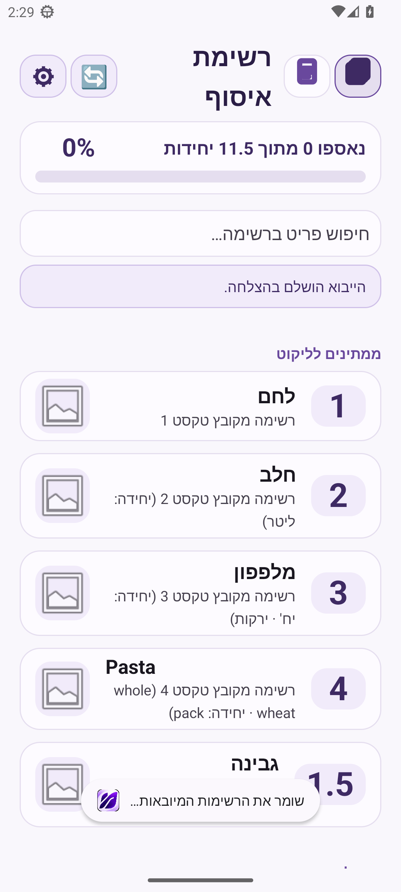

**002-search-pasta.png**

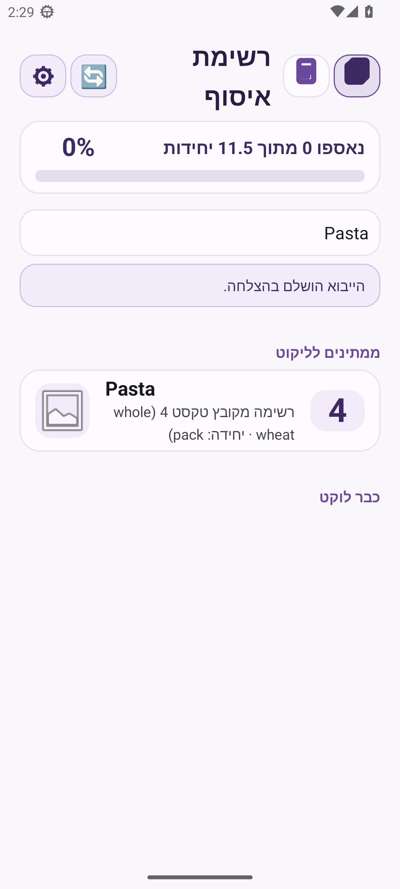

**003-partial-dialog.png**

**004-partial-dialog-moved.png**

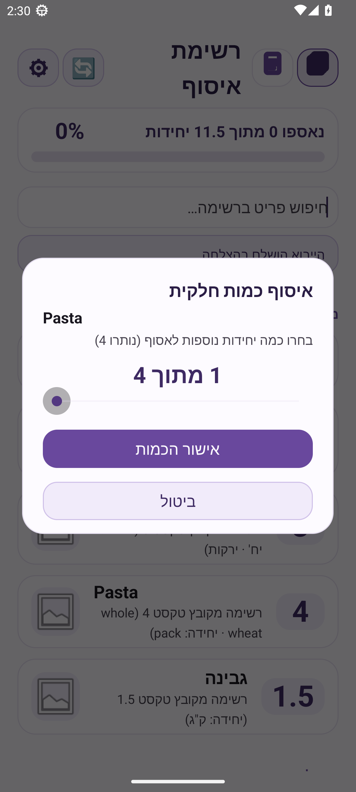

**005-partial-collected.png**

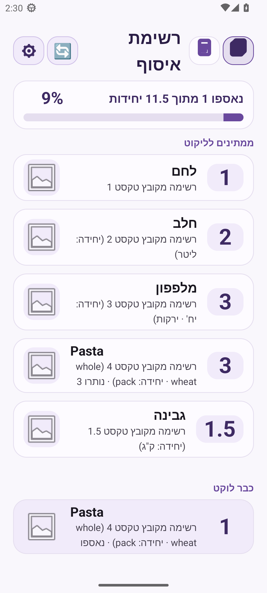

**006-reset-confirm.png**

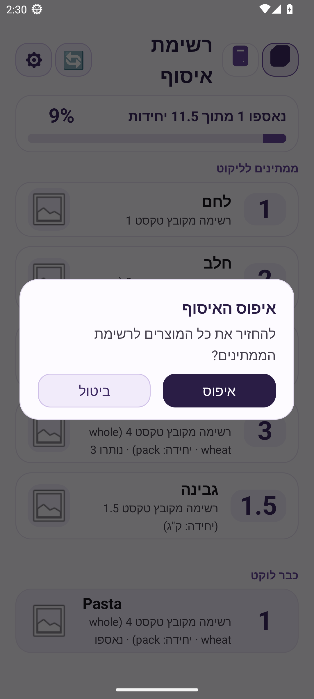

**007-view-by-account.png**

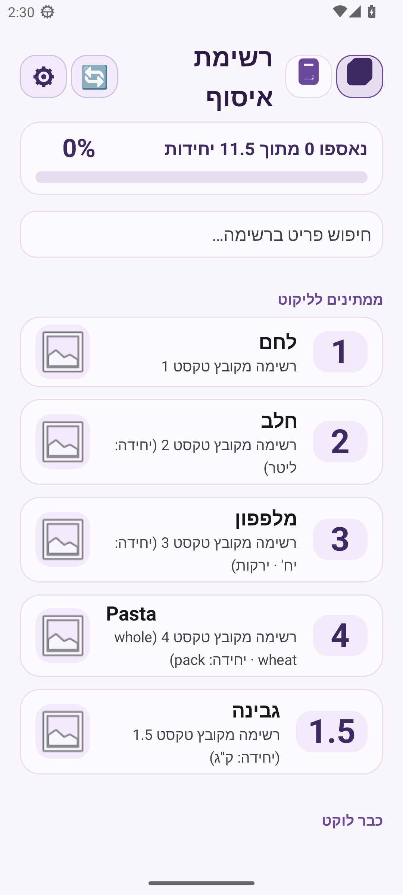

**008-view-combined.png**

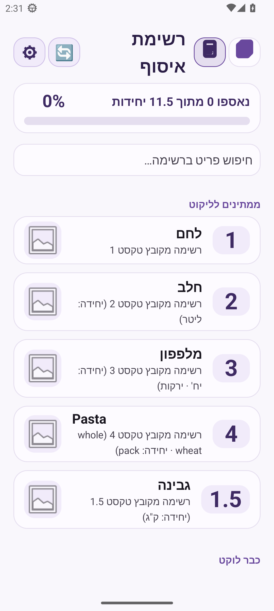

**009-landscape.png**

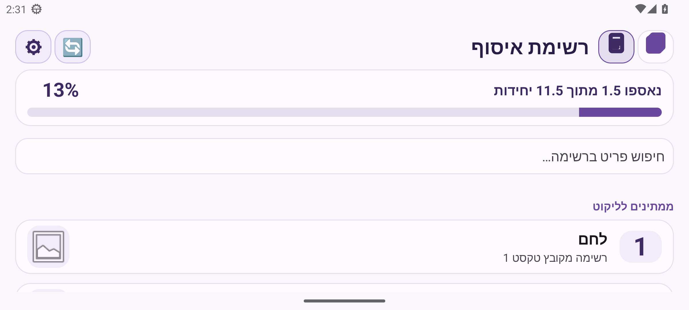

**010-settings-top.png**

**011-settings-middle.png**

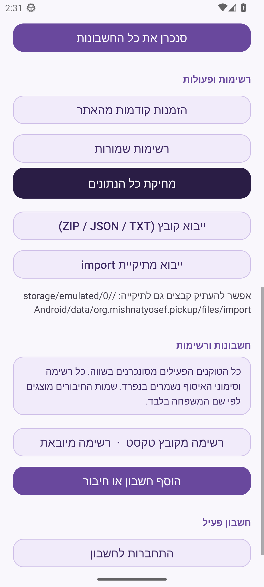

**012-settings-bottom.png**

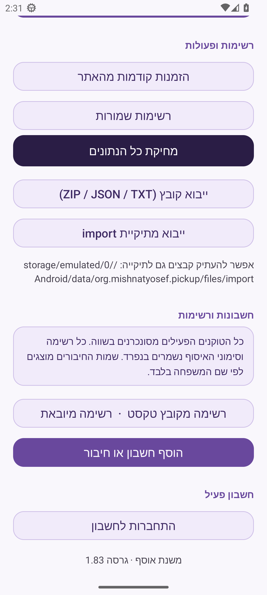

**013-saved-lists.png**

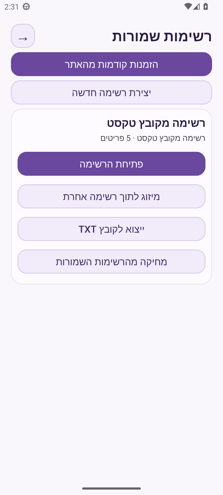

**014-before-explore.png**

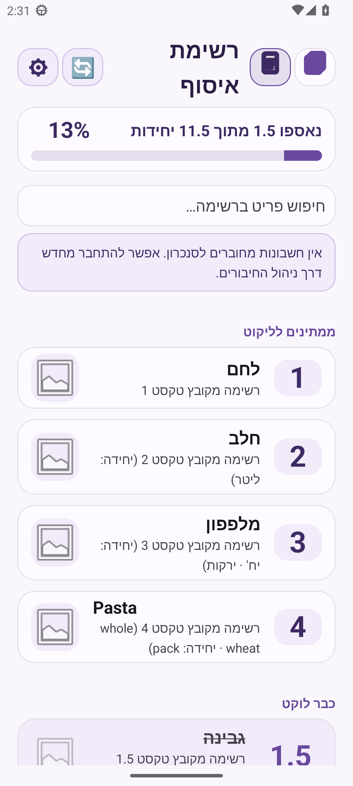

**015-screen-1.png**

**016-screen-2.png**

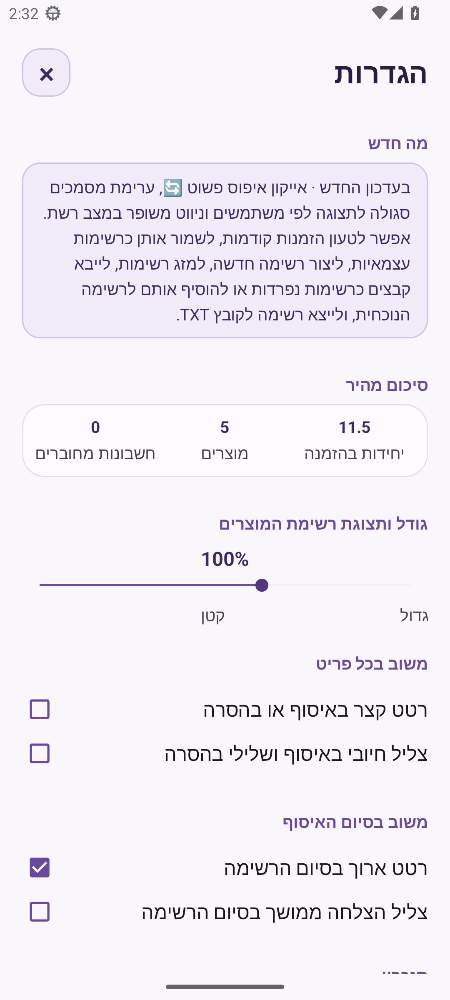

**017-screen-3.png**

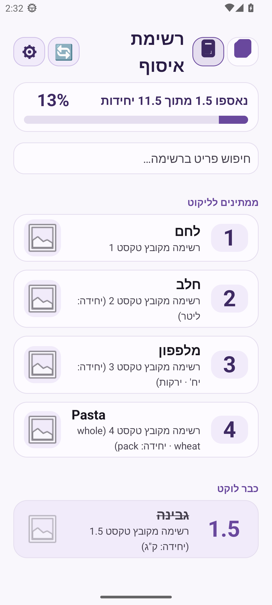

**018-screen-4.png**

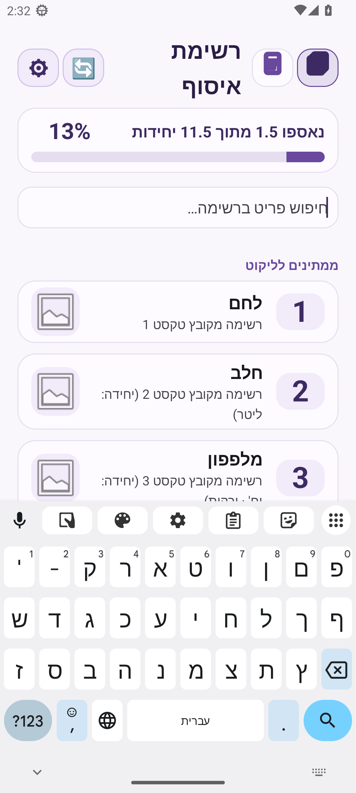

**019-screen-5.png**

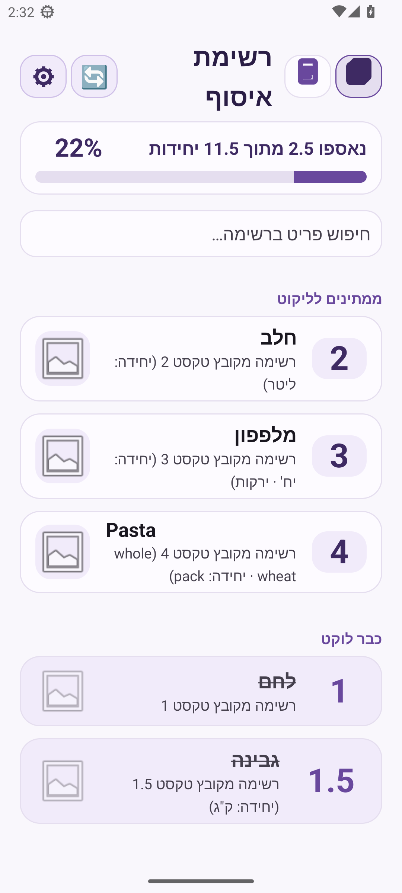

**020-screen-6.png**

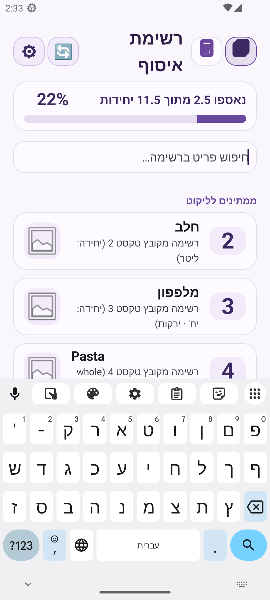

**021-screen-7.png**

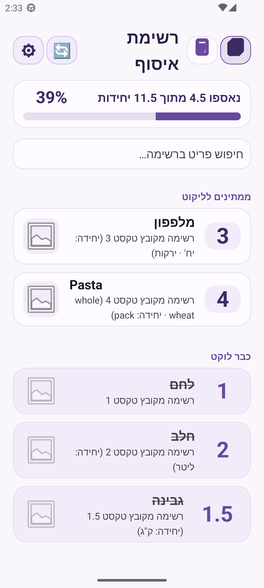

**022-screen-8.png**

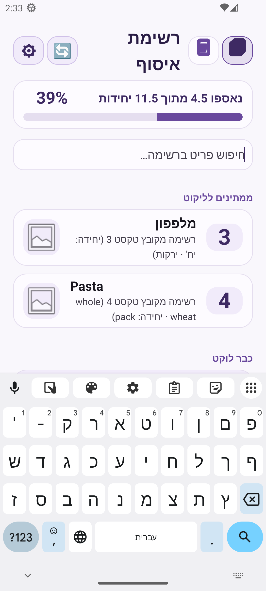

**023-screen-9.png**

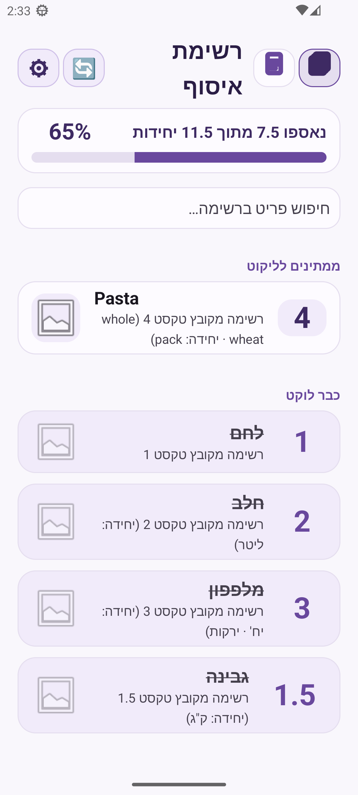

**024-screen-10.png**

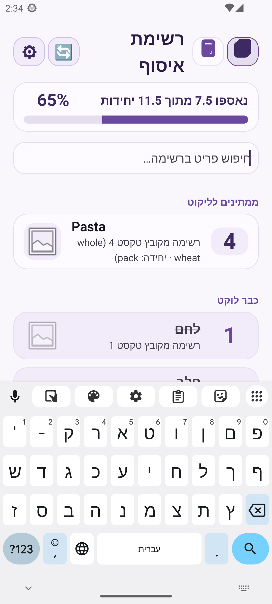

**025-final.png**

