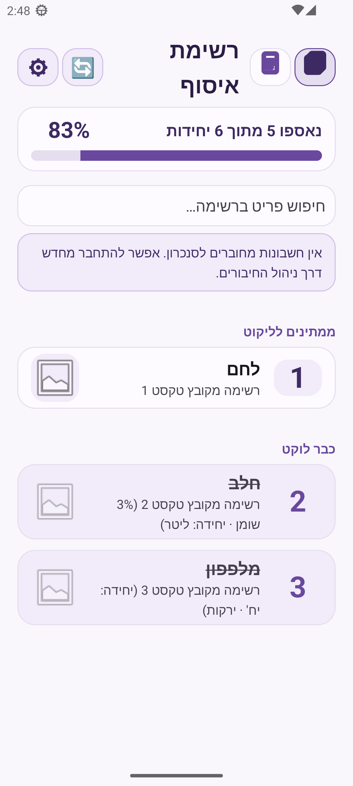
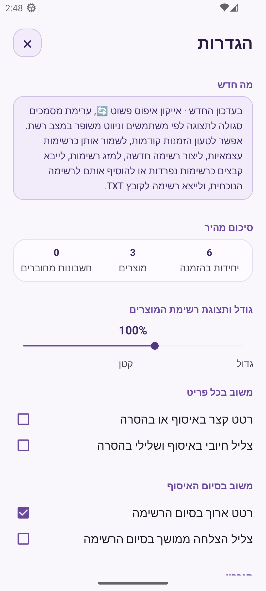
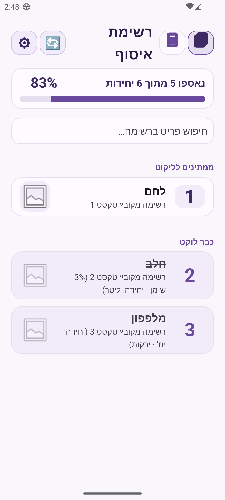
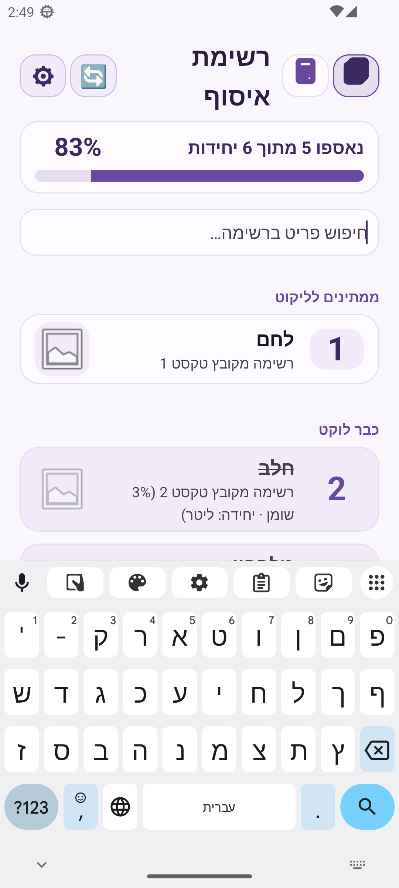
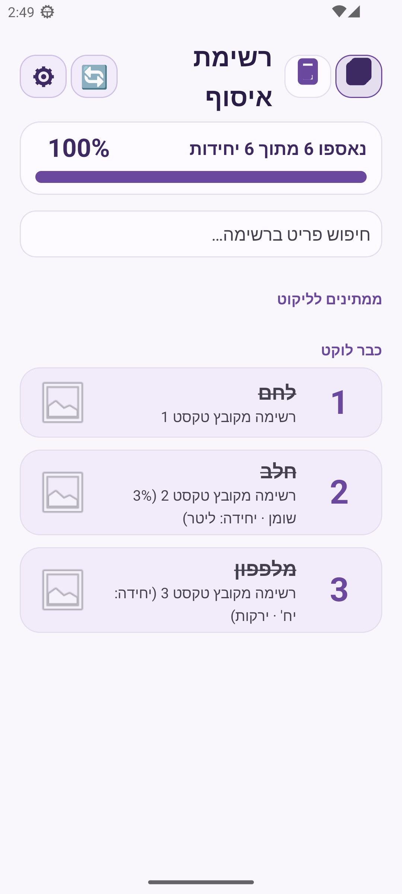
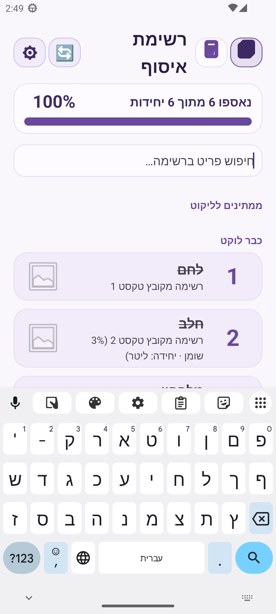

# UI test — mishnat-pickup (explore)

**Result:** ✅ PASSED  
**Package:** `org.mishnatyosef.pickup`  
**Device:** sdk_gphone64_x86_64 · Android 13 (API 33) · 1080x2400  
**Duration:** 85.6s

## Steps

| # | Action | Detail | Result | Time |
|---|---|---|---|---|
| 1 | explore-tap | ⚙ / הגדרות | ✅ | 1.26s |
| 2 | explore-tap | × / סגירת ההגדרות | ✅ | 1.25s |
| 3 | explore-tap | ⚙ / הגדרות | ✅ | 1.25s |
| 4 | explore-tap | רטט ארוך בסיום הרשימה | ✅ | 1.24s |
| 5 | explore-tap | צליל הצלחה ממושך בסיום הרשימה | ✅ | 1.24s |
| 6 | explore-tap | רשימה מאוחדת | ✅ | 1.24s |
| 7 | explore-tap | רשימה לפי חשבון | ✅ | 1.26s |
| 8 | explore-tap | חיפוש פריט ברשימה… | ✅ | 1.27s |
| 9 | explore-tap | ⚙ / הגדרות | ✅ | 1.26s |
| 10 | explore-tap | לחם, כמות 1 | ✅ | 1.25s |
| 11 | explore-tap | ⚙ / הגדרות | ✅ | 1.25s |
| 12 | explore-tap | רשימה מאוחדת | ✅ | 1.25s |
| 13 | explore-tap | רשימה לפי חשבון | ✅ | 1.26s |
| 14 | explore-tap | חיפוש פריט ברשימה… | ✅ | 1.26s |
| 15 | explore-tap | ⚙ / הגדרות | ✅ | 1.25s |
| 16 | explore-tap | לחם, כמות 1, לוקט | ✅ | 1.25s |

## Notes

- explore: 6 distinct screens, 16 elements tapped, 0 relaunches, 79s

## Screenshots

**001-screen-1.png**

**002-screen-2.png**

**003-screen-3.png**

**004-screen-4.png**

**005-screen-5.png**

**006-screen-6.png**

**007-final.png**

