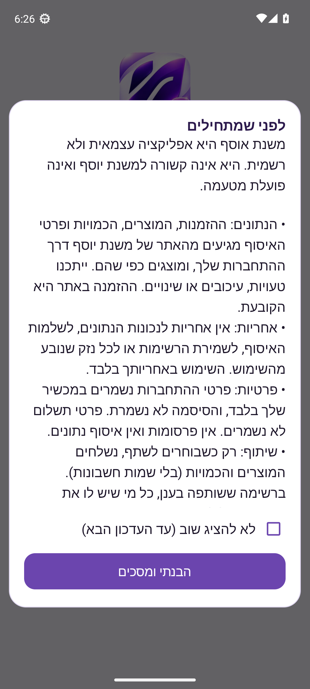
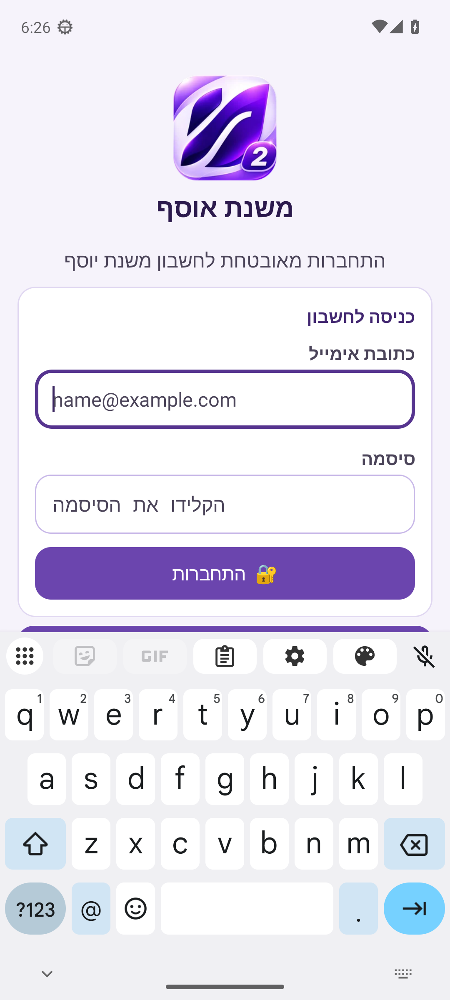
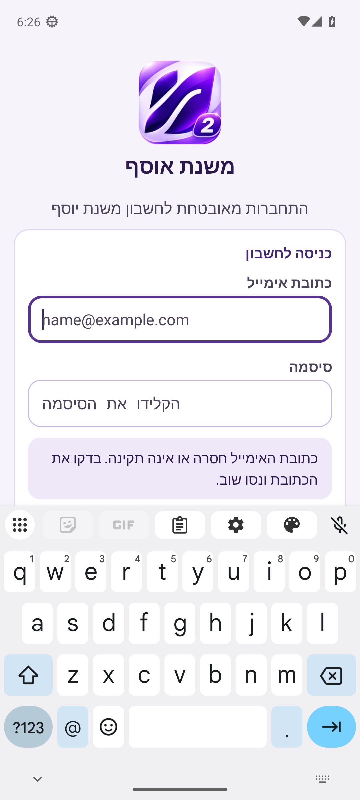
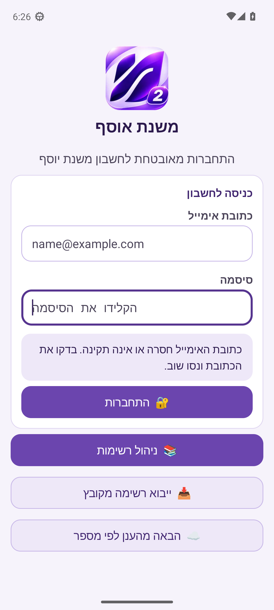
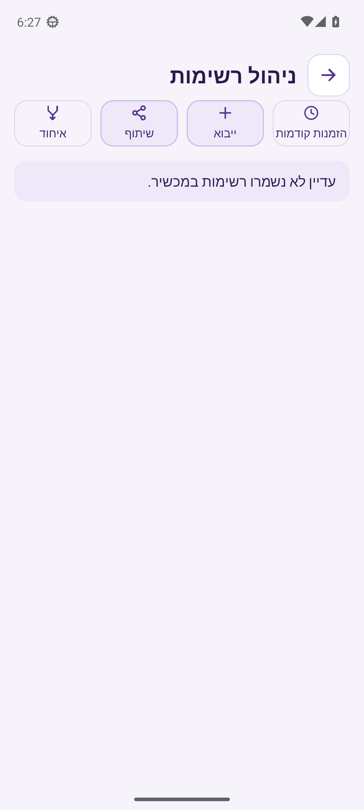
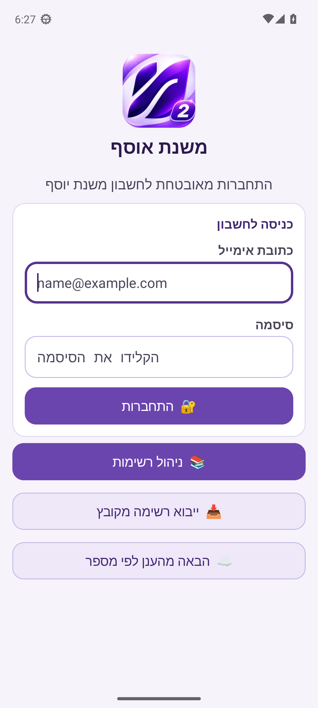
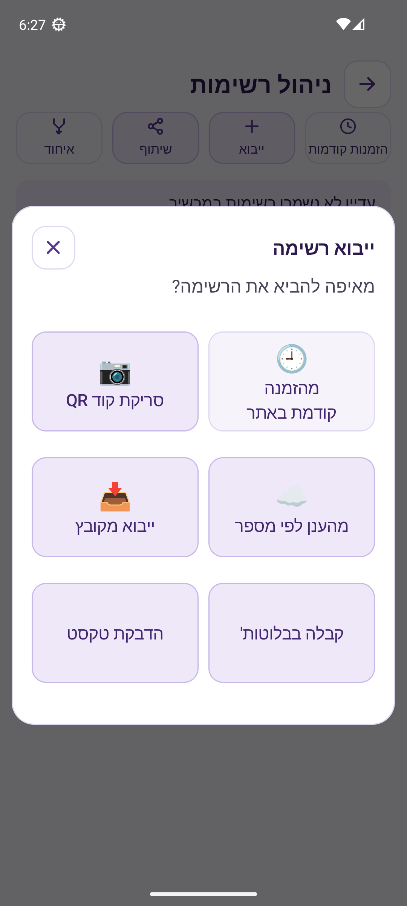

# UI test — mishnat-pickup (explore)

**Result:** ✅ PASSED  
**Package:** `org.mishnatyosef.pickup`  
**Device:** sdk_gphone64_x86_64 · Android 13 (API 33) · 1080x2400  
**Duration:** 98.4s

## Steps

| # | Action | Detail | Result | Time |
|---|---|---|---|---|
| 1 | explore-tap | לא להציג שוב (עד העדכון הבא) | ✅ | 1.26s |
| 2 | explore-tap | הבנתי ומסכים | ✅ | 1.24s |
| 3 | explore-tap | name@example.com | ✅ | 1.25s |
| 4 | explore-tap | הקלידו את הסיסמה | ✅ | 1.25s |
| 5 | explore-tap | 🔐  התחברות | ✅ | 1.25s |
| 6 | explore-tap | name@example.com | ✅ | 1.25s |
| 7 | explore-tap | הקלידו את הסיסמה | ✅ | 1.25s |
| 8 | explore-tap | name@example.com | ✅ | 1.26s |
| 9 | explore-tap | הקלידו את הסיסמה | ✅ | 1.26s |
| 10 | explore-tap | 🔐  התחברות | ✅ | 1.24s |
| 11 | explore-tap | 📚  ניהול רשימות | ✅ | 1.36s |
| 12 | explore-tap | חזרה | ✅ | 1.29s |
| 13 | explore-tap | name@example.com | ✅ | 1.26s |
| 14 | explore-tap | 📚  ניהול רשימות | ✅ | 1.31s |
| 15 | explore-tap | שיתוף / שיתוף | ✅ | 1.51s |
| 16 | explore-tap | ייבוא / ייבוא | ✅ | 1.43s |
| 17 | explore-tap | סגירה | ✅ | 1.74s |

## Notes

- explore: 7 distinct screens, 17 elements tapped, 0 relaunches, 89s

## Screenshots

**001-screen-1.png**

**002-screen-2.png**

**003-screen-3.png**

**004-screen-4.png**

**005-screen-5.png**

**006-screen-6.png**

**007-screen-7.png**

**008-final.png**

