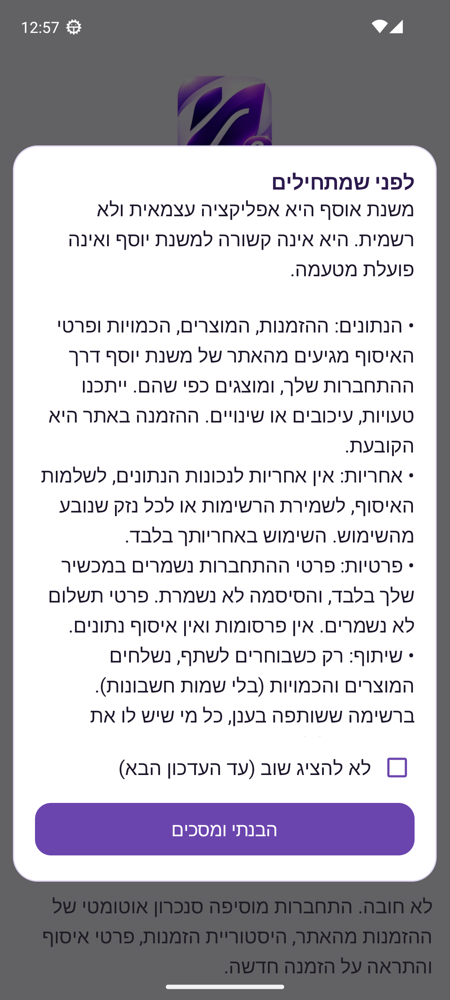
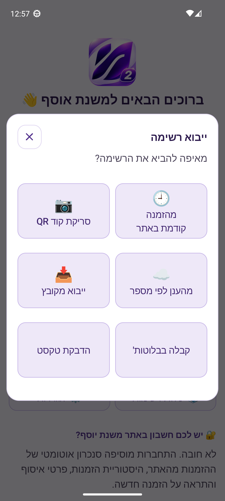
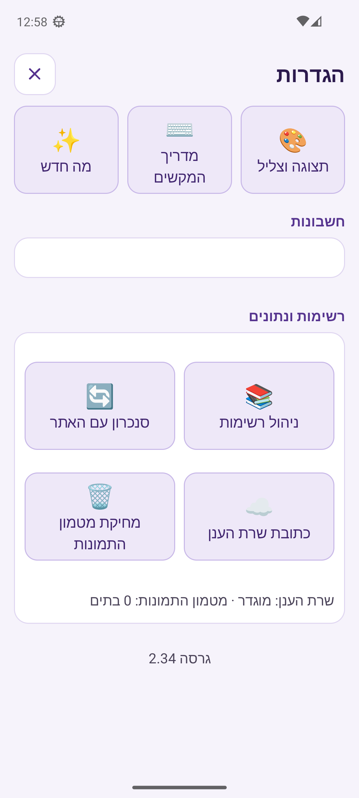
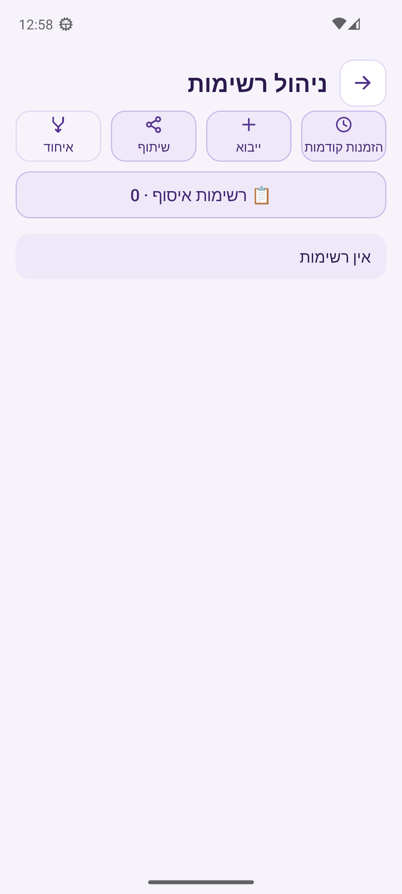
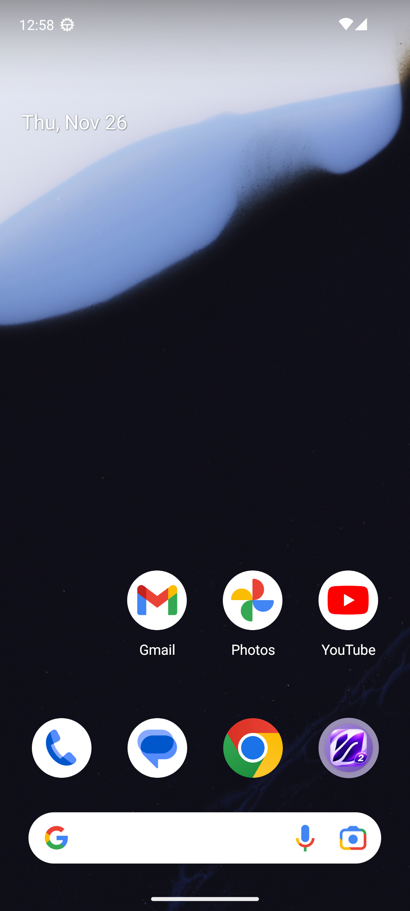

# UI test — mishnat-pickup (explore)

**Result:** ✅ PASSED  
**Package:** `org.mishnatyosef.pickup`  
**Device:** sdk_gphone64_x86_64 · Android 13 (API 33) · 1080x2400  
**Duration:** 82.7s

## Steps

| # | Action | Detail | Result | Time |
|---|---|---|---|---|
| 1 | explore-tap | לא להציג שוב (עד העדכון הבא) | ✅ | 1.24s |
| 2 | explore-tap | הבנתי ומסכים | ✅ | 1.23s |
| 3 | explore-tap | ייבוא רשימות עכשיו. בלי התחברות ובלי אינטרנט | ✅ | 1.38s |
| 4 | explore-tap | סגירה | ✅ | 1.3s |
| 5 | explore-tap | ⚙️  הגדרות | ✅ | 1.4s |
| 6 | explore-tap | סגירת ההגדרות | ✅ | 1.3s |
| 7 | explore-tap | 📚  ניהול רשימות | ✅ | 1.3s |
| 8 | explore-tap | חזרה | ✅ | 1.34s |

## Notes

- explore: 5 distinct screens, 8 elements tapped, 6 relaunches, 76s

## Screenshots

**001-screen-1.png**

**002-screen-2.png**

**003-screen-3.png**

**004-screen-4.png**

**005-screen-5.png**

**006-final.png**

