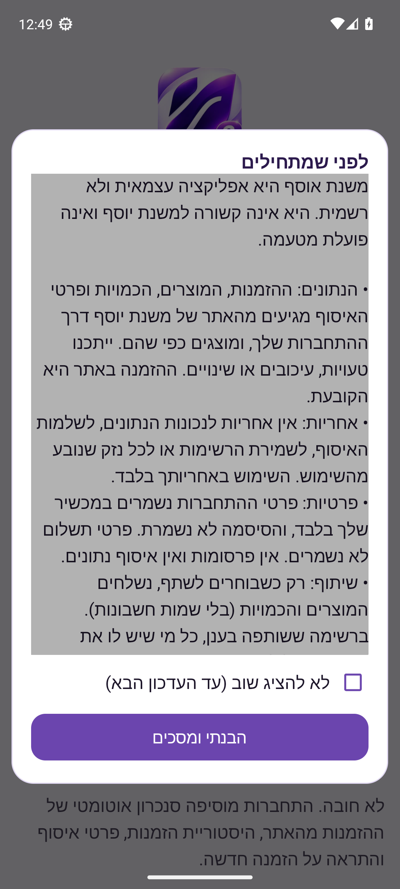
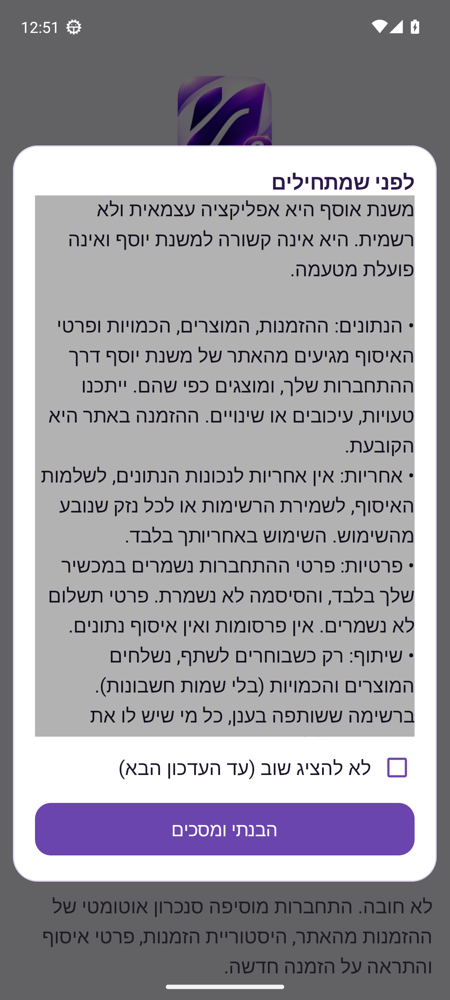
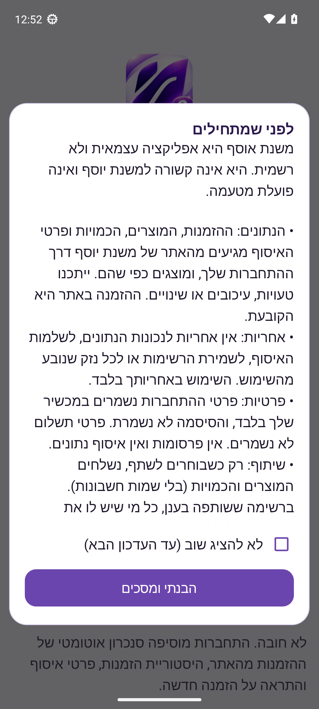
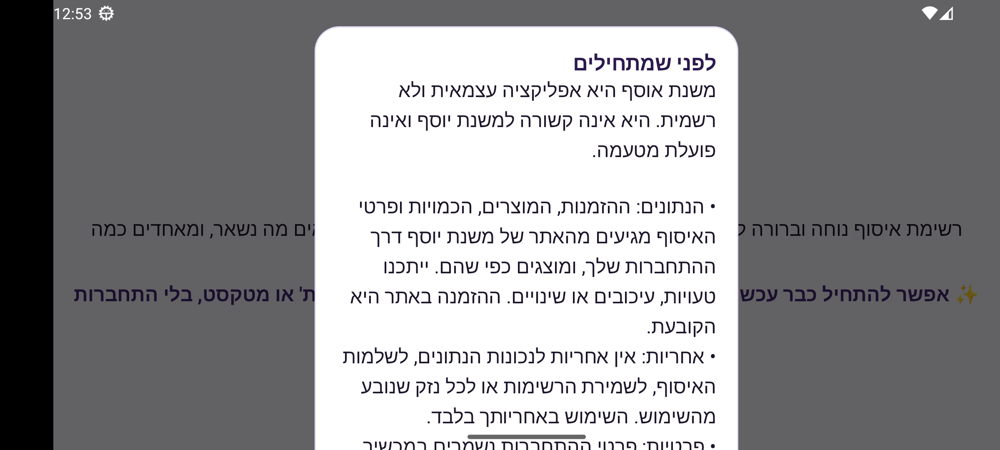
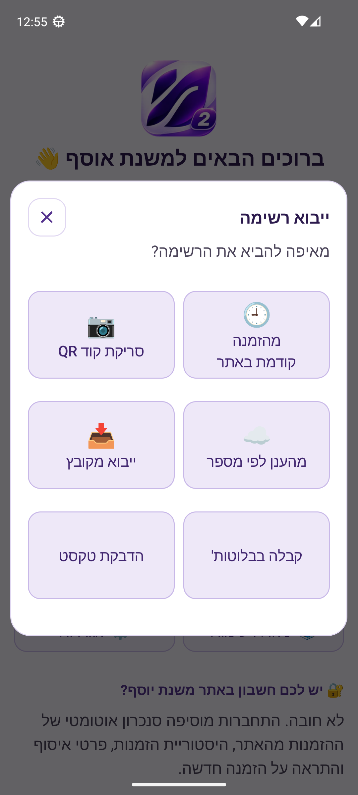
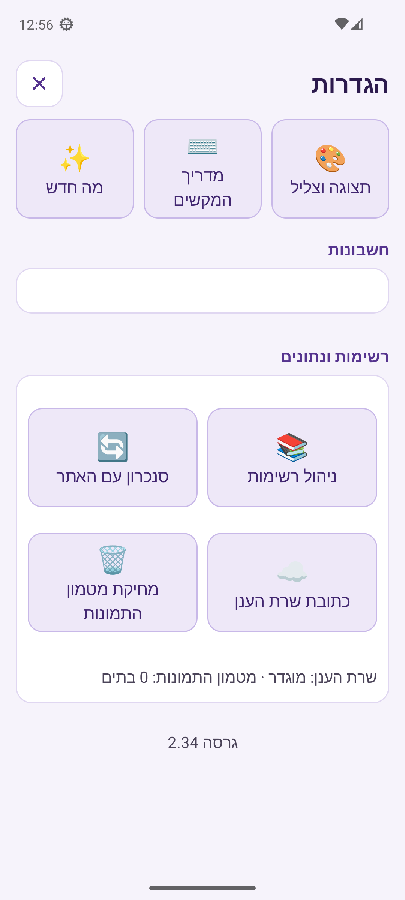
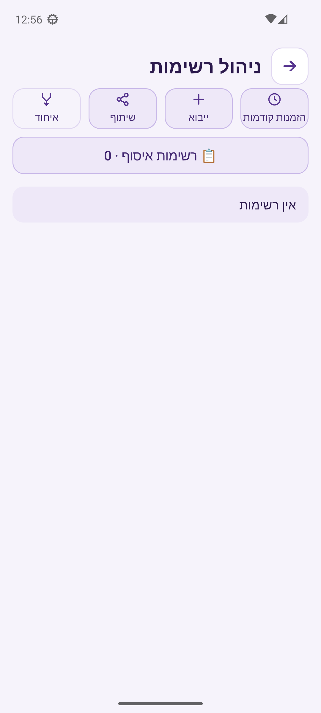
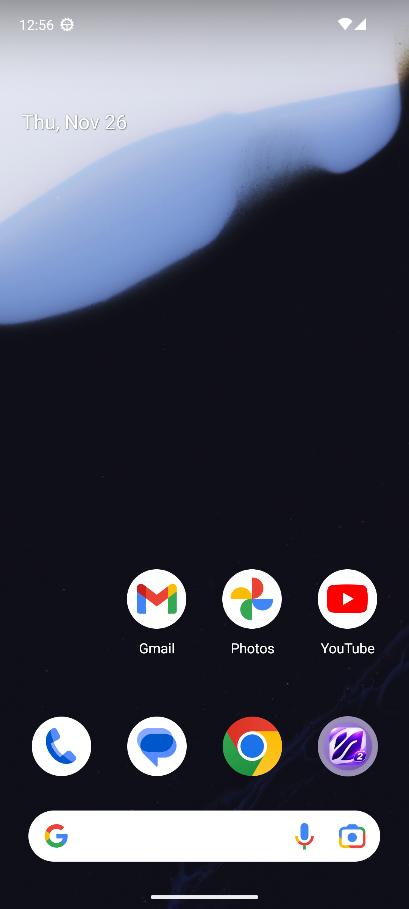

# UI test — mishnat-pickup (scenario)

**Result:** ❌ FAILED  
**Package:** `org.mishnatyosef.pickup`  
**Device:** sdk_gphone64_x86_64 · Android 13 (API 33) · 1080x2400  
**Duration:** 624.8s

## Steps

| # | Action | Detail | Result | Time |
|---|---|---|---|---|
| 1 | clear_data |  | ✅ | 0.54s |
| 2 | push | src='fixtures/ui-test-features.txt', dest='/sdcard/Download/ui-test-features.txt' | ✅ | 28.0s |
| 3 | launch |  | ✅ | 4.64s |
| 4 | wait_for | text='כניסה לחשבון' | ❌ — element not found within 30s: text='כניסה לחשבון' | 31.63s |
| 5 | scroll_to | text='ייבוא רשימה מקובץ' | ❌ — not found after scrolling: text='ייבוא רשימה מקובץ' | 14.68s |
| 6 | tap | text='ייבוא רשימה מקובץ' | ❌ — element not found within 10s: text='ייבוא רשימה מקובץ' | 10.47s |
| 7 | tap | text='ui-test-features' | ❌ — element not found within 10s: text='ui-test-features' | 12.65s |
| 8 | wait_for | text='נמצאו 1 רשימות' | ❌ — element not found within 15s: text='נמצאו 1 רשימות' | 15.28s |
| 9 | tap | text='ייבא רשימות' | ❌ — element not found within 10s: text='ייבא רשימות' | 12.61s |
| 10 | wait_for | 1+2+3+4+1.5 units | ❌ — element not found within 10s: text='נאספו 0 מתוך 11.5' | 10.03s |
| 11 | screenshot | name='imported-5-items' | ✅ | 2.24s |
| 12 | assert_text | decimal quantity kept | ❌ — element not found within 5s: text='1.5' | 7.27s |
| 13 | tap | text='חיפוש פריט' | ❌ — element not found within 10s: text='חיפוש פריט' | 12.58s |
| 14 | type | value='Pasta', hide_keyboard=True | ✅ | 0.85s |
| 15 | wait | seconds=1 | ✅ | 1.05s |
| 16 | screenshot | name='search-pasta' | ✅ | 2.22s |
| 17 | assert_text | text='Pasta' | ❌ — element not found within 5s: text='Pasta' | 7.27s |
| 18 | assert_not_visible | search filters other items | ✅ | 2.5s |
| 19 | type | class='EditText' | ❌ — element not found within 10s: class='EditText' | 12.55s |
| 20 | wait | seconds=1 | ✅ | 1.05s |
| 21 | assert_text | cleared search shows all items | ❌ — element not found within 5s: text='מלפפון' | 7.28s |
| 22 | long_press | text='Pasta' | ❌ — element not found within 10s: text='Pasta' | 12.58s |
| 23 | wait_for | text='איסוף כמות חלקית' | ❌ — element not found within 5s: text='איסוף כמות חלקית' | 7.26s |
| 24 | screenshot | name='partial-dialog' | ✅ | 2.22s |
| 25 | swipe | RTL slider: try to pick more units | ❌ — element not found within 10s: class='SeekBar' | 12.6s |
| 26 | screenshot | name='partial-dialog-moved' | ✅ | 2.21s |
| 27 | tap | text='אישור הכמות' | ❌ — element not found within 10s: text='אישור הכמות' | 12.56s |
| 28 | wait | seconds=1 | ✅ | 1.06s |
| 29 | scroll_to | the partial card sits in the collected section, below the fold | ❌ — not found after scrolling: text='נאספו חלקית' | 17.62s |
| 30 | screenshot | name='partial-collected' | ✅ | 2.22s |
| 31 | scroll_to | text='נאספו 1 מתוך' | ❌ — not found after scrolling: text='נאספו 1 מתוך' | 18.11s |
| 32 | tap | desc='איפוס ליקוט' | ❌ — element not found within 10s: desc='איפוס ליקוט' | 12.59s |
| 33 | wait_for | text='להחזיר את כל המוצרים' | ❌ — element not found within 5s: text='להחזיר את כל המוצרים' | 7.28s |
| 34 | screenshot | name='reset-confirm' | ✅ | 2.22s |
| 35 | tap | text='איפוס' | ❌ — element not found within 10s: text='איפוס' | 12.54s |
| 36 | wait_for | text='נאספו 0 מתוך 11.5' | ❌ — element not found within 5s: text='נאספו 0 מתוך 11.5' | 7.26s |
| 37 | tap | desc='רשימה לפי חשבון' | ❌ — element not found within 10s: desc='רשימה לפי חשבון' | 12.59s |
| 38 | wait | seconds=1.5 | ✅ | 1.55s |
| 39 | screenshot | name='view-by-account' | ✅ | 2.22s |
| 40 | tap | desc='רשימה מאוחדת' | ❌ — element not found within 10s: desc='רשימה מאוחדת' | 12.55s |
| 41 | wait | seconds=1.5 | ✅ | 1.55s |
| 42 | screenshot | name='view-combined' | ✅ | 2.23s |
| 43 | tap | text='גבינה' | ❌ — element not found within 10s: text='גבינה' | 12.57s |
| 44 | assert_text | text='נאספו 1.5 מתוך 11.5' | ❌ — element not found within 5s: text='נאספו 1.5 מתוך 11.5' | 7.25s |
| 45 | rotate | to='landscape' | ✅ | 1.6s |
| 46 | wait | seconds=1.5 | ✅ | 1.56s |
| 47 | assert_text | progress survives rotation | ❌ — element not found within 5s: text='נאספו 1.5 מתוך 11.5' | 7.25s |
| 48 | screenshot | name='landscape' | ✅ | 2.22s |
| 49 | rotate | to='portrait' | ✅ | 1.59s |
| 50 | wait | seconds=1.5 | ✅ | 1.56s |
| 51 | tap | desc='הגדרות' | ❌ — element not found within 10s: desc='הגדרות' | 12.54s |
| 52 | wait_for | text='סיכום מהיר' | ❌ — element not found within 8s: text='סיכום מהיר' | 9.91s |
| 53 | screenshot | name='settings-top' | ✅ | 2.23s |
| 54 | swipe | direction='up' | ✅ | 1.22s |
| 55 | screenshot | name='settings-middle' | ✅ | 2.23s |
| 56 | swipe | direction='up' | ✅ | 1.22s |
| 57 | swipe | direction='up' | ✅ | 1.23s |
| 58 | screenshot | name='settings-bottom' | ✅ | 2.25s |
| 59 | scroll_to | text='רשימות שמורות' | ❌ — not found after scrolling: text='רשימות שמורות' | 21.34s |
| 60 | tap | text='רשימות שמורות' | ❌ — element not found within 10s: text='רשימות שמורות' | 12.52s |
| 61 | wait | seconds=2 | ✅ | 2.06s |
| 62 | screenshot | name='saved-lists' | ✅ | 2.22s |
| 63 | back |  | ✅ | 0.87s |
| 64 | wait | seconds=1 | ✅ | 1.06s |
| 65 | back |  | ✅ | 0.88s |
| 66 | wait | seconds=1 | ✅ | 1.06s |
| 67 | launch | restart=False | ✅ | 2.76s |
| 68 | screenshot | name='before-explore' | ✅ | 2.21s |
| 69 | explore-tap | לא להציג שוב (עד העדכון הבא) | ✅ | 1.27s |
| 70 | explore-tap | הבנתי ומסכים | ✅ | 1.27s |
| 71 | explore-tap | ייבוא רשימות עכשיו. בלי התחברות ובלי אינטרנט | ✅ | 1.9s |
| 72 | explore-tap | סגירה | ✅ | 1.38s |
| 73 | explore-tap | ⚙️  הגדרות | ✅ | 1.68s |
| 74 | explore-tap | סגירת ההגדרות | ✅ | 1.32s |
| 75 | explore-tap | 📚  ניהול רשימות | ✅ | 1.54s |
| 76 | explore-tap | חזרה | ✅ | 1.4s |
| 69 | explore | auto-explore from the list screen | ✅ | 76.92s |
| 70 | assert_foreground |  | ⚠️ — foreground app is com.google.android.apps.nexuslauncher, expected org.mishnatyosef.pickup | 0.02s |

## Notes

- explore: 5 distinct screens, 8 elements tapped, 6 relaunches, 77s

## Screenshots

**001-step4-wait_for-FAILED.png**

**002-step5-scroll_to-FAILED.png**

**003-step6-tap-FAILED.png**

**004-step7-tap-FAILED.png**

**005-step8-wait_for-FAILED.png**

**006-step9-tap-FAILED.png**

**007-step10-wait_for-FAILED.png**

**008-imported-5-items.png**

**009-step12-assert_text-FAILED.png**

**010-step13-tap-FAILED.png**

**011-search-pasta.png**

**012-step17-assert_text-FAILED.png**

**013-step19-type-FAILED.png**

**014-step21-assert_text-FAILED.png**

**015-step22-long_press-FAILED.png**

**016-step23-wait_for-FAILED.png**

**017-partial-dialog.png**

**018-step25-swipe-FAILED.png**

**019-partial-dialog-moved.png**

**020-step27-tap-FAILED.png**

**021-step29-scroll_to-FAILED.png**

**022-partial-collected.png**

**023-step31-scroll_to-FAILED.png**

**024-step32-tap-FAILED.png**

**025-step33-wait_for-FAILED.png**

**026-reset-confirm.png**

**027-step35-tap-FAILED.png**

**028-step36-wait_for-FAILED.png**

**029-step37-tap-FAILED.png**

**030-view-by-account.png**

**031-step40-tap-FAILED.png**

**032-view-combined.png**

**033-step43-tap-FAILED.png**

**034-step44-assert_text-FAILED.png**

**035-step47-assert_text-FAILED.png**

**036-landscape.png**

**037-step51-tap-FAILED.png**

**038-step52-wait_for-FAILED.png**

**039-settings-top.png**

**040-settings-middle.png**

**041-settings-bottom.png**

**042-step59-scroll_to-FAILED.png**

**043-step60-tap-FAILED.png**

**044-saved-lists.png**

**045-before-explore.png**

**046-screen-1.png**

**047-screen-2.png**

**048-screen-3.png**

**049-screen-4.png**

**050-screen-5.png**

**051-final.png**

