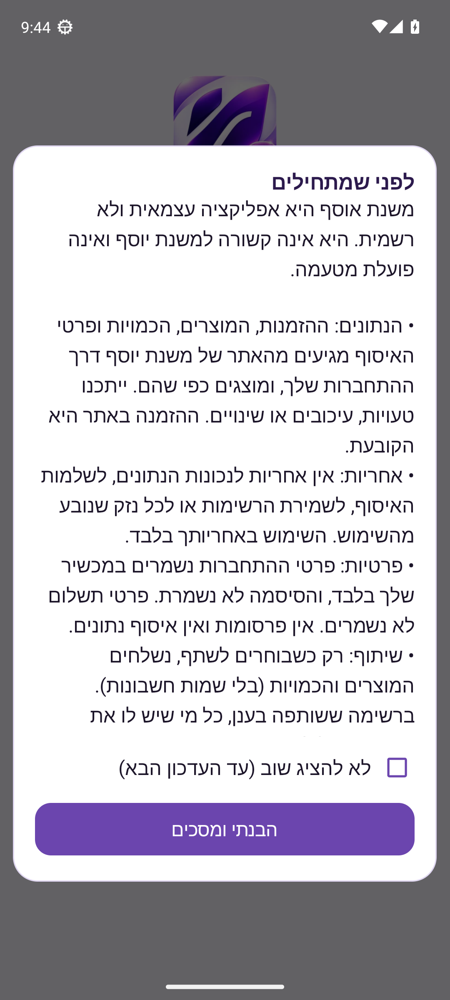

# UI test — mishnat-pickup (scenario)

**Result:** ❌ FAILED  
**Package:** `org.mishnatyosef.pickup`  
**Device:** sdk_gphone64_x86_64 · Android 13 (API 33) · 1080x2400  
**Duration:** 46.1s

## Steps

| # | Action | Detail | Result | Time |
|---|---|---|---|---|
| 1 | clear_data |  | ✅ | 0.41s |
| 2 | push | src='fixtures/ui-test-list.txt', dest='/sdcard/Download/ui-test-list.txt' | ✅ | 3.61s |
| 3 | launch |  | ✅ | 3.42s |
| 4 | wait_for | text='כניסה לחשבון' | ❌ — element not found within 30s: text='כניסה לחשבון' | 31.84s |

## Screenshots

**001-step4-wait_for-FAILED.png**

**002-final.png**

