# UI test — chullin (explore)

**Result:** ✅ PASSED  
**Package:** `com.londkirs.chullin`  
**Device:** sdk_gphone64_x86_64 · Android 13 (API 33) · 1080x2400  
**Duration:** 210.0s

## Steps

| # | Action | Detail | Result | Time |
|---|---|---|---|---|
| 1 | explore-tap | ⚙ | ✅ | 1.57s |
| 2 | explore-tap | כהה | ✅ | 2.04s |
| 3 | explore-tap | רש"י | ✅ | 1.37s |
| 4 | explore-tap | ⚙ | ✅ | 1.53s |
| 5 | explore-tap | בהיר | ✅ | 2.37s |
| 6 | explore-tap | ✓ רש"י | ✅ | 1.47s |
| 7 | explore-tap | גמרא | ✅ | 1.37s |
| 8 | explore-tap | ⚙ | ✅ | 1.45s |
| 9 | explore-tap | נקה | ✅ | 1.66s |
| 10 | explore-tap | בחר תאריך | ✅ | 1.68s |
| 11 | explore-tap | 2026 / #date_picker_header_year | ✅ | 1.32s |
| 12 | explore-tap | 2026 / #date_picker_header_year | ✅ | 1.47s |
| 13 | explore-tap | יום ה׳, 26 בנוב׳ / #date_picker_header_date | ✅ | 1.41s |
| 14 | explore-tap | יום ה׳, 26 בנוב׳ / #date_picker_header_date | ✅ | 1.34s |
| 15 | explore-tap | החודש הבא / #next | ✅ | 1.31s |
| 16 | explore-tap | 2026 / #date_picker_header_year | ✅ | 1.46s |
| 17 | explore-tap | אישור / #button1 | ✅ | 1.29s |
| 18 | explore-tap | גמרא | ✅ | 1.3s |
| 19 | explore-tap | גמרא+רש"י | ✅ | 1.31s |
| 20 | explore-tap | מלא | ✅ | 1.3s |
| 21 | explore-tap | 100% | ✅ | 1.29s |
| 22 | explore-tap | 75% | ✅ | 1.28s |
| 23 | explore-tap | 50% | ✅ | 1.28s |
| 24 | explore-tap | 25% | ✅ | 1.3s |
| 25 | explore-tap | החלף מסכת: חולין | ✅ | 1.31s |
| 26 | explore-tap | ייבוא קובץ תוספות למסכת חולין | ✅ | 1.98s |
| 27 | explore | left app to com.google.android.documentsui | ✅ | 0s |
| 28 | explore-tap | שחזור | ✅ | 1.32s |
| 29 | explore | left app to com.google.android.documentsui | ✅ | 0s |
| 30 | explore-tap | ייצוא גיבוי | ✅ | 1.31s |
| 31 | explore | left app to com.google.android.documentsui | ✅ | 0s |
| 32 | explore-tap | סגור / #button1 | ✅ | 1.3s |
| 33 | explore-tap | ⚙ | ✅ | 1.3s |
| 34 | explore-tap | רש"י | ✅ | 1.3s |
| 35 | explore-tap | ⚙ | ✅ | 1.3s |
| 36 | explore-tap | ✓ רש"י | ✅ | 1.29s |

## Notes

- explore: uiautomator dump failed: 
- explore: 10 distinct screens, 33 elements tapped, 0 relaunches, 199s

## Screenshots

**001-screen-1.png**

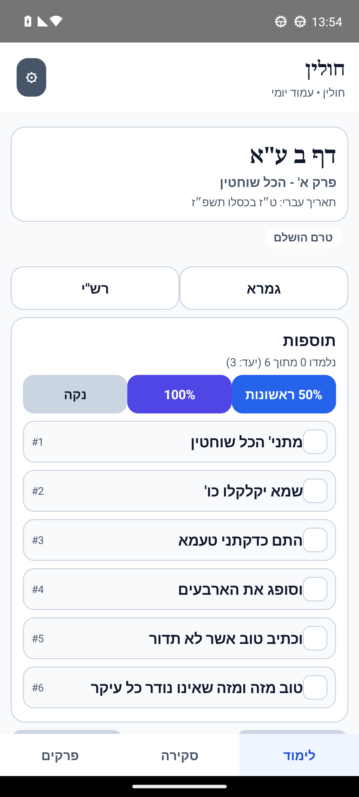

**002-screen-2.png**

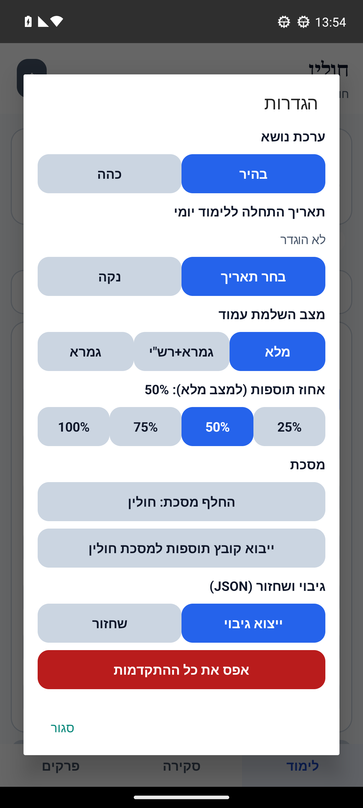

**003-screen-3.png**

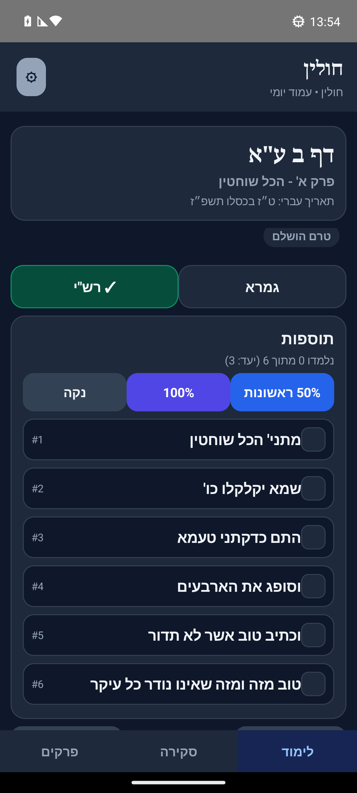

**004-screen-4.png**

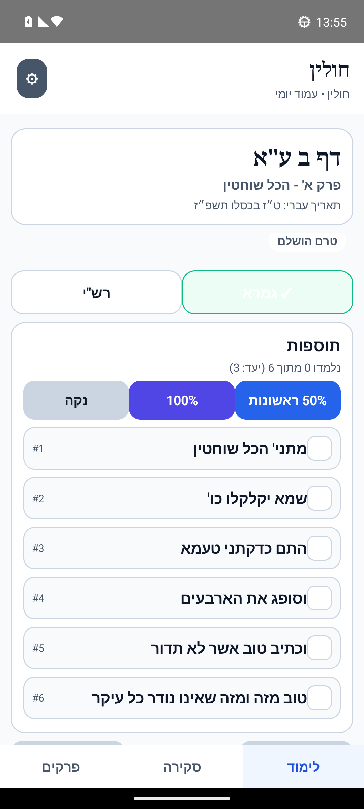

**005-screen-5.png**

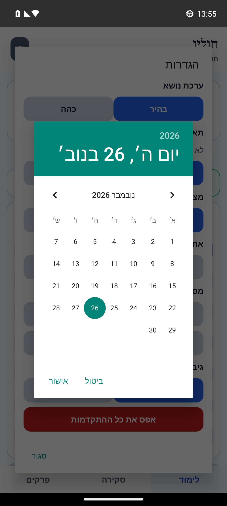

**006-screen-6.png**

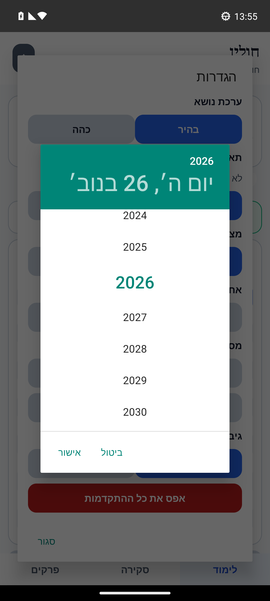

**007-screen-7.png**

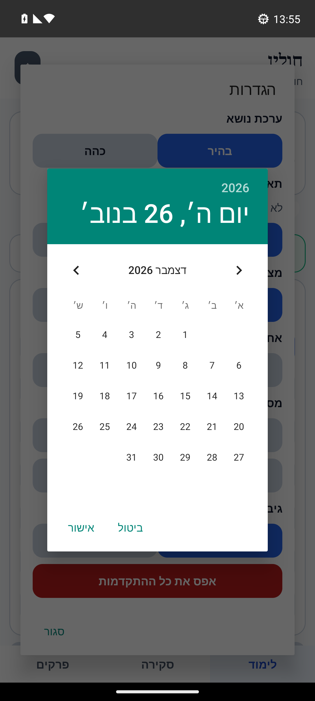

**008-screen-8.png**

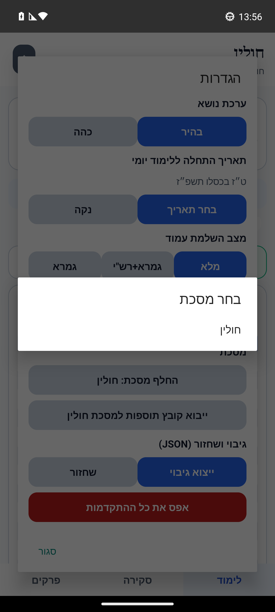

**009-left-app-to-com-google-android-documentsui.png**

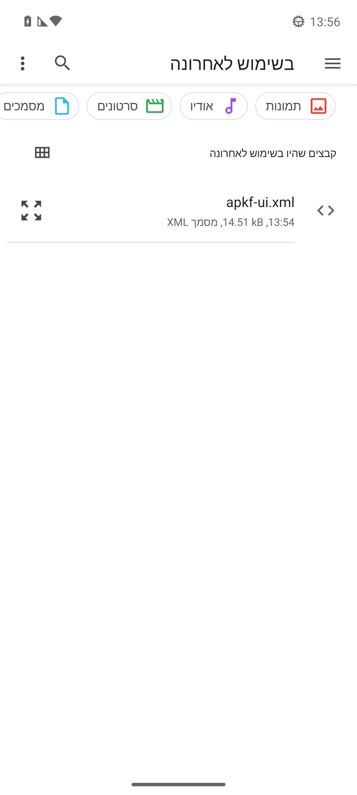

**010-left-app-to-com-google-android-documentsui.png**

**011-left-app-to-com-google-android-documentsui.png**

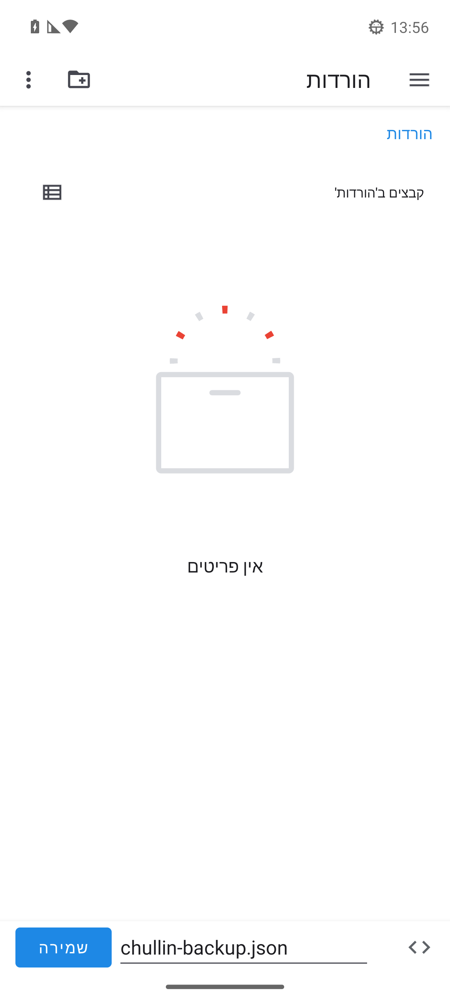

**012-screen-9.png**

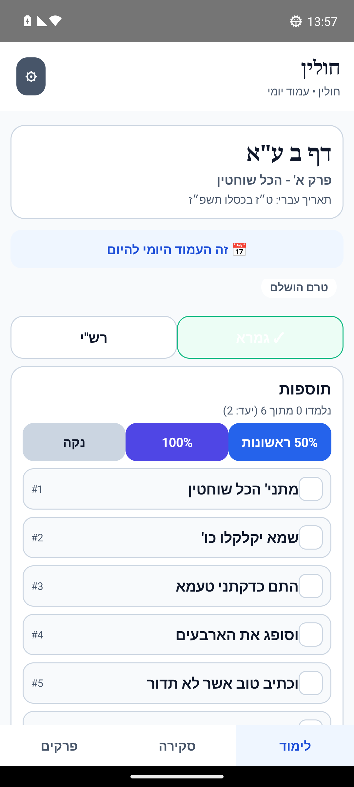

**013-screen-10.png**

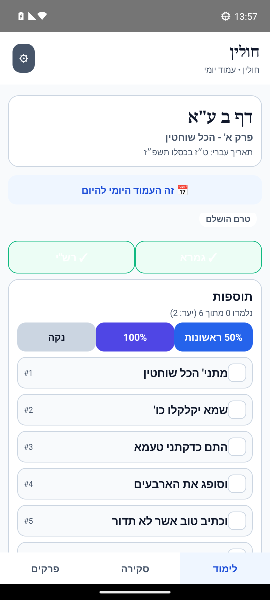

**014-final.png**

