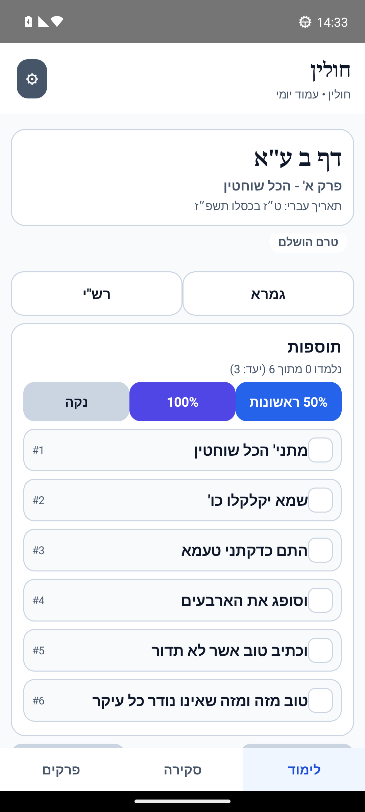

# UI test — chullin (scenario)

**Result:** ❌ FAILED  
**Package:** `com.londkirs.chullin`  
**Device:** sdk_gphone64_x86_64 · Android 13 (API 33) · 1080x2400  
**Duration:** 23.5s

## Steps

| # | Action | Detail | Result | Time |
|---|---|---|---|---|
| 1 | launch | clear_data=True | ✅ | 4.51s |
| 2 | wait_for | text='חולין' | ✅ | 2.96s |
| 3 | assert_text | text='הכל שוחטין' | ✅ | 2.53s |
| 4 | assert_text | text='הבא' | ❌ — element not found within 5s: text='הבא' | 5.57s |

## Screenshots

**001-step4-assert_text-FAILED.png**

**002-final.png**

