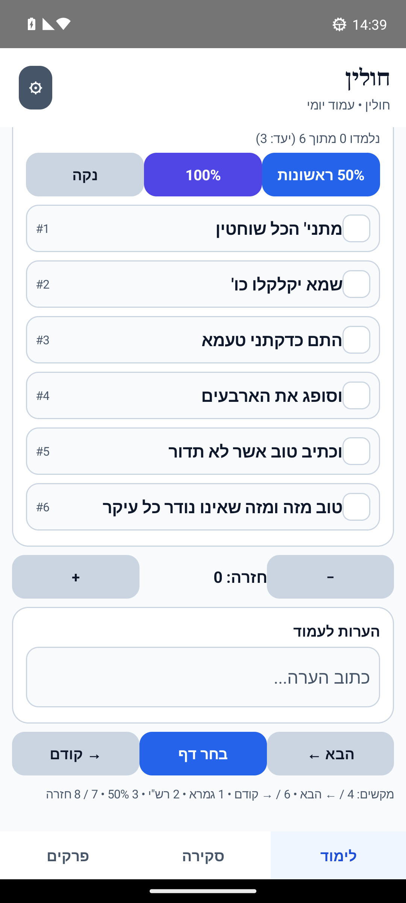

# UI test — chullin (scenario)

**Result:** ❌ FAILED  
**Package:** `com.londkirs.chullin`  
**Device:** sdk_gphone64_x86_64 · Android 13 (API 33) · 1080x2400  
**Duration:** 40.4s

## Steps

| # | Action | Detail | Result | Time |
|---|---|---|---|---|
| 1 | launch | clear_data=True | ✅ | 3.92s |
| 2 | wait_for | text='חולין' | ✅ | 2.81s |
| 3 | assert_text | text='הכל שוחטין' | ✅ | 2.58s |
| 4 | scroll_to | text='הבא' | ✅ | 6.65s |
| 5 | assert_text | text='הבא' | ✅ | 2.63s |
| 6 | screenshot | name='study-start' | ✅ | 3.27s |
| 7 | tap | text='גמרא' | ❌ — element not found within 10s: text='גמרא' | 11.47s |

## Screenshots

**001-study-start.png**

**002-step7-tap-FAILED.png**

**003-final.png**

