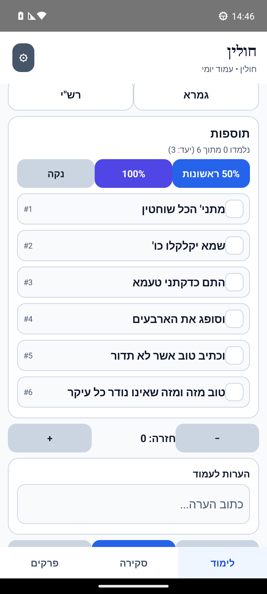
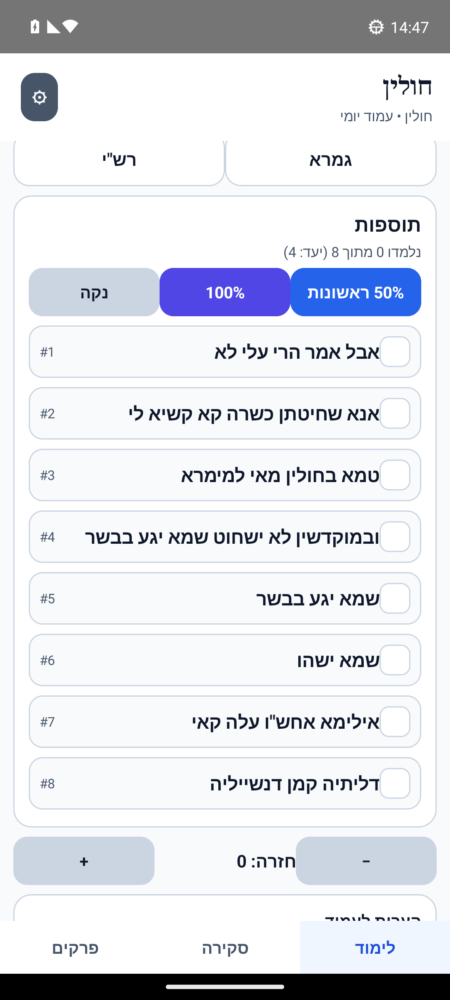
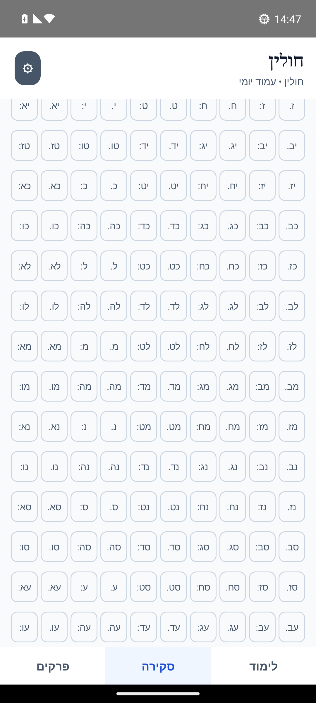

# UI test — chullin (scenario)

**Result:** ❌ FAILED  
**Package:** `com.londkirs.chullin`  
**Device:** sdk_gphone64_x86_64 · Android 13 (API 33) · 1080x2400  
**Duration:** 80.4s

## Steps

| # | Action | Detail | Result | Time |
|---|---|---|---|---|
| 1 | launch | clear_data=True | ✅ | 6.57s |
| 2 | wait_for | text='חולין' | ✅ | 2.69s |
| 3 | assert_text | text='הכל שוחטין' | ✅ | 2.23s |
| 4 | scroll_to | text='הבא' | ✅ | 6.15s |
| 5 | assert_text | text='הבא' | ✅ | 2.53s |
| 6 | screenshot | name='study-start' | ✅ | 3.04s |
| 7 | scroll_to | text='גמרא' | ✅ | 2.73s |
| 8 | tap | text='גמרא' | ✅ | 3.71s |
| 9 | scroll_to | text='גמרא' | ✅ | 2.73s |
| 10 | assert_text | text='✓ גמרא' | ✅ | 2.39s |
| 11 | scroll_to | text='גמרא' | ✅ | 2.75s |
| 12 | tap | text='✓ גמרא' | ✅ | 3.58s |
| 13 | assert_not_visible | text='✓ גמרא' | ✅ | 2.95s |
| 14 | scroll_to | text='הבא' | ✅ | 2.22s |
| 15 | tap | text='הבא ←' | ✅ | 3.43s |
| 16 | wait | seconds=1 | ✅ | 1.19s |
| 17 | screenshot | name='after-next' | ✅ | 3.25s |
| 18 | scroll_to | text='הבא' | ✅ | 5.79s |
| 19 | tap | text='→ קודם' | ✅ | 3.58s |
| 20 | wait | seconds=1 | ✅ | 1.09s |
| 21 | tap | text='סקירה' | ✅ | 3.44s |
| 22 | assert_text | text='סקירה כללית' | ❌ — element not found within 5s: text='סקירה כללית' | 5.03s |

## Screenshots

**001-study-start.png**

**002-after-next.png**

**003-step22-assert_text-FAILED.png**

**004-final.png**

