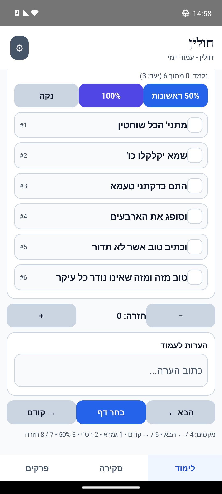
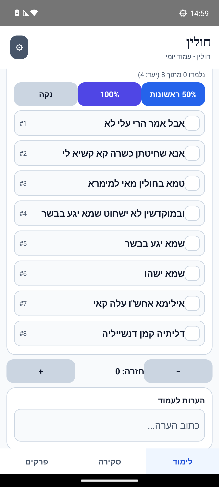
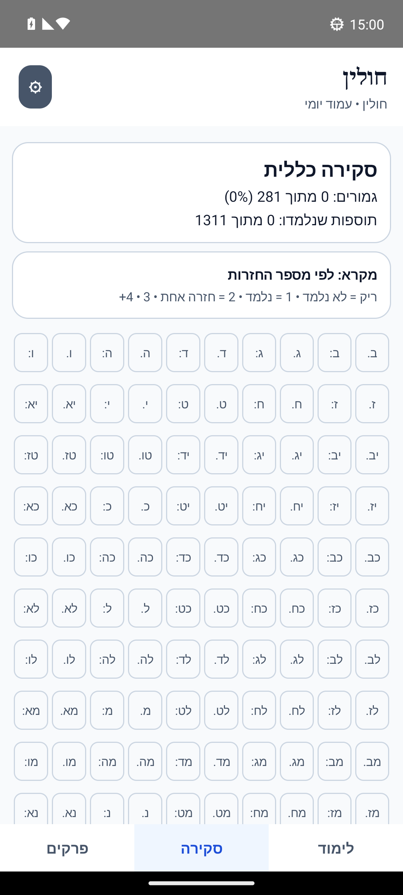
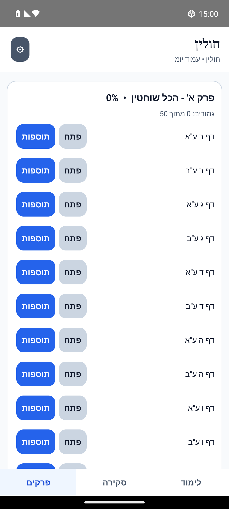

# UI test — chullin (scenario)

**Result:** ✅ PASSED  
**Package:** `com.londkirs.chullin`  
**Device:** sdk_gphone64_x86_64 · Android 13 (API 33) · 1080x2400  
**Duration:** 114.6s

## Steps

| # | Action | Detail | Result | Time |
|---|---|---|---|---|
| 1 | launch | clear_data=True | ✅ | 3.77s |
| 2 | wait_for | text='חולין' | ✅ | 2.82s |
| 3 | assert_text | text='הכל שוחטין' | ✅ | 2.43s |
| 4 | scroll_to | text='הבא' | ✅ | 6.68s |
| 5 | assert_text | text='הבא' | ✅ | 3.1s |
| 6 | screenshot | name='study-start' | ✅ | 3.65s |
| 7 | swipe | direction='down' | ✅ | 1.31s |
| 8 | swipe | direction='down' | ✅ | 1.5s |
| 9 | swipe | direction='down' | ✅ | 1.42s |
| 10 | wait | seconds=1 | ✅ | 1.45s |
| 11 | tap | text='גמרא' | ✅ | 3.76s |
| 12 | swipe | direction='down' | ✅ | 1.47s |
| 13 | swipe | direction='down' | ✅ | 1.32s |
| 14 | swipe | direction='down' | ✅ | 1.33s |
| 15 | wait | seconds=1 | ✅ | 1.15s |
| 16 | assert_text | text='✓ גמרא' | ✅ | 2.6s |
| 17 | swipe | direction='down' | ✅ | 1.41s |
| 18 | swipe | direction='down' | ✅ | 1.32s |
| 19 | swipe | direction='down' | ✅ | 1.3s |
| 20 | wait | seconds=1 | ✅ | 1.55s |
| 21 | tap | text='✓ גמרא' | ✅ | 3.93s |
| 22 | assert_not_visible | text='✓ גמרא' | ✅ | 3.09s |
| 23 | scroll_to | text='הבא' | ✅ | 5.87s |
| 24 | tap | text='הבא ←' | ✅ | 3.31s |
| 25 | wait | seconds=1 | ✅ | 1.08s |
| 26 | screenshot | name='after-next' | ✅ | 2.52s |
| 27 | scroll_to | text='הבא' | ✅ | 5.78s |
| 28 | tap | text='→ קודם' | ✅ | 3.43s |
| 29 | wait | seconds=1 | ✅ | 1.08s |
| 30 | tap | text='סקירה' | ✅ | 3.37s |
| 31 | scroll_to | text='סקירה כללית' | ✅ | 6.41s |
| 32 | assert_text | text='סקירה כללית' | ✅ | 2.54s |
| 33 | assert_text | text='גמורים: 0' | ✅ | 2.25s |
| 34 | screenshot | name='overview' | ✅ | 2.32s |
| 35 | tap | text='פרקים' | ✅ | 3.13s |
| 36 | scroll_to | text='הכל שוחטין' | ✅ | 2.04s |
| 37 | assert_text | text='הכל שוחטין' | ✅ | 2.03s |
| 38 | tap | text='הכל שוחטין' | ✅ | 3.07s |
| 39 | assert_text | text='אותו ואת בנו' | ⚠️ — element not found within 5s: text='אותו ואת בנו' | 7.44s |
| 40 | screenshot | name='perakim' | ✅ | 2.27s |

## Screenshots

**001-study-start.png**

**002-after-next.png**

**003-overview.png**

**004-perakim.png**

