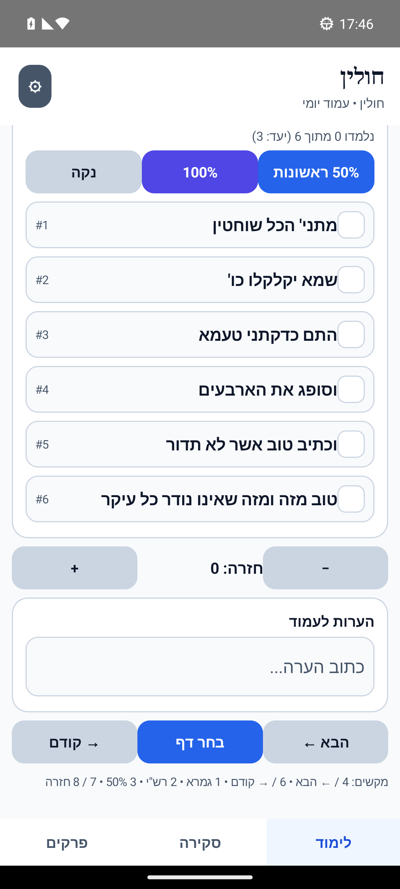
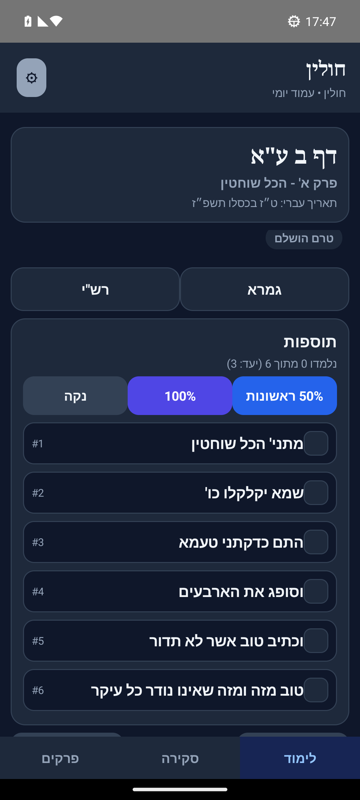

# UI test — chullin (scenario)

**Result:** ❌ FAILED  
**Package:** `com.londkirs.chullin`  
**Device:** sdk_gphone64_x86_64 · Android 13 (API 33) · 1080x2400  
**Duration:** 105.8s

## Steps

| # | Action | Detail | Result | Time |
|---|---|---|---|---|
| 1 | launch | clear_data=True | ✅ | 5.91s |
| 2 | wait_for | text='חולין' | ✅ | 2.8s |
| 3 | assert_text | text='הכל שוחטין' | ✅ | 2.44s |
| 4 | scroll_to | text='הבא' | ✅ | 6.69s |
| 5 | assert_text | text='הבא' | ✅ | 2.65s |
| 6 | screenshot | name='study-start' | ✅ | 3.04s |
| 7 | scroll_to | text="מתני' הכל שוחטין" | ✅ | 2.59s |
| 8 | tap | text="מתני' הכל שוחטין" | ✅ | 3.31s |
| 9 | wait | seconds=1 | ✅ | 1.05s |
| 10 | assert_text | text='נלמדו 1 מתוך 6' | ✅ | 2.64s |
| 11 | tap | text="מתני' הכל שוחטין" | ✅ | 3.61s |
| 12 | wait | seconds=1 | ✅ | 1.05s |
| 13 | assert_text | text='נלמדו 0 מתוך 6' | ✅ | 2.54s |
| 14 | swipe | direction='down' | ✅ | 1.34s |
| 15 | swipe | direction='down' | ✅ | 1.36s |
| 16 | swipe | direction='down' | ✅ | 1.58s |
| 17 | tap | text='⚙' | ✅ | 3.52s |
| 18 | wait_for | text='ערכת נושא' | ✅ | 2.33s |
| 19 | tap | text='כהה' | ✅ | 3.11s |
| 20 | wait | seconds=2 | ✅ | 2.08s |
| 21 | screenshot | name='dark-theme' | ✅ | 12.64s |
| 22 | tap | text='⚙' | ❌ — uiautomator dump failed:  | 11.78s |

## Notes

- UI dump for 002-dark-theme.png failed: uiautomator dump failed: 
- UI dump for 003-step22-tap-FAILED.png failed: uiautomator dump failed: 
- UI dump for 004-final.png failed: uiautomator dump failed: 

## Screenshots

**001-study-start.png**

**002-dark-theme.png**

**003-step22-tap-FAILED.png**

**004-final.png**

