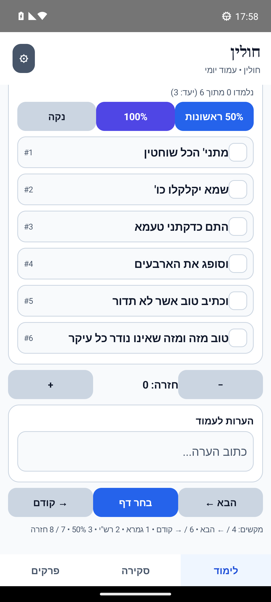
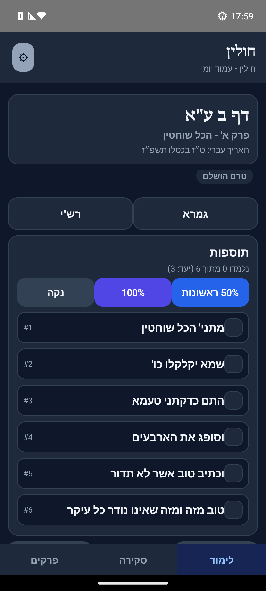

# UI test — chullin (scenario)

**Result:** ✅ PASSED  
**Package:** `com.londkirs.chullin`  
**Device:** sdk_gphone64_x86_64 · Android 13 (API 33) · 1080x2400  
**Duration:** 70.4s

## Steps

| # | Action | Detail | Result | Time |
|---|---|---|---|---|
| 1 | launch | clear_data=True | ✅ | 4.33s |
| 2 | wait_for | text='חולין' | ✅ | 2.62s |
| 3 | assert_text | text='הכל שוחטין' | ✅ | 2.48s |
| 4 | scroll_to | text='הבא' | ✅ | 6.52s |
| 5 | assert_text | text='הבא' | ✅ | 2.54s |
| 6 | screenshot | name='study-start' | ✅ | 2.56s |
| 7 | scroll_to | text="מתני' הכל שוחטין" | ✅ | 2.3s |
| 8 | tap | text="מתני' הכל שוחטין" | ✅ | 3.52s |
| 9 | wait | seconds=1 | ✅ | 1.09s |
| 10 | assert_text | text='נלמדו 1 מתוך 6' | ✅ | 2.51s |
| 11 | tap | text="מתני' הכל שוחטין" | ✅ | 3.32s |
| 12 | wait | seconds=1 | ✅ | 1.08s |
| 13 | assert_text | text='נלמדו 0 מתוך 6' | ✅ | 2.73s |
| 14 | swipe | direction='down' | ✅ | 1.44s |
| 15 | swipe | direction='down' | ✅ | 1.34s |
| 16 | swipe | direction='down' | ✅ | 1.59s |
| 17 | wait | seconds=2 | ✅ | 2.1s |
| 18 | tap | text='⚙' | ✅ | 3.66s |
| 19 | wait_for | text='ערכת נושא' | ✅ | 2.42s |
| 20 | tap | text='כהה' | ✅ | 3.36s |
| 21 | wait | seconds=2 | ✅ | 2.18s |
| 22 | screenshot | name='dark-theme' | ✅ | 13.06s |

## Notes

- UI dump for 002-dark-theme.png failed: uiautomator dump failed: 

## Screenshots

**001-study-start.png**

**002-dark-theme.png**

