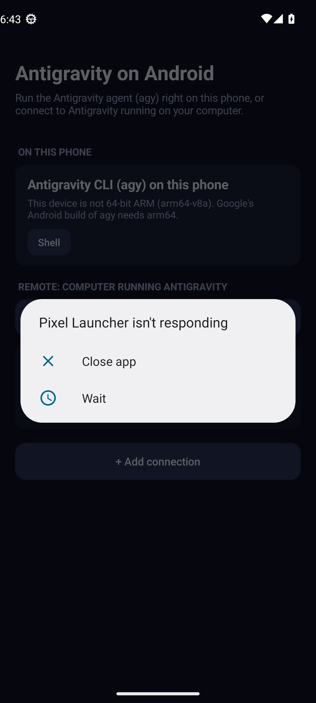

# UI test — antigravity-remote (explore)

**Result:** ✅ PASSED  
**Package:** `com.londkirs.antigravityremote`  
**Device:** sdk_gphone64_x86_64 · Android 13 (API 33) · 1080x2400  
**Duration:** 46.5s

## Steps

| # | Action | Detail | Result | Time |
|---|---|---|---|---|
| 1 | explore | left app to com.google.android.apps.nexuslauncher | ✅ | 0s |
| 2 | explore | left app to com.google.android.apps.nexuslauncher | ✅ | 0s |
| 3 | explore | left app to com.google.android.apps.nexuslauncher | ✅ | 0s |
| 4 | explore | left app to com.google.android.apps.nexuslauncher | ✅ | 0s |
| 5 | explore | left app to com.google.android.apps.nexuslauncher | ✅ | 0s |
| 6 | explore | left app to com.google.android.apps.nexuslauncher | ✅ | 0s |

## Notes

- explore: app kept leaving the foreground; stopping
- explore: 0 distinct screens, 0 elements tapped, 6 relaunches, 39s

## Screenshots

**001-left-app-to-com-google-android-apps-nexuslauncher.png**

**002-left-app-to-com-google-android-apps-nexuslauncher.png**

**003-left-app-to-com-google-android-apps-nexuslauncher.png**

**004-left-app-to-com-google-android-apps-nexuslauncher.png**

**005-left-app-to-com-google-android-apps-nexuslauncher.png**

**006-left-app-to-com-google-android-apps-nexuslauncher.png**

**007-final.png**

