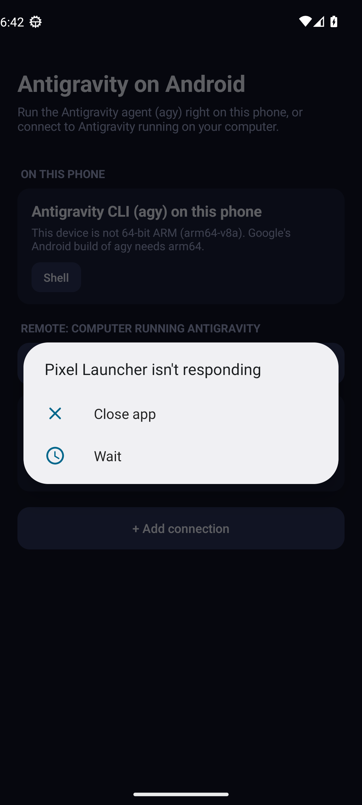

# UI test — antigravity-remote (scenario)

**Result:** ❌ FAILED  
**Package:** `com.londkirs.antigravityremote`  
**Device:** sdk_gphone64_x86_64 · Android 13 (API 33) · 1080x2400  
**Duration:** 36.8s

## Steps

| # | Action | Detail | Result | Time |
|---|---|---|---|---|
| 1 | launch | clear_data=True | ✅ | 6.43s |
| 2 | wait_for | text='Antigravity' | ❌ — element not found within 20s: text='Antigravity' | 21.12s |

## Screenshots

**001-step2-wait_for-FAILED.png**

**002-final.png**

