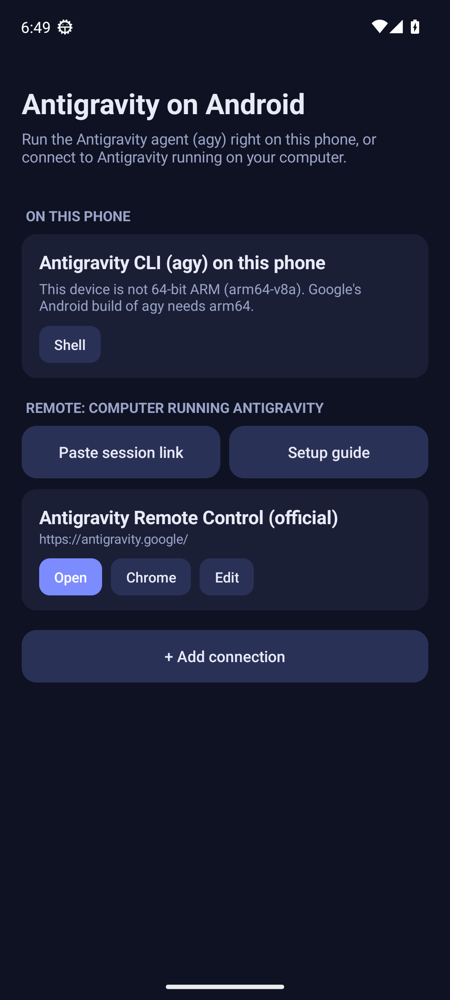
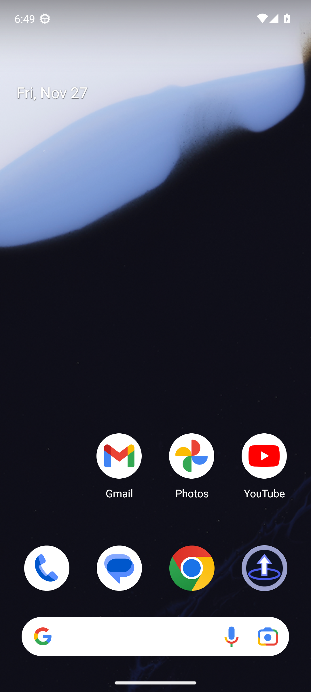

# UI test — antigravity-remote (explore)

**Result:** ❌ FAILED  
**Package:** `com.londkirs.antigravityremote`  
**Device:** sdk_gphone64_x86_64 · Android 13 (API 33) · 1080x2400  
**Duration:** 15.8s

## Crashes / ANRs

```
Crash: E/AndroidRuntime( 8005): Process: com.londkirs.antigravityremote, PID: 8005
--------- beginning of crash
E/AndroidRuntime( 8005): FATAL EXCEPTION: main
E/AndroidRuntime( 8005): Process: com.londkirs.antigravityremote, PID: 8005
E/AndroidRuntime( 8005): java.lang.RuntimeException: Unable to start activity ComponentInfo{com.londkirs.antigravityremote/com.londkirs.antigravityremote.TerminalActivity}: java.lang.NullPointerException: Attempt to read from field 'int com.termux.view.TerminalRenderer.mTextSize' on a null object reference in method 'void com.termux.view.TerminalView.setTypeface(android.graphics.Typeface)'
E/AndroidRuntime( 8005): 	at android.app.ActivityThread.performLaunchActivity(ActivityThread.java:3645)
E/AndroidRuntime( 8005): 	at android.app.ActivityThread.handleLaunchActivity(ActivityThread.java:3782)
E/AndroidRuntime( 8005): 	at android.app.servertransaction.LaunchActivityItem.execute(LaunchActivityItem.java:101)
E/AndroidRuntime( 8005): 	at android.app.servertransaction.TransactionExecutor.executeCallbacks(TransactionExecutor.java:138)
E/AndroidRuntime( 8005): 	at android.app.servertransaction.TransactionExecutor.execute(TransactionExecutor.java:95)
E/AndroidRuntime( 8005): 	at android.app.ActivityThread$H.handleMessage(ActivityThread.java:2307)
E/AndroidRuntime( 8005): 	at android.os.Handler.dispatchMessage(Handler.java:106)
E/AndroidRuntime( 8005): 	at android.os.Looper.loopOnce(Looper.java:201)
E/AndroidRuntime( 8005): 	at android.os.Looper.loop(Looper.java:288)
E/AndroidRuntime( 8005): 	at android.app.ActivityThread.main(ActivityThread.java:7924)
E/AndroidRuntime( 8005): 	at java.lang.reflect.Method.invoke(Native Method)
E/AndroidRuntime( 8005): 	at com.android.internal.os.RuntimeInit$MethodAndArgsCaller.run(RuntimeInit.java:548)
E/AndroidRuntime( 8005): 	at com.android.internal.os.ZygoteInit.main(ZygoteInit.java:936)
E/AndroidRuntime( 8005): Caused by: java.lang.NullPointerException: Attempt to read from field 'int com.termux.view.TerminalRenderer.mTextSize' on a null object reference in method 'void com.termux.view.TerminalView.setTypeface(android.graphics.Typeface)'
E/AndroidRuntime( 8005): 	at com.termux.view.TerminalView.setTypeface(TerminalView.java:454)
E/AndroidRuntime( 8005): 	at com.londkirs.antigravityremote.TerminalActivity.onCreate(TerminalActivity.kt:118)
E/AndroidRuntime( 8005): 	at android.app.Activity.performCreate(Activity.java:8342)
E/AndroidRuntime( 8005): 	at android.app.Activity.performCreate(Activity.java:8321)
E/AndroidRuntime( 8005): 	at android.app.Instrumentation.callActivityOnCreate(Instrumentation.java:1417)
E/AndroidRuntime( 8005): 	at android.app.ActivityThread.performLaunchActivity(ActivityThread.java:3626)
E/AndroidRuntime( 8005): 	... 12 more

--------- beginning of crash
```

## Steps

| # | Action | Detail | Result | Time |
|---|---|---|---|---|
| 1 | explore-tap | Shell | ❌ — app crashed after this tap | 1.25s |

## Notes

- explore: 1 distinct screens, 1 elements tapped, 0 relaunches, 8s

## Screenshots

**001-screen-1.png**



**002-crash-after-Shell.png**


**003-final.png**


