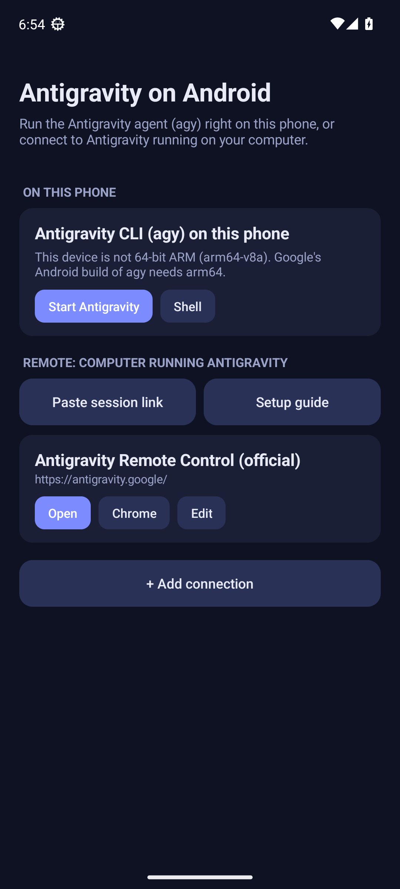
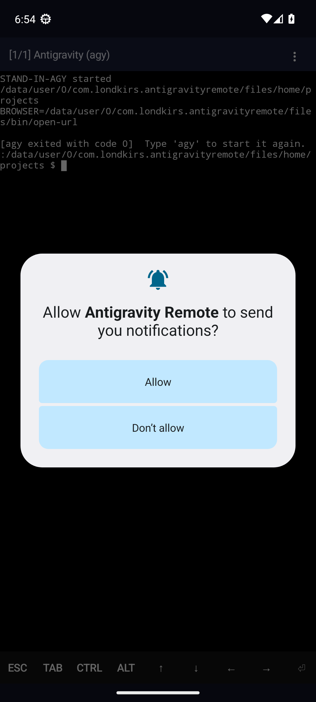

# UI test — antigravity-remote (scenario)

**Result:** ❌ FAILED  
**Package:** `com.londkirs.antigravityremote`  
**Device:** sdk_gphone64_x86_64 · Android 13 (API 33) · 1080x2400  
**Duration:** 67.2s

## Steps

| # | Action | Detail | Result | Time |
|---|---|---|---|---|
| 1 | launch | clear_data=True | ✅ | 4.53s |
| 2 | tap | text='Wait' | ⚠️ — element not found within 10s: text='Wait' | 11.04s |
| 3 | shell | cmd='run-as com.londkirs.antigravityremote sh -c \'mkdir -p files/bin && echo "#!/system/b | ✅ | 0.21s |
| 4 | back |  | ✅ | 1.08s |
| 5 | launch |  | ✅ | 3.87s |
| 6 | tap | text='Wait' | ⚠️ — element not found within 10s: text='Wait' | 12.0s |
| 7 | wait_for | text='Start Antigravity' | ✅ | 2.11s |
| 8 | screenshot | name='home-installed' | ✅ | 2.66s |
| 9 | tap | text='Start Antigravity' | ✅ | 3.35s |
| 10 | wait | seconds=5 | ✅ | 5.13s |
| 11 | tap | text='Wait' | ⚠️ — element not found within 10s: text='Wait' | 11.23s |
| 12 | screenshot | name='agy-session' | ✅ | 2.75s |
| 13 | assert_foreground |  | ❌ — foreground app is com.google.android.permissioncontroller, expected com.londkirs.antigravityremote | 0.07s |

## Screenshots

**001-home-installed.png**

**002-agy-session.png**

**003-step13-assert_foreground-FAILED.png**

**004-final.png**

