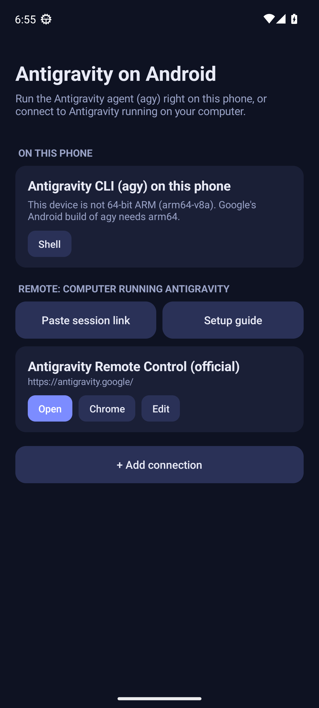
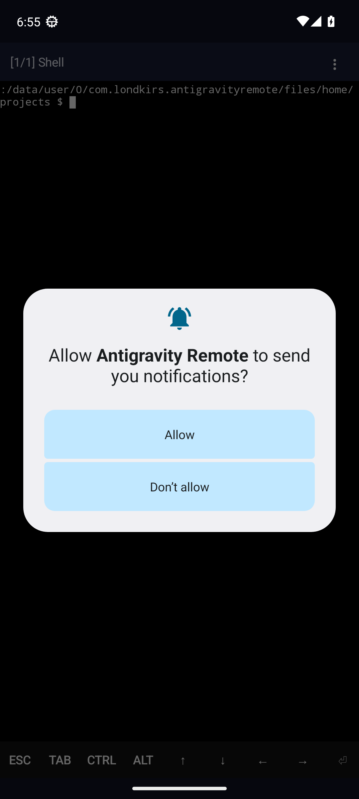

# UI test — antigravity-remote (scenario)

**Result:** ❌ FAILED  
**Package:** `com.londkirs.antigravityremote`  
**Device:** sdk_gphone64_x86_64 · Android 13 (API 33) · 1080x2400  
**Duration:** 44.5s

## Steps

| # | Action | Detail | Result | Time |
|---|---|---|---|---|
| 1 | launch | clear_data=True | ✅ | 3.78s |
| 2 | tap | text='Wait' | ⚠️ — element not found within 10s: text='Wait' | 10.41s |
| 3 | wait_for | text='Antigravity on Android' | ✅ | 2.05s |
| 4 | screenshot | name='home' | ✅ | 2.3s |
| 5 | tap | text='Shell' | ✅ | 3.27s |
| 6 | wait | seconds=4 | ✅ | 4.04s |
| 7 | tap | text='Wait' | ⚠️ — element not found within 10s: text='Wait' | 10.03s |
| 8 | screenshot | name='terminal-opened' | ✅ | 2.2s |
| 9 | assert_foreground |  | ❌ — foreground app is com.google.android.permissioncontroller, expected com.londkirs.antigravityremote | 0.03s |

## Screenshots

**001-home.png**

**002-terminal-opened.png**

**003-step9-assert_foreground-FAILED.png**

**004-final.png**

