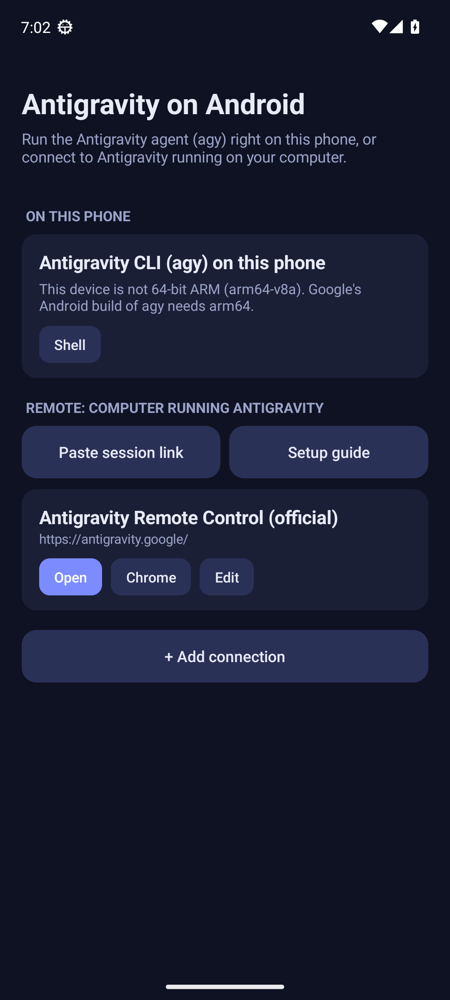
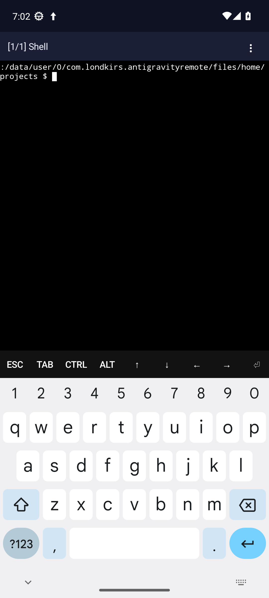
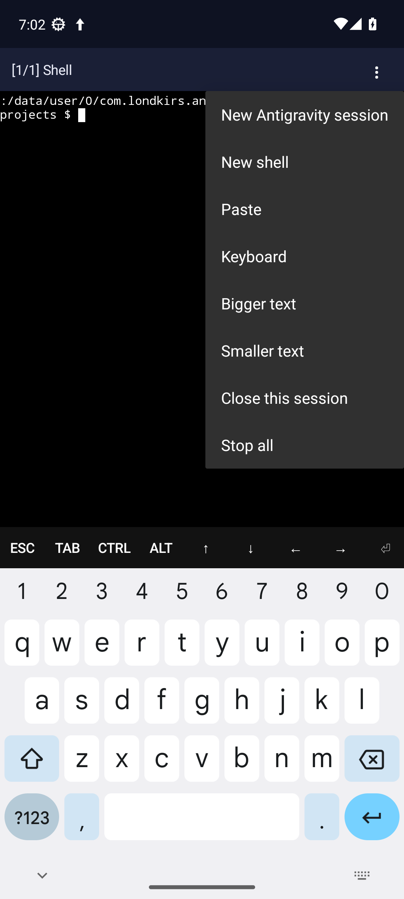
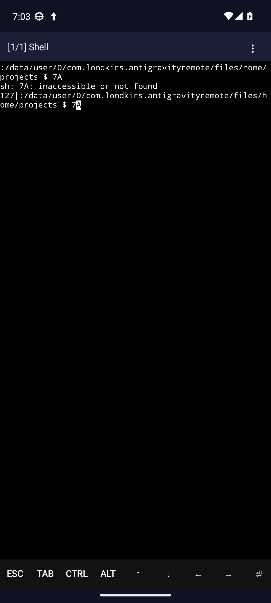

# UI test — antigravity-remote (explore)

**Result:** ✅ PASSED  
**Package:** `com.londkirs.antigravityremote`  
**Device:** sdk_gphone64_x86_64 · Android 13 (API 33) · 1080x2400  
**Duration:** 81.2s

## Steps

| # | Action | Detail | Result | Time |
|---|---|---|---|---|
| 1 | explore-tap | Shell | ✅ | 1.36s |
| 2 | explore-tap | ⋮ / More | ✅ | 1.29s |
| 3 | explore-tap | ESC | ✅ | 1.25s |
| 4 | explore-tap | TAB | ✅ | 1.25s |
| 5 | explore-tap | CTRL | ✅ | 1.25s |
| 6 | explore-tap | ALT | ✅ | 1.25s |
| 7 | explore-tap | ↑ | ✅ | 1.25s |
| 8 | explore-tap | ↓ | ✅ | 1.25s |
| 9 | explore-tap | ← | ✅ | 1.25s |
| 10 | explore-tap | → | ✅ | 1.25s |
| 11 | explore-tap | ⏎ | ✅ | 1.25s |
| 12 | explore-tap | ESC | ✅ | 1.25s |
| 13 | explore-tap | TAB | ✅ | 1.25s |
| 14 | explore-tap | CTRL | ✅ | 1.25s |
| 15 | explore-tap | ALT | ✅ | 1.25s |
| 16 | explore-tap | ↑ | ✅ | 1.25s |
| 17 | explore-tap | ↓ | ✅ | 1.25s |
| 18 | explore-tap | ← | ✅ | 1.25s |

## Notes

- explore: 3 distinct screens, 18 elements tapped, 0 relaunches, 73s

## Screenshots

**001-screen-1.png**

**002-screen-2.png**

**003-screen-3.png**

**004-final.png**

