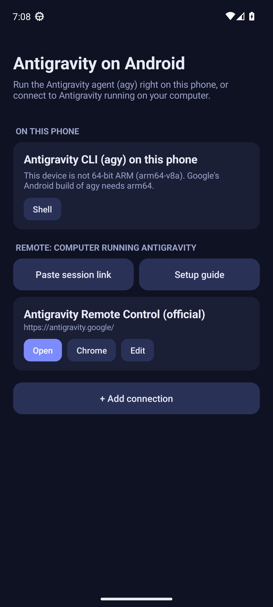
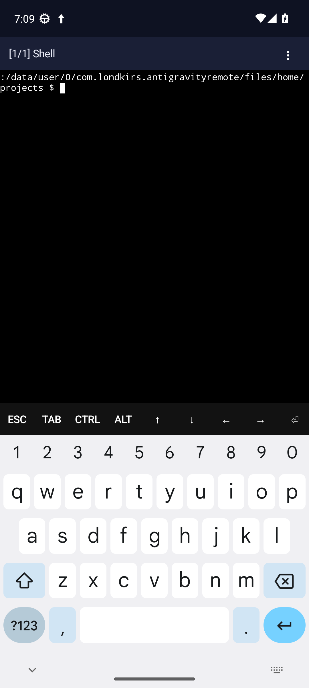
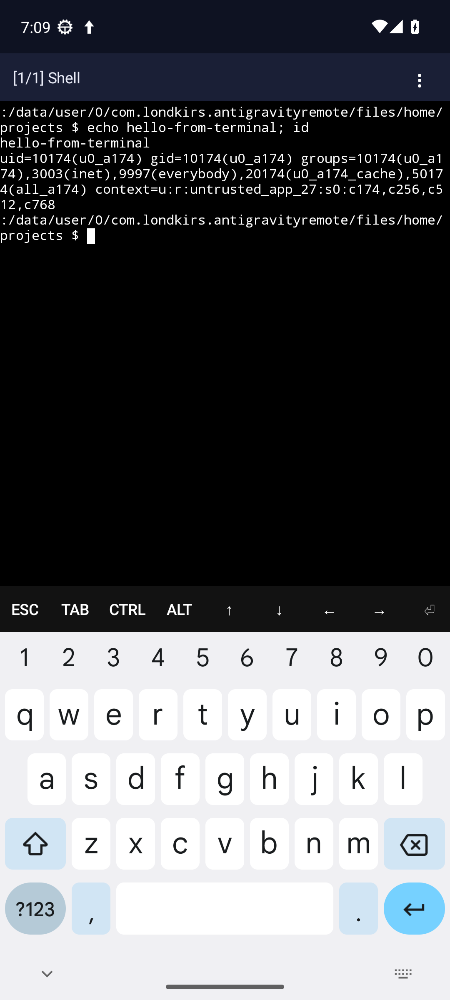

# UI test — antigravity-remote (scenario)

**Result:** ❌ FAILED  
**Package:** `com.londkirs.antigravityremote`  
**Device:** sdk_gphone64_x86_64 · Android 13 (API 33) · 1080x2400  
**Duration:** 52.2s

## Steps

| # | Action | Detail | Result | Time |
|---|---|---|---|---|
| 1 | launch | clear_data=True | ✅ | 3.88s |
| 2 | shell | cmd='pm grant com.londkirs.antigravityremote android.permission.POST_NOTIFICATIONS', ignor | ✅ | 0.19s |
| 3 | tap | regex='^Allow$' | ⚠️ — element not found within 3s: regex='^Allow$' | 4.93s |
| 4 | wait_for | text='Antigravity on Android' | ✅ | 2.07s |
| 5 | screenshot | name='home' | ✅ | 2.52s |
| 6 | tap | text='Shell' | ✅ | 3.46s |
| 7 | wait | seconds=4 | ✅ | 4.04s |
| 8 | tap | regex='^Allow$' | ⚠️ — element not found within 3s: regex='^Allow$' | 4.86s |
| 9 | screenshot | name='terminal-opened' | ✅ | 2.14s |
| 10 | assert_foreground |  | ✅ | 0.06s |
| 11 | type | value='echo hello-from-terminal; id', enter=True | ✅ | 0.75s |
| 12 | wait | seconds=2 | ✅ | 2.03s |
| 13 | screenshot | name='terminal-command' | ✅ | 2.12s |
| 14 | assert_foreground |  | ✅ | 0.04s |
| 15 | wait_for | text='hello-from-terminal' | ❌ — element not found within 10s: text='hello-from-terminal' | 12.46s |

## Screenshots

**001-home.png**

**002-terminal-opened.png**

**003-terminal-command.png**

**004-step15-wait_for-FAILED.png**

**005-final.png**

