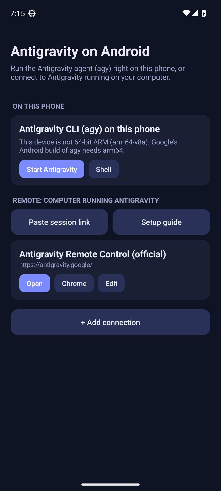
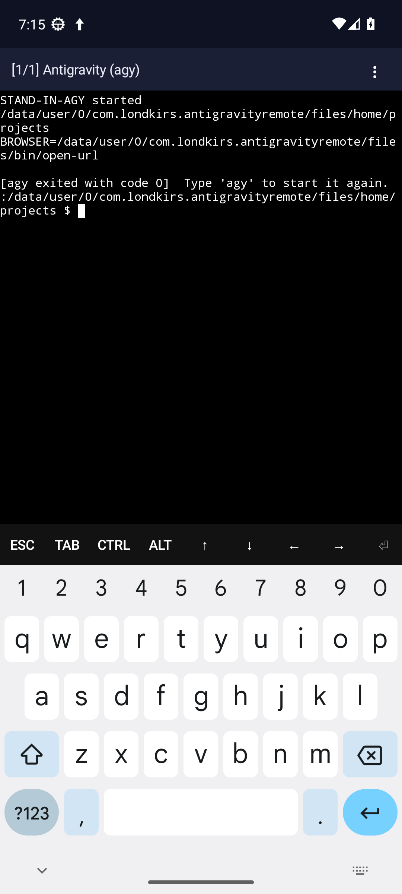

# UI test — antigravity-remote (scenario)

**Result:** ✅ PASSED  
**Package:** `com.londkirs.antigravityremote`  
**Device:** sdk_gphone64_x86_64 · Android 13 (API 33) · 1080x2400  
**Duration:** 50.3s

## Steps

| # | Action | Detail | Result | Time |
|---|---|---|---|---|
| 1 | launch | clear_data=True | ✅ | 5.69s |
| 2 | shell | cmd='pm grant com.londkirs.antigravityremote android.permission.POST_NOTIFICATIONS', ignor | ✅ | 0.13s |
| 3 | tap | regex='^Allow$' | ⚠️ — element not found within 3s: regex='^Allow$' | 5.45s |
| 4 | shell | cmd='run-as com.londkirs.antigravityremote sh -c \'mkdir -p files/bin && echo "#!/system/b | ✅ | 0.17s |
| 5 | back |  | ✅ | 1.39s |
| 6 | launch |  | ✅ | 3.75s |
| 7 | shell | cmd='pm grant com.londkirs.antigravityremote android.permission.POST_NOTIFICATIONS', ignor | ✅ | 0.17s |
| 8 | tap | regex='^Allow$' | ⚠️ — element not found within 3s: regex='^Allow$' | 5.63s |
| 9 | wait_for | text='Start Antigravity' | ✅ | 2.48s |
| 10 | screenshot | name='home-installed' | ✅ | 2.79s |
| 11 | tap | text='Start Antigravity' | ✅ | 3.81s |
| 12 | wait | seconds=5 | ✅ | 5.2s |
| 13 | tap | regex='^Allow$' | ⚠️ — element not found within 3s: regex='^Allow$' | 5.81s |
| 14 | screenshot | name='agy-session' | ✅ | 2.78s |
| 15 | assert_foreground |  | ✅ | 0.2s |

## Screenshots

**001-home-installed.png**

**002-agy-session.png**

**003-final.png**

