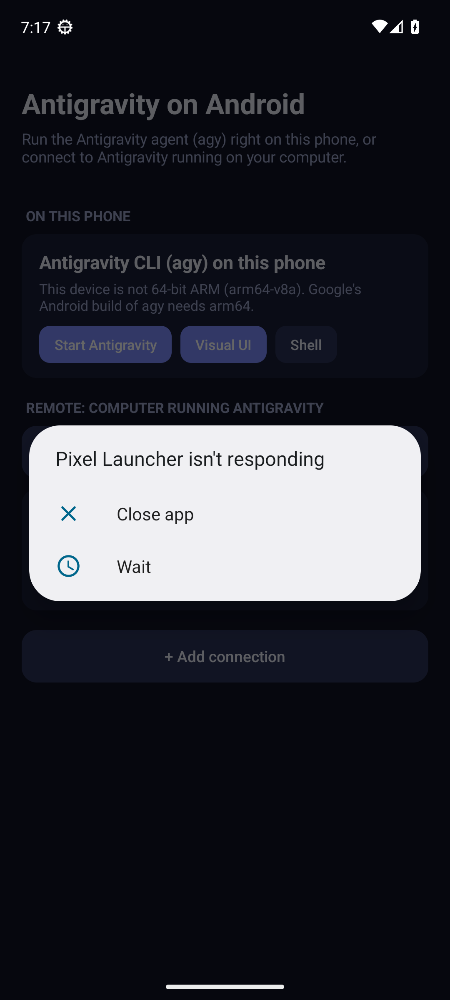

# UI test — antigravity-remote (scenario)

**Result:** ❌ FAILED  
**Package:** `com.londkirs.antigravityremote`  
**Device:** sdk_gphone64_x86_64 · Android 13 (API 33) · 1080x2400  
**Duration:** 52.9s

## Steps

| # | Action | Detail | Result | Time |
|---|---|---|---|---|
| 1 | launch | clear_data=True | ✅ | 7.04s |
| 2 | shell | cmd='pm grant com.londkirs.antigravityremote android.permission.POST_NOTIFICATIONS', ignor | ✅ | 0.1s |
| 3 | tap | regex='^Allow$' | ⚠️ — element not found within 3s: regex='^Allow$' | 6.02s |
| 4 | shell | cmd='run-as com.londkirs.antigravityremote sh -c \'mkdir -p files/bin && echo "#!/system/b | ✅ | 0.16s |
| 5 | back |  | ✅ | 1.02s |
| 6 | launch |  | ✅ | 4.47s |
| 7 | shell | cmd='pm grant com.londkirs.antigravityremote android.permission.POST_NOTIFICATIONS', ignor | ✅ | 0.23s |
| 8 | tap | regex='^Allow$' | ⚠️ — element not found within 3s: regex='^Allow$' | 5.94s |
| 9 | wait_for | text='Start Antigravity' | ❌ — element not found within 20s: text='Start Antigravity' | 21.12s |

## Screenshots

**001-step9-wait_for-FAILED.png**

**002-final.png**

