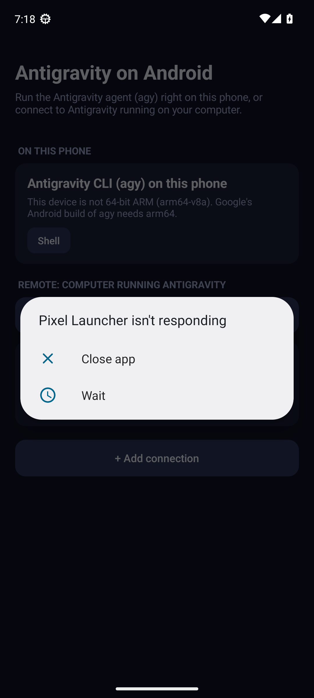

# UI test — antigravity-remote (scenario)

**Result:** ❌ FAILED  
**Package:** `com.londkirs.antigravityremote`  
**Device:** sdk_gphone64_x86_64 · Android 13 (API 33) · 1080x2400  
**Duration:** 35.7s

## Steps

| # | Action | Detail | Result | Time |
|---|---|---|---|---|
| 1 | launch | clear_data=True | ✅ | 3.55s |
| 2 | shell | cmd='pm grant com.londkirs.antigravityremote android.permission.POST_NOTIFICATIONS', ignor | ✅ | 0.12s |
| 3 | tap | regex='^Allow$' | ⚠️ — element not found within 3s: regex='^Allow$' | 5.03s |
| 4 | wait_for | text='Antigravity on Android' | ❌ — element not found within 20s: text='Antigravity on Android' | 21.9s |

## Screenshots

**001-step4-wait_for-FAILED.png**

**002-final.png**

