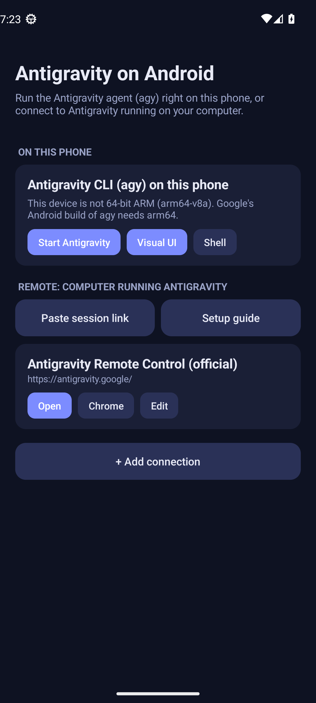
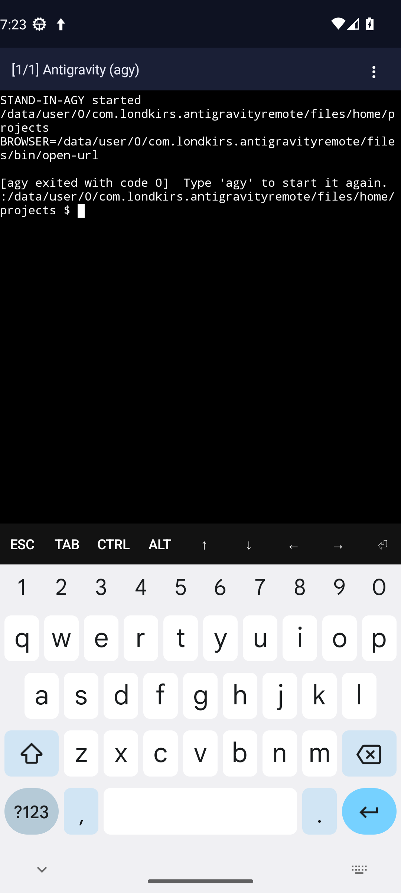
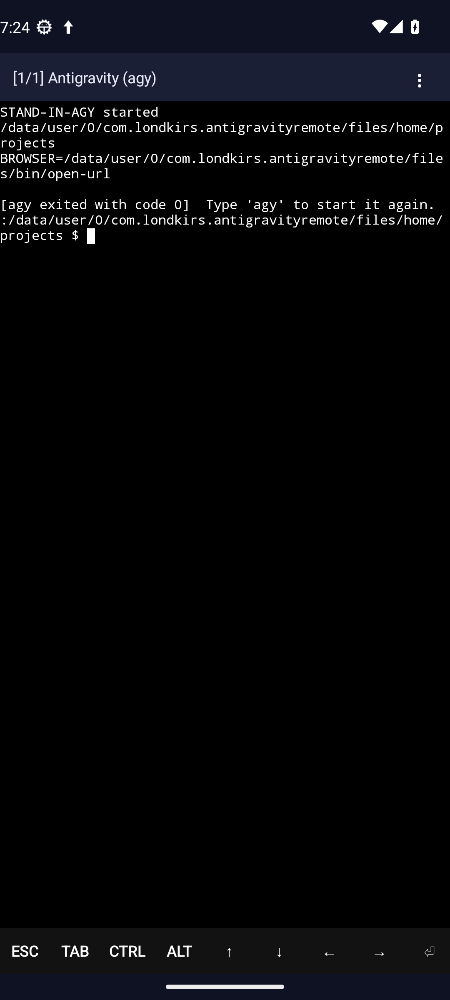

# UI test — antigravity-remote (scenario)

**Result:** ❌ FAILED  
**Package:** `com.londkirs.antigravityremote`  
**Device:** sdk_gphone64_x86_64 · Android 13 (API 33) · 1080x2400  
**Duration:** 86.8s

## Steps

| # | Action | Detail | Result | Time |
|---|---|---|---|---|
| 1 | launch | clear_data=True | ✅ | 6.78s |
| 2 | shell | cmd='pm grant com.londkirs.antigravityremote android.permission.POST_NOTIFICATIONS', ignor | ✅ | 0.46s |
| 3 | tap | regex='^Allow$' | ⚠️ — element not found within 3s: regex='^Allow$' | 3.24s |
| 4 | tap | regex='^Wait$' | ✅ | 3.49s |
| 5 | shell | cmd='run-as com.londkirs.antigravityremote sh -c \'mkdir -p files/bin && echo "#!/system/b | ✅ | 0.24s |
| 6 | back |  | ✅ | 1.34s |
| 7 | launch |  | ✅ | 4.14s |
| 8 | shell | cmd='pm grant com.londkirs.antigravityremote android.permission.POST_NOTIFICATIONS', ignor | ✅ | 0.29s |
| 9 | tap | regex='^Allow$' | ⚠️ — element not found within 3s: regex='^Allow$' | 5.74s |
| 10 | tap | regex='^Wait$' | ⚠️ — element not found within 3s: regex='^Wait$' | 5.35s |
| 11 | wait_for | text='Start Antigravity' | ✅ | 2.65s |
| 12 | screenshot | name='home-installed' | ✅ | 3.19s |
| 13 | tap | text='Start Antigravity' | ✅ | 3.89s |
| 14 | wait | seconds=5 | ✅ | 5.25s |
| 15 | tap | regex='^Allow$' | ⚠️ — element not found within 3s: regex='^Allow$' | 5.61s |
| 16 | tap | regex='^Wait$' | ⚠️ — element not found within 3s: regex='^Wait$' | 5.24s |
| 17 | screenshot | name='agy-session' | ✅ | 4.41s |
| 18 | assert_foreground |  | ✅ | 0.37s |
| 19 | back |  | ✅ | 1.14s |
| 20 | wait_for | text='Visual UI' | ❌ — element not found within 15s: text='Visual UI' | 17.34s |

## Screenshots

**001-home-installed.png**

**002-agy-session.png**

**003-step20-wait_for-FAILED.png**

**004-final.png**

