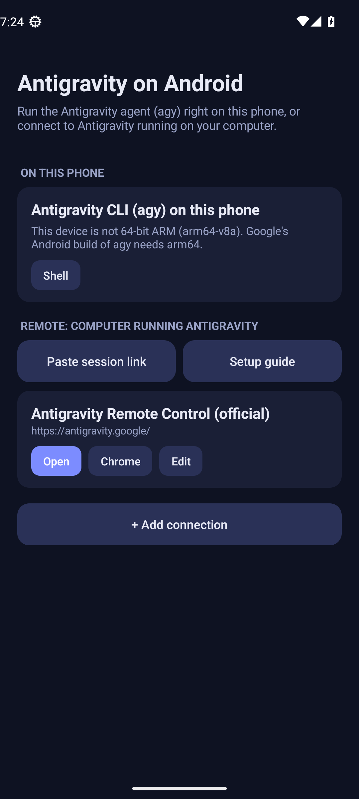
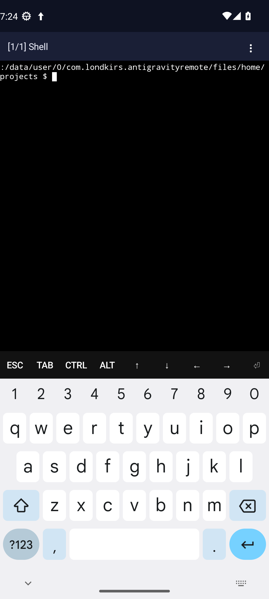
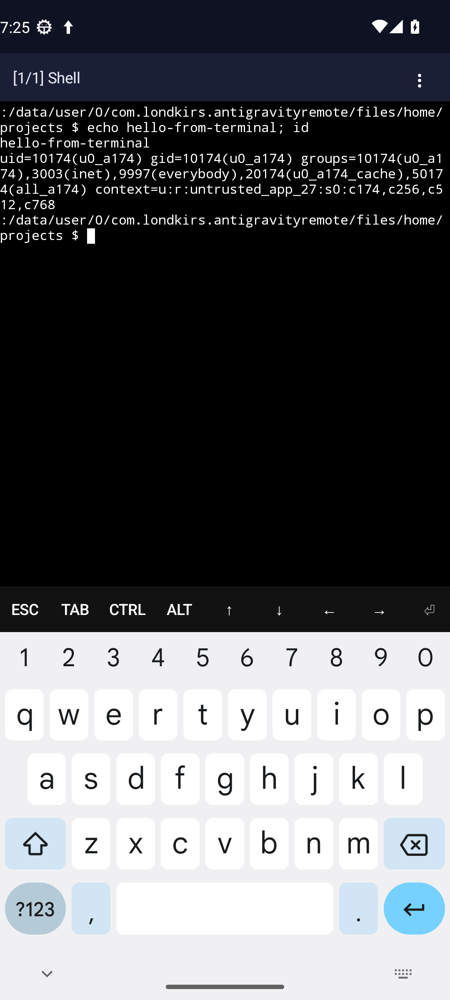

# UI test — antigravity-remote (scenario)

**Result:** ✅ PASSED  
**Package:** `com.londkirs.antigravityremote`  
**Device:** sdk_gphone64_x86_64 · Android 13 (API 33) · 1080x2400  
**Duration:** 50.6s

## Steps

| # | Action | Detail | Result | Time |
|---|---|---|---|---|
| 1 | launch | clear_data=True | ✅ | 4.34s |
| 2 | shell | cmd='pm grant com.londkirs.antigravityremote android.permission.POST_NOTIFICATIONS', ignor | ✅ | 0.33s |
| 3 | tap | regex='^Allow$' | ⚠️ — element not found within 3s: regex='^Allow$' | 5.01s |
| 4 | tap | regex='^Wait$' | ⚠️ — element not found within 3s: regex='^Wait$' | 5.4s |
| 5 | wait_for | text='Antigravity on Android' | ✅ | 2.14s |
| 6 | screenshot | name='home' | ✅ | 2.91s |
| 7 | tap | text='Shell' | ✅ | 3.53s |
| 8 | wait | seconds=4 | ✅ | 4.05s |
| 9 | tap | regex='^Allow$' | ⚠️ — element not found within 3s: regex='^Allow$' | 4.97s |
| 10 | tap | regex='^Wait$' | ⚠️ — element not found within 3s: regex='^Wait$' | 5.0s |
| 11 | screenshot | name='terminal-opened' | ✅ | 2.68s |
| 12 | assert_foreground |  | ✅ | 0.15s |
| 13 | type | value='echo hello-from-terminal; id', enter=True | ✅ | 1.44s |
| 14 | wait | seconds=2 | ✅ | 2.04s |
| 15 | screenshot | name='terminal-command' | ✅ | 2.29s |
| 16 | assert_foreground |  | ✅ | 0.06s |

## Screenshots

**001-home.png**

**002-terminal-opened.png**

**003-terminal-command.png**

**004-final.png**

