# UI test — antigravity-remote (explore)

**Result:** ✅ PASSED  
**Package:** `com.londkirs.antigravityremote`  
**Device:** sdk_gphone64_x86_64 · Android 13 (API 33) · 1080x2400  
**Duration:** 223.2s

## Steps

| # | Action | Detail | Result | Time |
|---|---|---|---|---|
| 1 | explore-tap | Connect to a computer instead | ✅ | 1.62s |
| 2 | explore-tap | Back | ✅ | 1.51s |
| 3 | explore-tap | Connect to a computer | ✅ | 1.59s |
| 4 | explore-tap | Paste a session link | ✅ | 1.37s |
| 5 | explore-tap | How to enable it on the computer | ✅ | 1.34s |
| 6 | explore-tap | Copy | ✅ | 1.56s |
| 7 | explore-tap | Edit | ✅ | 1.61s |
| 8 | explore-tap | Antigravity Remote Control (official) | ✅ | 1.38s |
| 9 | explore-tap | Antigravity Remote Control (official) | ✅ | 1.9s |
| 10 | explore-tap | https://antigravity.google/ | ✅ | 2.26s |
| 11 | explore-tap | Cancel | ✅ | 1.94s |
| 12 | explore-tap | Open in app | ✅ | 2.52s |
| 13 | explore-tap | Back | ✅ | 2.27s |
| 14 | explore-tap | In Chrome | ✅ | 2.28s |
| 15 | explore | left app to com.android.chrome | ✅ | 0s |
| 16 | explore-tap | New connection | ✅ | 1.42s |
| 17 | explore-tap | Name | ✅ | 1.59s |
| 18 | explore-tap | Name | ✅ | 1.36s |
| 19 | explore-tap | https://… | ✅ | 1.36s |
| 20 | explore-tap | Cancel | ✅ | 1.42s |
| 21 | explore-tap | LinearLayout | ✅ | 1.68s |
| 22 | explore-tap | Back | ✅ | 3.6s |
| 23 | explore-tap | LinearLayout | ✅ | 1.52s |
| 24 | explore-tap | Connect to a computer instead | ✅ | 1.3s |
| 25 | explore-tap | Connect to a computer | ✅ | 1.28s |
| 26 | explore-tap | Install | ✅ | 1.45s |
| 27 | explore-tap | Connect to a computer instead | ✅ | 1.51s |
| 28 | explore-tap | Connect to a computer instead | ✅ | 1.32s |
| 29 | explore-tap | Connect to a computer | ✅ | 1.28s |
| 30 | explore-tap | LinearLayout | ✅ | 1.29s |
| 31 | explore-tap | Connect to a computer instead | ✅ | 1.28s |
| 32 | explore-tap | Connect to a computer | ✅ | 1.28s |

## Notes

- explore: 11 distinct screens, 31 elements tapped, 0 relaunches, 215s

## Screenshots

**001-screen-1.png**

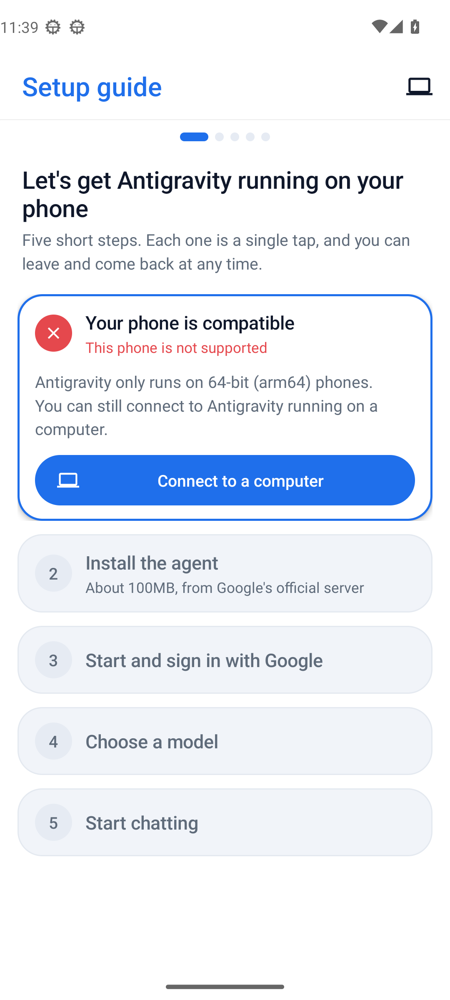

**002-screen-2.png**

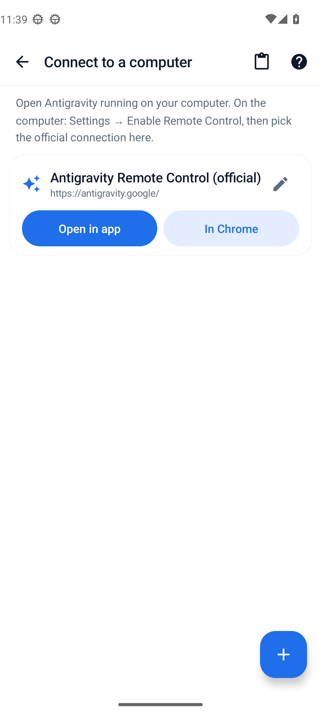

**003-screen-3.png**

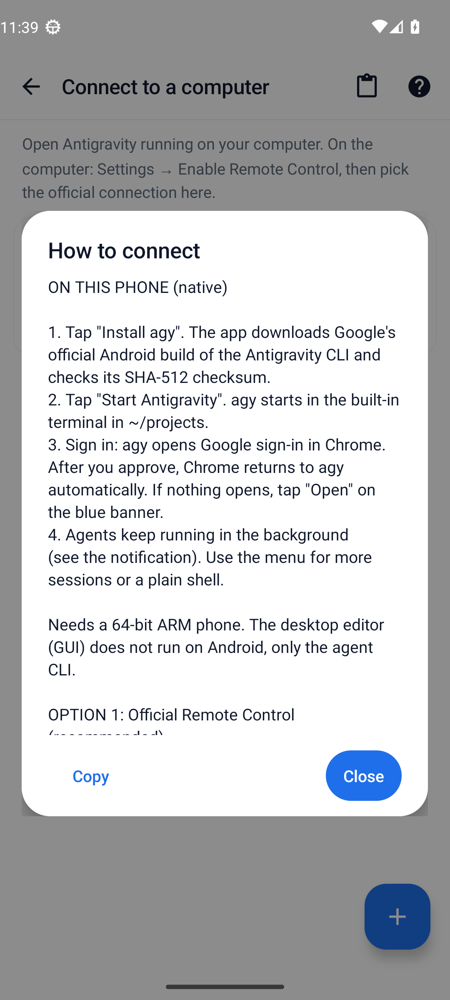

**004-screen-4.png**

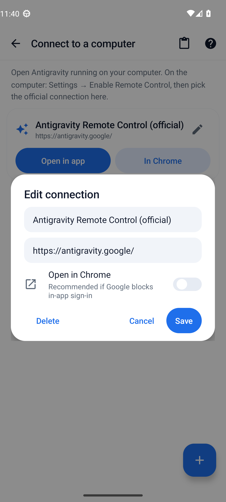

**005-screen-5.png**

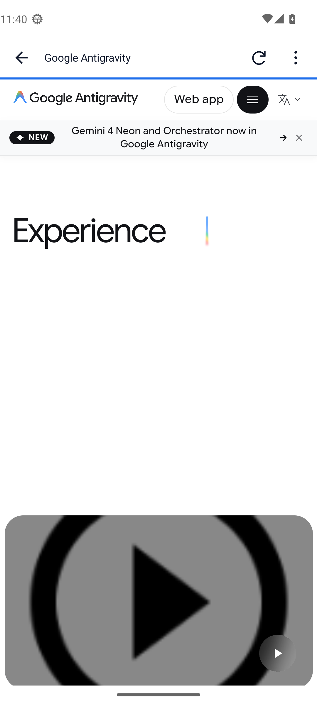

**006-left-app-to-com-android-chrome.png**

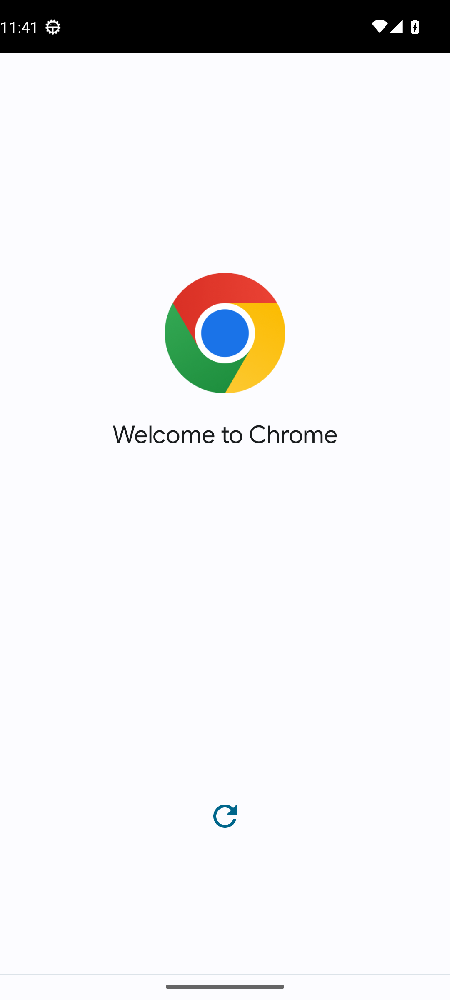

**007-screen-6.png**

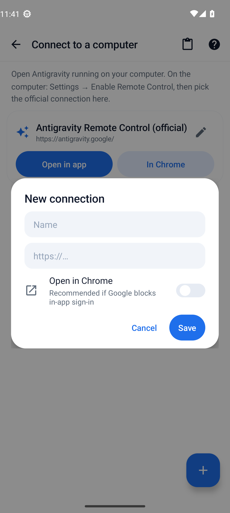

**008-screen-7.png**

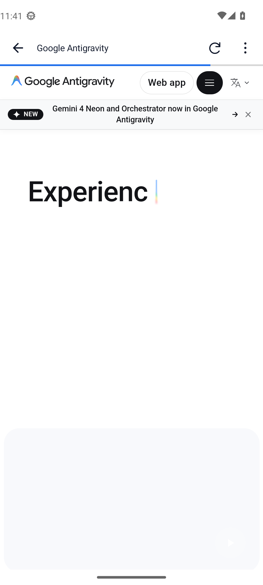

**009-screen-8.png**

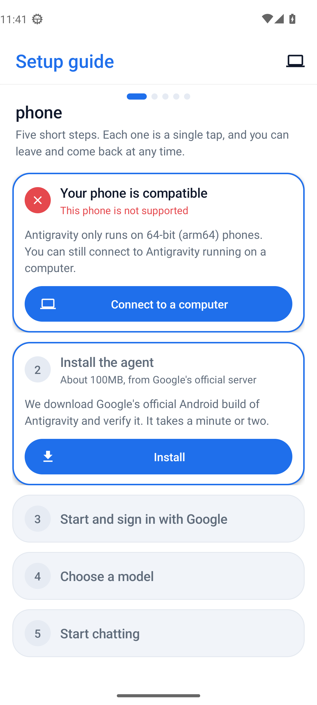

**010-screen-9.png**

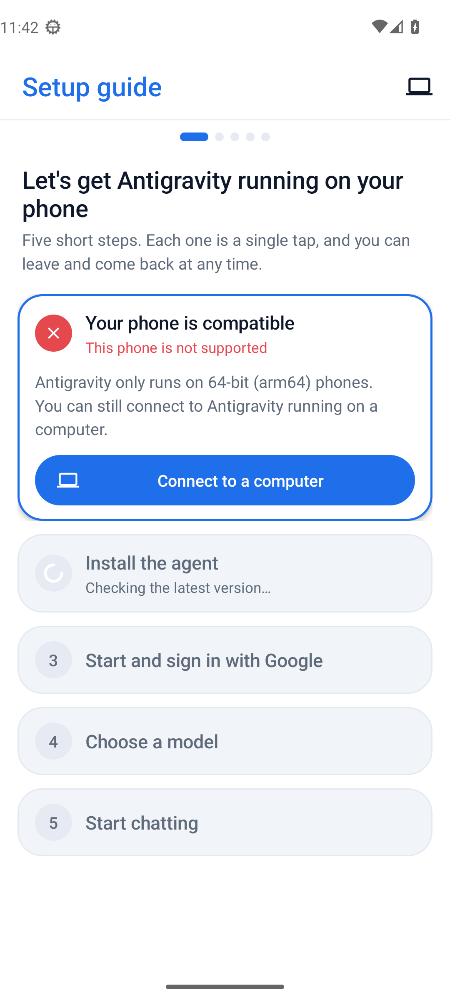

**011-screen-10.png**

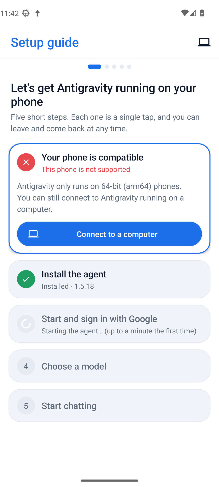

**012-screen-11.png**

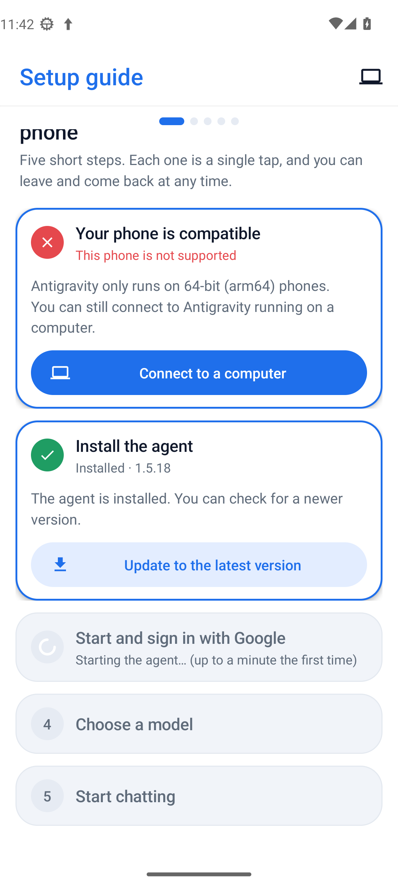

**013-final.png**

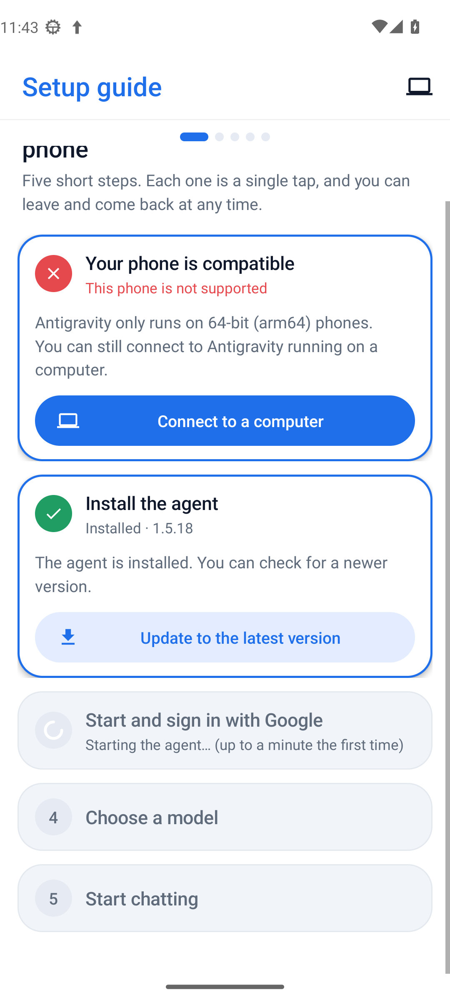
