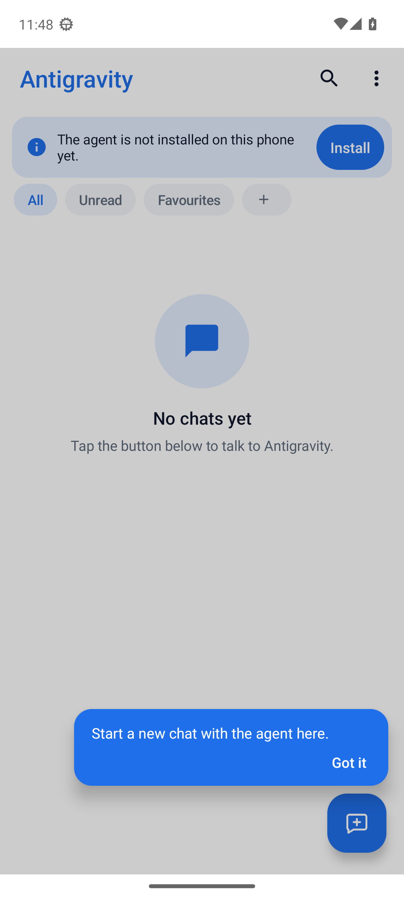
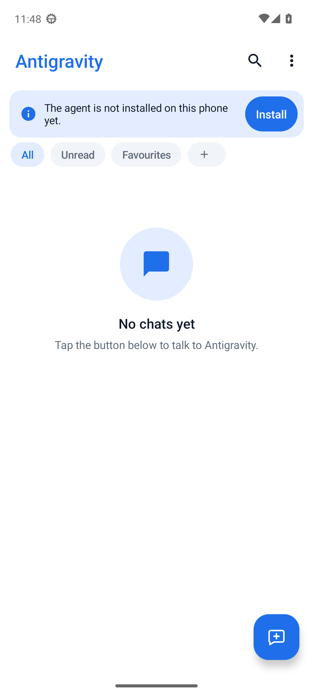
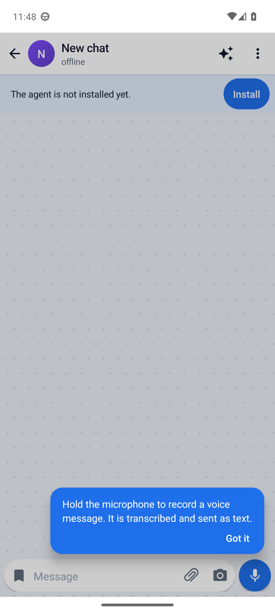
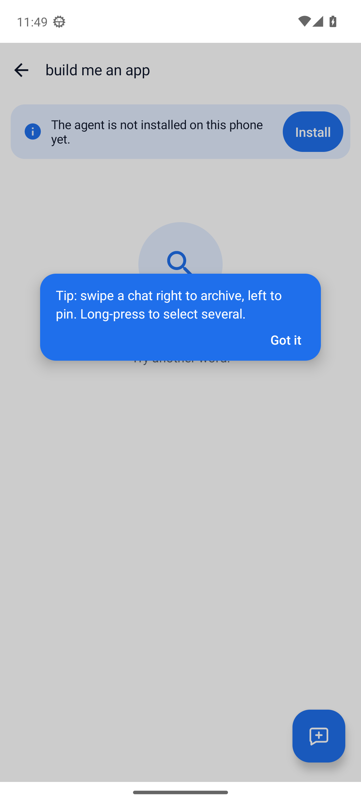
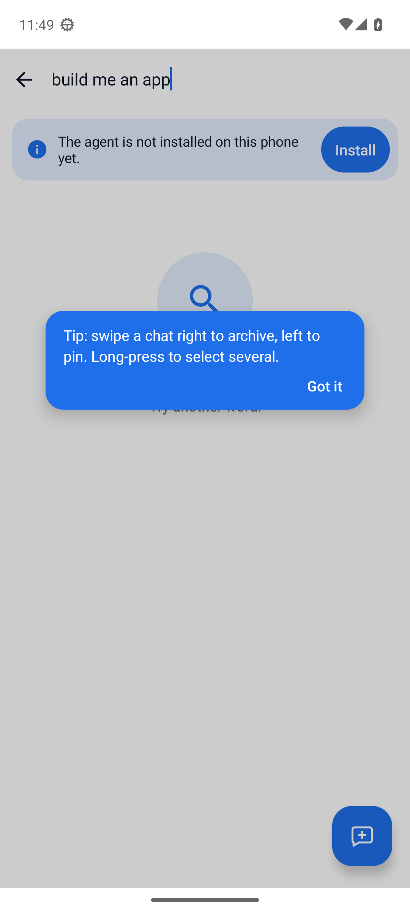
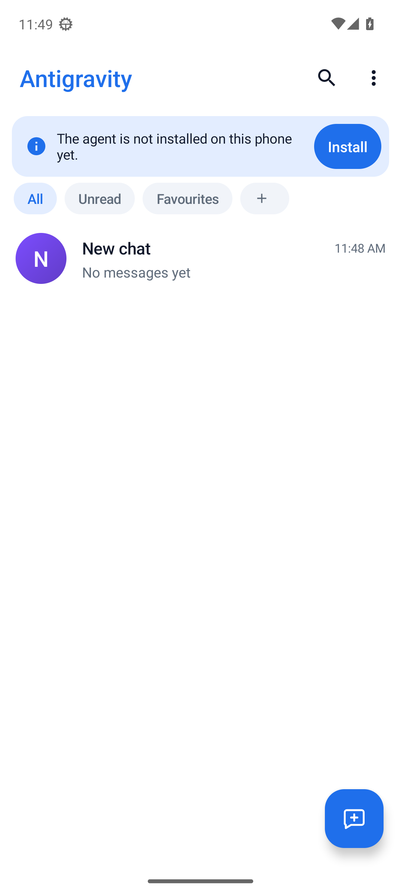
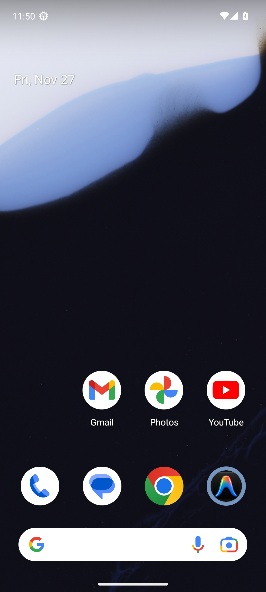
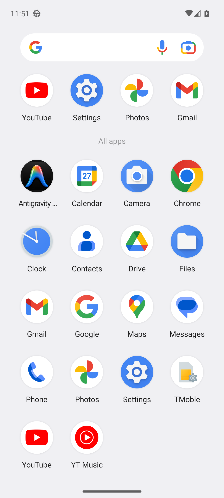
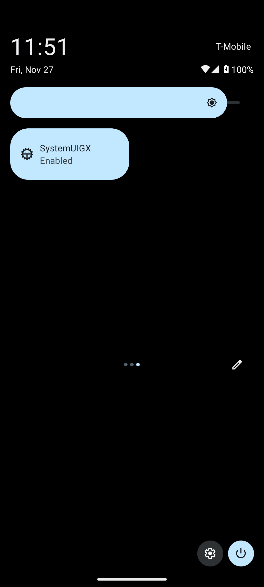
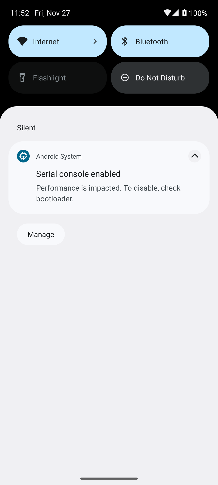

# UI test — antigravity-remote (scenario)

**Result:** ❌ FAILED  
**Package:** `com.londkirs.antigravityremote`  
**Device:** sdk_gphone64_x86_64 · Android 13 (API 33) · 1080x2400  
**Duration:** 276.7s

## Steps

| # | Action | Detail | Result | Time |
|---|---|---|---|---|
| 1 | launch | clear_data=True | ✅ | 5.19s |
| 2 | wait_for | text='Setup guide' | ✅ | 2.98s |
| 3 | tap | desc='Connect to a computer instead' | ✅ | 3.5s |
| 4 | wait | seconds=1 | ✅ | 1.33s |
| 5 | launch |  | ✅ | 4.44s |
| 6 | wait | seconds=2 | ✅ | 2.05s |
| 7 | screenshot | name='01-home-tip' | ✅ | 3.84s |
| 8 | tap | text='Got it' | ✅ | 3.4s |
| 9 | screenshot | name='02-home-empty' | ✅ | 3.07s |
| 10 | tap | desc='New chat' | ✅ | 3.5s |
| 11 | wait | seconds=3 | ✅ | 3.27s |
| 12 | screenshot | name='03-chat-empty' | ✅ | 3.3s |
| 13 | tap | text='Got it' | ✅ | 3.32s |
| 14 | type | value='Hello agent, build me an app', hide_keyboard=True | ✅ | 5.37s |
| 15 | screenshot | name='04-chat-typed' | ✅ | 3.23s |
| 16 | tap | desc='Attach' | ❌ — element not found within 10s: desc='Attach' | 11.63s |
| 17 | wait | seconds=1 | ✅ | 1.35s |
| 18 | screenshot | name='05-attach-sheet' | ✅ | 2.77s |
| 19 | back |  | ✅ | 1.1s |
| 20 | tap | desc='More' | ✅ | 3.59s |
| 21 | wait | seconds=1 | ✅ | 1.22s |
| 22 | screenshot | name='06-chat-menu' | ✅ | 2.81s |
| 23 | tap | text='Chat info' | ❌ — element not found within 10s: text='Chat info' | 10.66s |
| 24 | wait | seconds=1 | ✅ | 1.2s |
| 25 | screenshot | name='07-chat-info' | ✅ | 2.73s |
| 26 | back |  | ✅ | 1.79s |
| 27 | back |  | ✅ | 1.32s |
| 28 | wait | seconds=1 | ✅ | 1.4s |
| 29 | screenshot | name='08-home-draft' | ✅ | 4.04s |
| 30 | long_press | text='New chat' | ❌ — element not found within 10s: text='New chat' | 10.52s |
| 31 | screenshot | name='09-home-selection' | ✅ | 3.22s |
| 32 | back |  | ✅ | 0.91s |
| 33 | tap | desc='More' | ❌ — element not found within 10s: desc='More' | 10.03s |
| 34 | screenshot | name='10-home-menu' | ✅ | 2.84s |
| 35 | tap | text='Settings' | ❌ — element not found within 10s: text='Settings' | 10.13s |
| 36 | wait | seconds=1 | ✅ | 1.06s |
| 37 | screenshot | name='11-settings' | ✅ | 2.85s |
| 38 | scroll_to | text='App version' | ❌ — not found after scrolling: text='App version' | 28.07s |
| 39 | screenshot | name='12-settings-advanced' | ✅ | 2.32s |
| 40 | scroll_to | text='Theme' | ❌ — not found after scrolling: text='Theme' | 28.0s |
| 41 | tap | text='Theme' | ❌ — element not found within 10s: text='Theme' | 10.12s |
| 42 | wait | seconds=1 | ✅ | 1.06s |
| 43 | screenshot | name='13-theme-sheet' | ✅ | 2.33s |
| 44 | tap | text='Dark' | ❌ — element not found within 10s: text='Dark' | 10.08s |
| 45 | wait | seconds=2 | ✅ | 2.07s |
| 46 | screenshot | name='14-settings-dark' | ✅ | 2.31s |
| 47 | back |  | ✅ | 0.9s |
| 48 | wait | seconds=1 | ✅ | 1.06s |
| 49 | screenshot | name='15-home-dark' | ✅ | 2.31s |
| 50 | tap | text='New chat' | ❌ — element not found within 10s: text='New chat' | 10.2s |
| 51 | wait | seconds=2 | ✅ | 2.06s |
| 52 | screenshot | name='16-chat-dark' | ✅ | 2.32s |

## Screenshots

**001-01-home-tip.png**

**002-02-home-empty.png**

**003-03-chat-empty.png**

**004-04-chat-typed.png**

**005-step16-tap-FAILED.png**

**006-05-attach-sheet.png**

**007-06-chat-menu.png**

**008-step23-tap-FAILED.png**

**009-07-chat-info.png**

**010-08-home-draft.png**

**011-step30-long_press-FAILED.png**

**012-09-home-selection.png**

**013-step33-tap-FAILED.png**

**014-10-home-menu.png**

**015-step35-tap-FAILED.png**

**016-11-settings.png**

**017-step38-scroll_to-FAILED.png**

**018-12-settings-advanced.png**

**019-step40-scroll_to-FAILED.png**

**020-step41-tap-FAILED.png**

**021-13-theme-sheet.png**

**022-step44-tap-FAILED.png**

**023-14-settings-dark.png**

**024-15-home-dark.png**

**025-step50-tap-FAILED.png**

**026-16-chat-dark.png**

