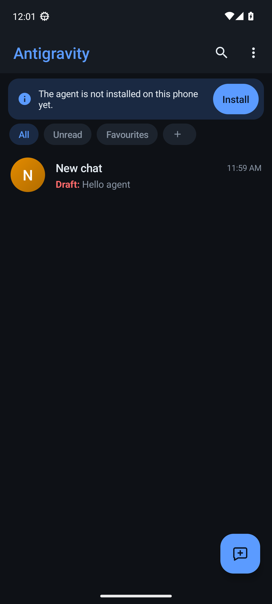
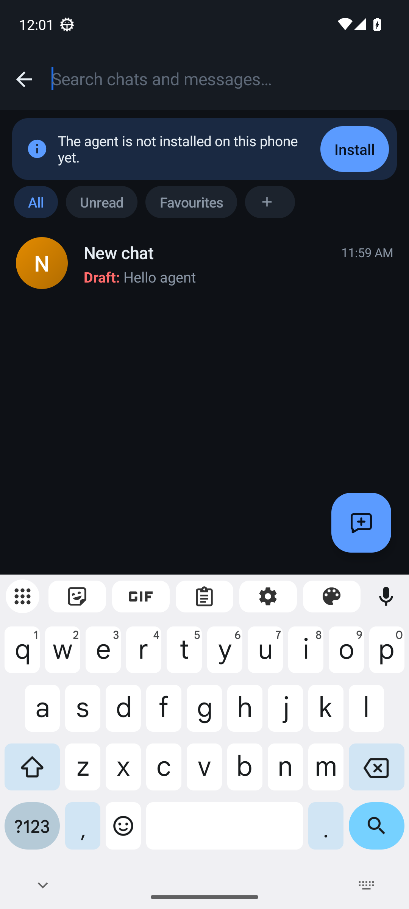
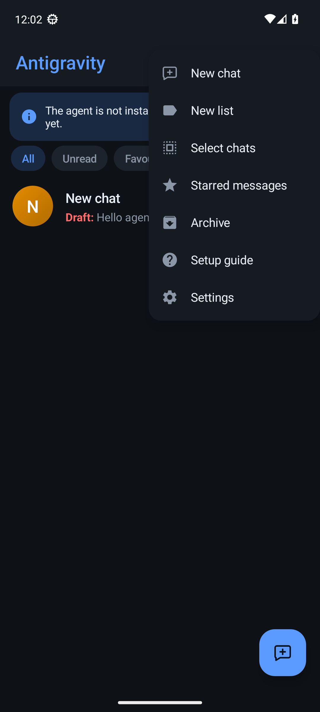
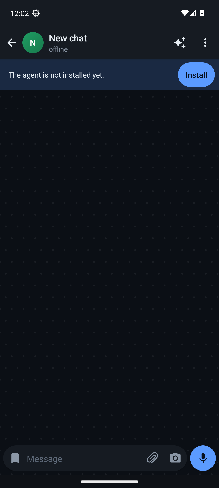
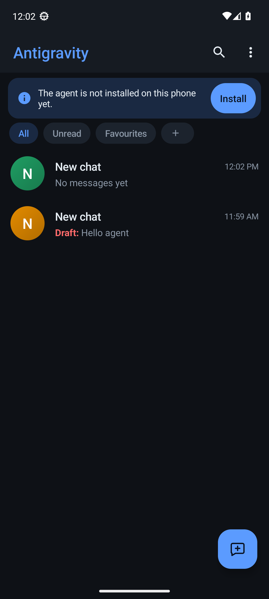
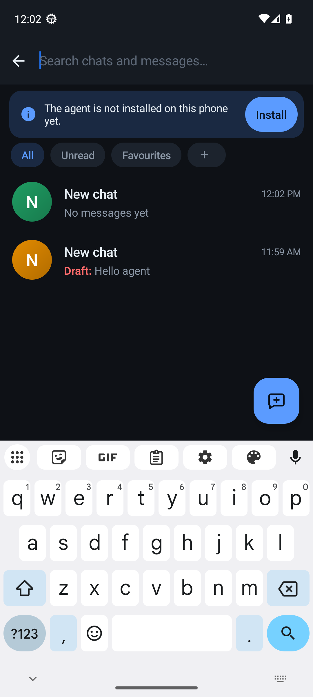
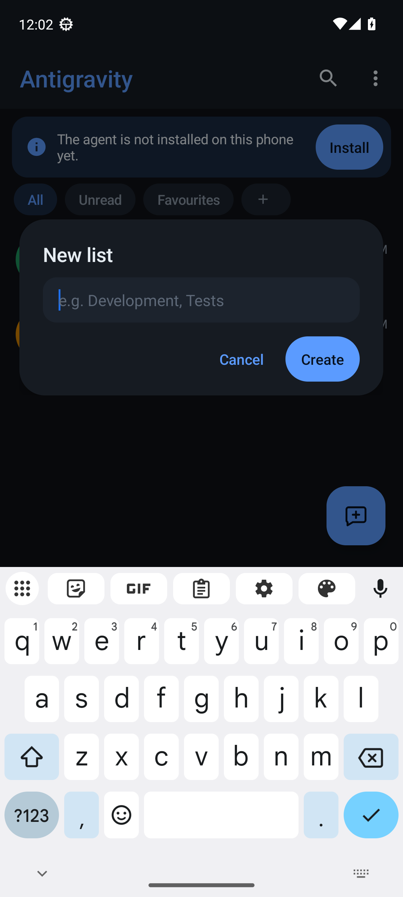
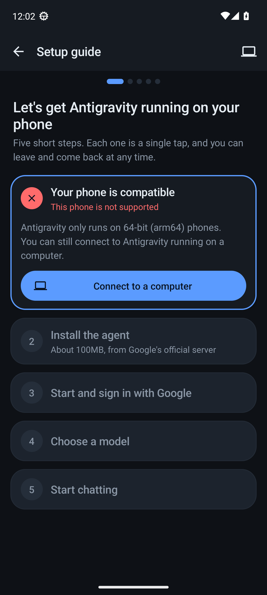
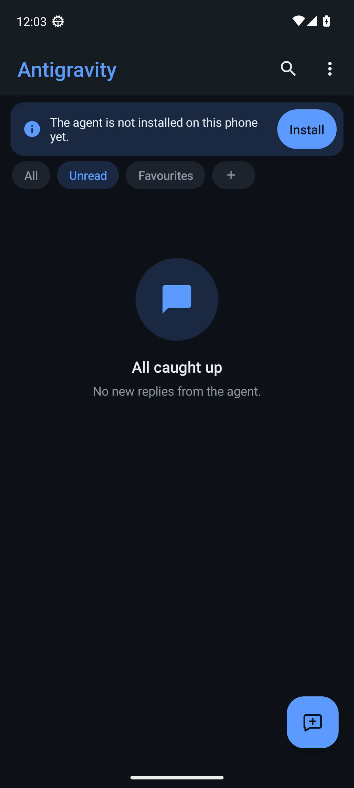
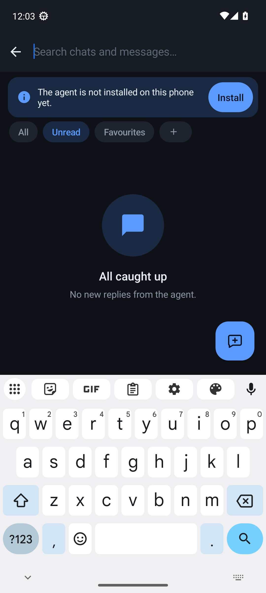

# UI test — antigravity-remote (explore)

**Result:** ✅ PASSED  
**Package:** `com.londkirs.antigravityremote`  
**Device:** sdk_gphone64_x86_64 · Android 13 (API 33) · 1080x2400  
**Duration:** 96.8s

## Steps

| # | Action | Detail | Result | Time |
|---|---|---|---|---|
| 1 | explore-tap | Search | ✅ | 1.24s |
| 2 | explore-tap | Close search | ✅ | 1.26s |
| 3 | explore-tap | More | ✅ | 1.24s |
| 4 | explore-tap | LinearLayout | ✅ | 1.24s |
| 5 | explore-tap | Back | ✅ | 1.24s |
| 6 | explore-tap | Search | ✅ | 1.24s |
| 7 | explore-tap | Close search | ✅ | 1.26s |
| 8 | explore-tap | More | ✅ | 1.25s |
| 9 | explore-tap | LinearLayout | ✅ | 1.26s |
| 10 | explore-tap | e.g. Development, Tests | ✅ | 1.25s |
| 11 | explore-tap | Cancel | ✅ | 1.24s |
| 12 | explore-tap | Install | ✅ | 1.24s |
| 13 | explore-tap | Back | ✅ | 1.25s |
| 14 | explore-tap | All | ✅ | 1.24s |
| 15 | explore-tap | Unread | ✅ | 1.24s |
| 16 | explore-tap | Search | ✅ | 1.24s |
| 17 | explore-tap | Close search | ✅ | 1.24s |
| 18 | explore-tap | More | ✅ | 1.24s |
| 19 | explore-tap | LinearLayout | ✅ | 1.24s |
| 20 | explore-tap | Search | ✅ | 1.24s |

## Notes

- explore: 11 distinct screens, 20 elements tapped, 0 relaunches, 89s

## Screenshots

**001-screen-1.png**

**002-screen-2.png**

**003-screen-3.png**

**004-screen-4.png**

**005-screen-5.png**

**006-screen-6.png**

**007-screen-7.png**

**008-screen-8.png**

**009-screen-9.png**

**010-screen-10.png**

**011-screen-11.png**

**012-final.png**

