# UI test — antigravity-remote (scenario)

**Result:** ✅ PASSED  
**Package:** `com.londkirs.antigravityremote`  
**Device:** sdk_gphone64_x86_64 · Android 13 (API 33) · 1080x2400  
**Duration:** 152.6s

## Steps

| # | Action | Detail | Result | Time |
|---|---|---|---|---|
| 1 | launch | clear_data=True | ✅ | 4.68s |
| 2 | wait_for | text='Setup guide' | ✅ | 3.19s |
| 3 | tap | desc='Connect to a computer instead' | ✅ | 3.33s |
| 4 | wait | seconds=1 | ✅ | 1.27s |
| 5 | launch |  | ✅ | 4.01s |
| 6 | wait | seconds=2 | ✅ | 2.11s |
| 7 | screenshot | name='01-home-tip' | ✅ | 2.95s |
| 8 | wait | seconds=2 | ✅ | 2.17s |
| 9 | tap | text='Got it' | ✅ | 3.45s |
| 10 | screenshot | name='02-home-empty' | ✅ | 2.79s |
| 11 | tap | desc='New chat' | ✅ | 3.54s |
| 12 | wait | seconds=3 | ✅ | 3.16s |
| 13 | screenshot | name='03-chat-empty' | ✅ | 3.57s |
| 14 | wait | seconds=2 | ✅ | 2.24s |
| 15 | tap | text='Got it' | ✅ | 3.78s |
| 16 | tap | text='Message' | ✅ | 3.57s |
| 17 | type | text='Message' | ✅ | 4.73s |
| 18 | screenshot | name='04b-keyboard' | ✅ | 3.17s |
| 19 | key | key='BACK' | ✅ | 0.92s |
| 20 | screenshot | name='04-chat-typed' | ✅ | 2.53s |
| 21 | tap | desc='Attach' | ✅ | 3.2s |
| 22 | wait | seconds=1 | ✅ | 1.08s |
| 23 | screenshot | name='05-attach-sheet' | ✅ | 2.73s |
| 24 | back |  | ✅ | 1.18s |
| 25 | tap | desc='More' | ✅ | 3.3s |
| 26 | wait | seconds=1 | ✅ | 1.05s |
| 27 | screenshot | name='06-chat-menu' | ✅ | 2.35s |
| 28 | tap | text='Chat info' | ✅ | 3.04s |
| 29 | wait | seconds=1 | ✅ | 1.18s |
| 30 | screenshot | name='07-chat-info' | ✅ | 2.28s |
| 31 | back |  | ✅ | 0.89s |
| 32 | back |  | ✅ | 0.87s |
| 33 | wait | seconds=1 | ✅ | 1.05s |
| 34 | wait | seconds=2 | ✅ | 2.06s |
| 35 | tap | text='Got it' | ✅ | 3.26s |
| 36 | screenshot | name='08-home-draft' | ✅ | 3.01s |
| 37 | long_press | text='New chat' | ✅ | 4.09s |
| 38 | screenshot | name='09-home-selection' | ✅ | 2.59s |
| 39 | back |  | ✅ | 0.88s |
| 40 | tap | desc='More' | ✅ | 3.06s |
| 41 | screenshot | name='10-home-menu' | ✅ | 2.28s |
| 42 | tap | text='Settings' | ✅ | 3.04s |
| 43 | wait | seconds=1 | ✅ | 1.13s |
| 44 | screenshot | name='11-settings' | ✅ | 2.29s |
| 45 | scroll_to | text='App version' | ✅ | 5.31s |
| 46 | screenshot | name='12-settings-advanced' | ✅ | 2.32s |
| 47 | scroll_to | text='Theme' | ✅ | 5.25s |
| 48 | tap | text='Theme' | ✅ | 3.07s |
| 49 | wait | seconds=1 | ✅ | 1.06s |
| 50 | screenshot | name='13-theme-sheet' | ✅ | 2.29s |
| 51 | tap | text='Dark' | ✅ | 3.03s |
| 52 | wait | seconds=2 | ✅ | 2.06s |
| 53 | screenshot | name='14-settings-dark' | ✅ | 2.33s |
| 54 | back |  | ✅ | 0.88s |
| 55 | wait | seconds=1 | ✅ | 1.06s |
| 56 | screenshot | name='15-home-dark' | ✅ | 2.3s |
| 57 | tap | text='New chat' | ✅ | 3.04s |
| 58 | wait | seconds=2 | ✅ | 2.06s |
| 59 | screenshot | name='16-chat-dark' | ✅ | 2.48s |

## Screenshots

**001-01-home-tip.png**

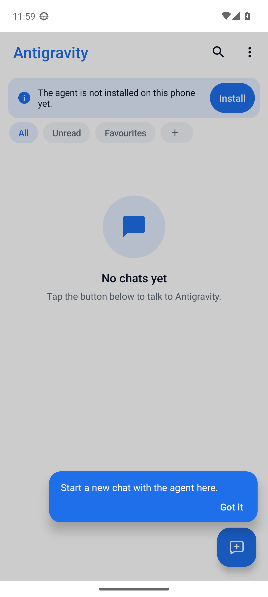

**002-02-home-empty.png**

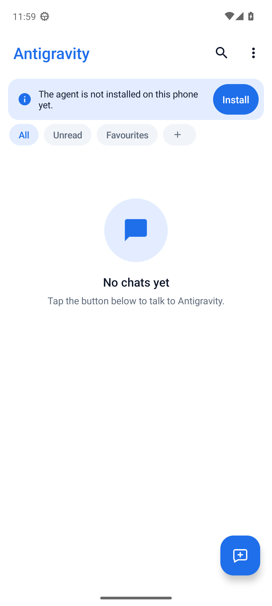

**003-03-chat-empty.png**

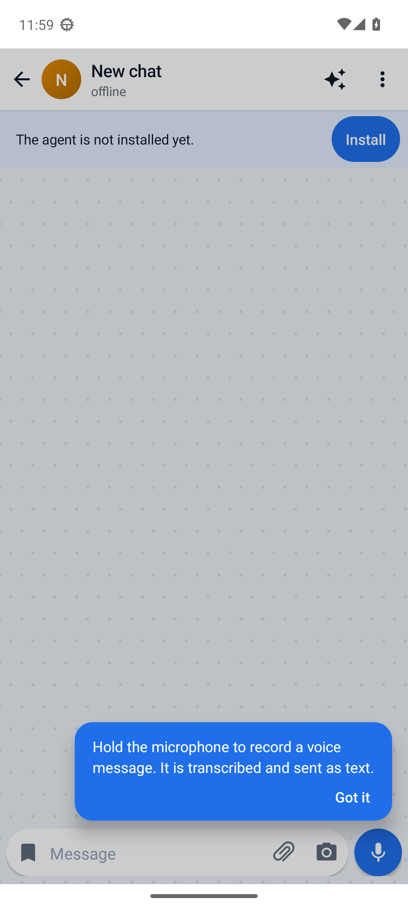

**004-04b-keyboard.png**

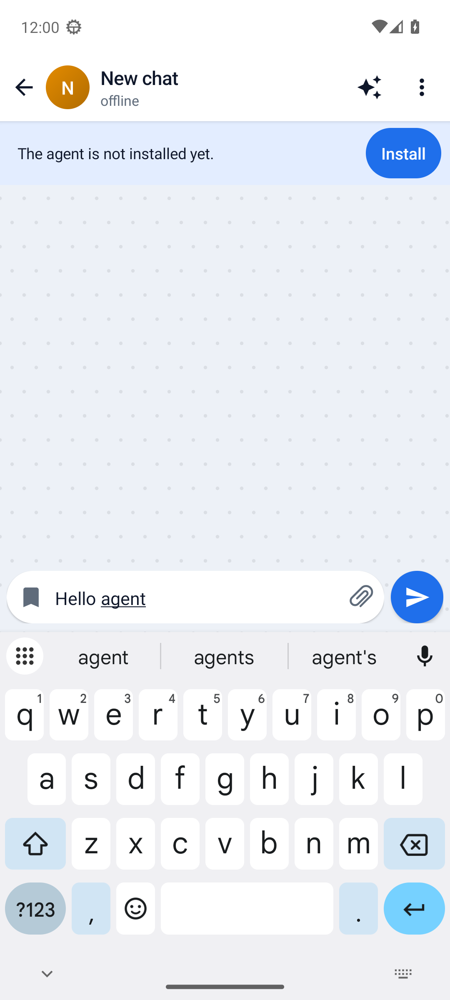

**005-04-chat-typed.png**

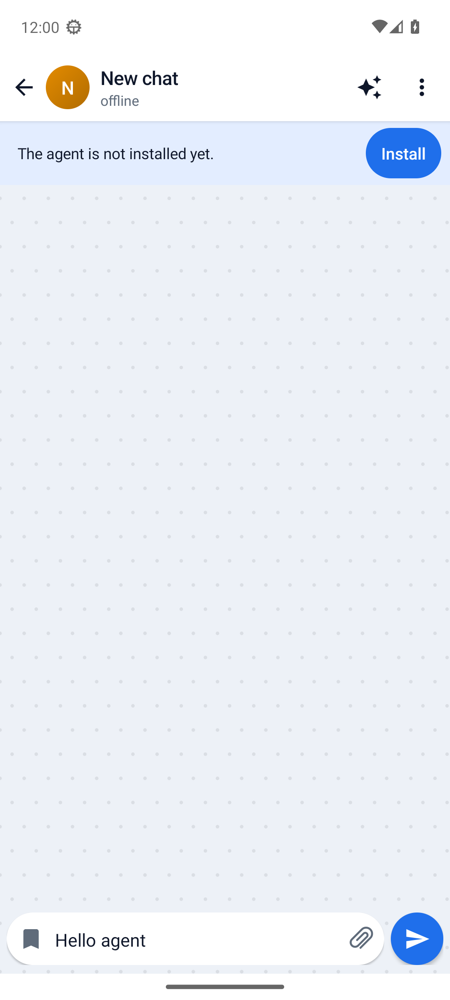

**006-05-attach-sheet.png**

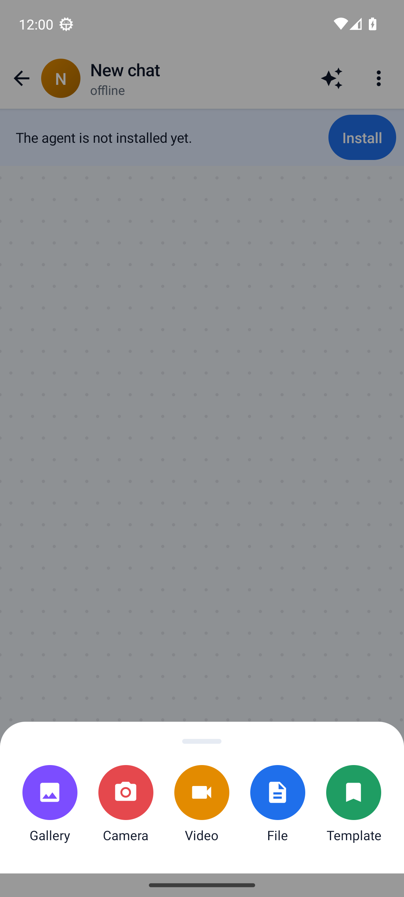

**007-06-chat-menu.png**

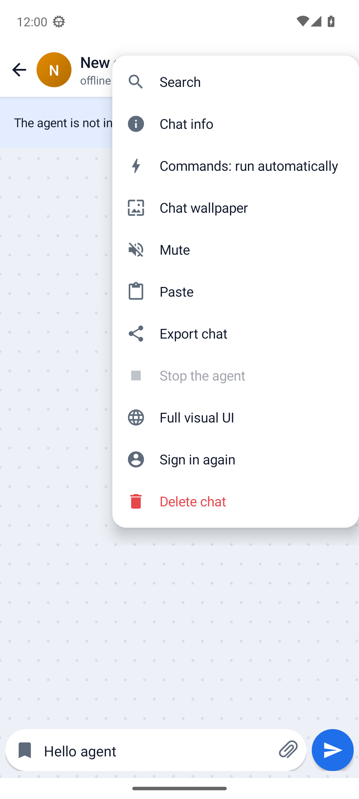

**008-07-chat-info.png**

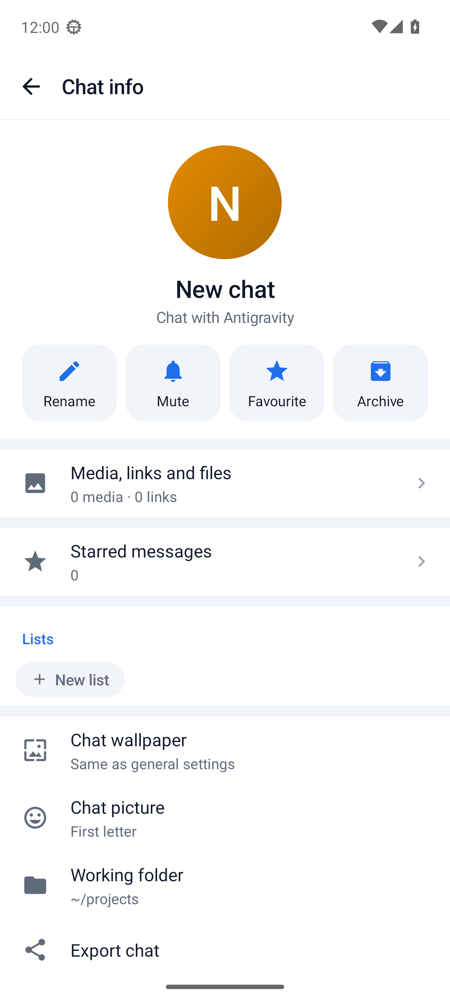

**009-08-home-draft.png**

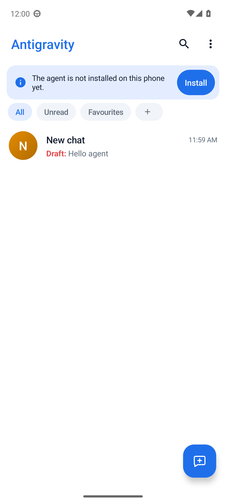

**010-09-home-selection.png**

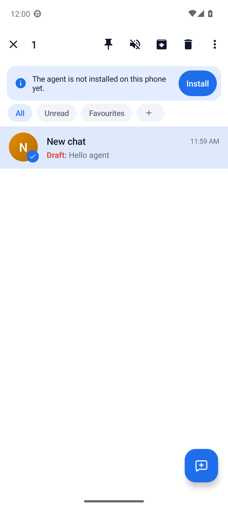

**011-10-home-menu.png**

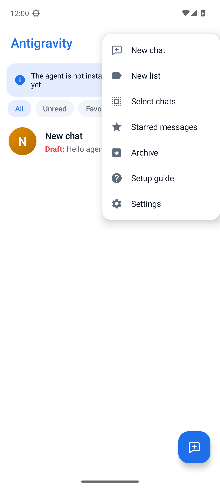

**012-11-settings.png**

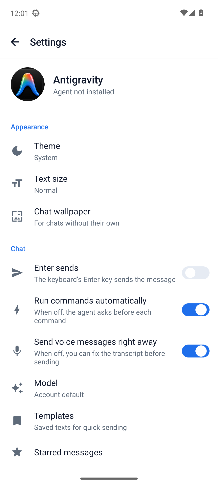

**013-12-settings-advanced.png**

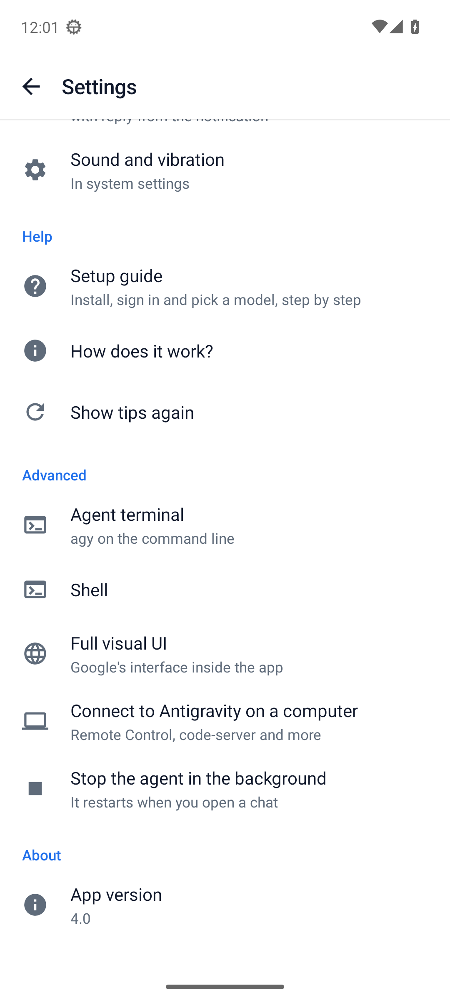

**014-13-theme-sheet.png**

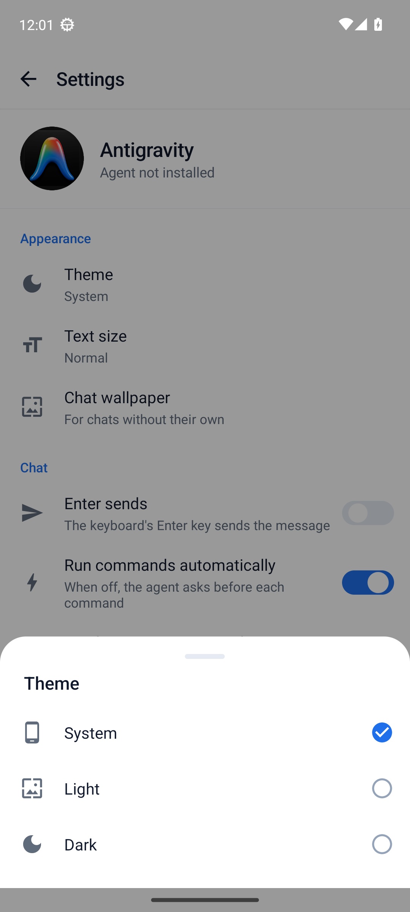

**015-14-settings-dark.png**

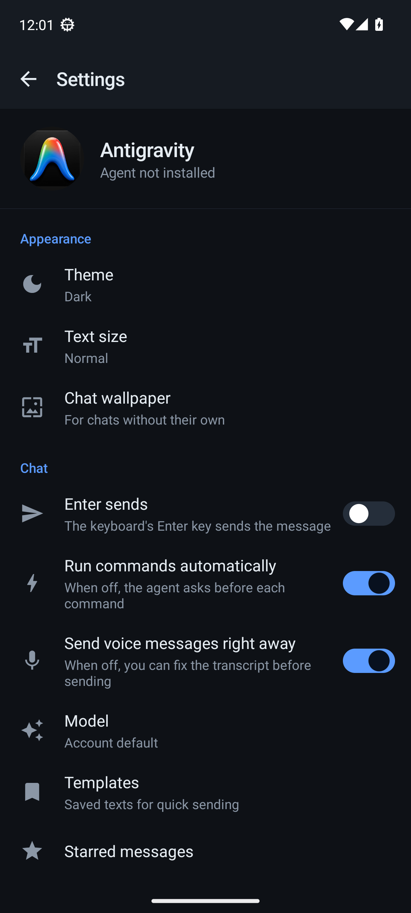

**016-15-home-dark.png**

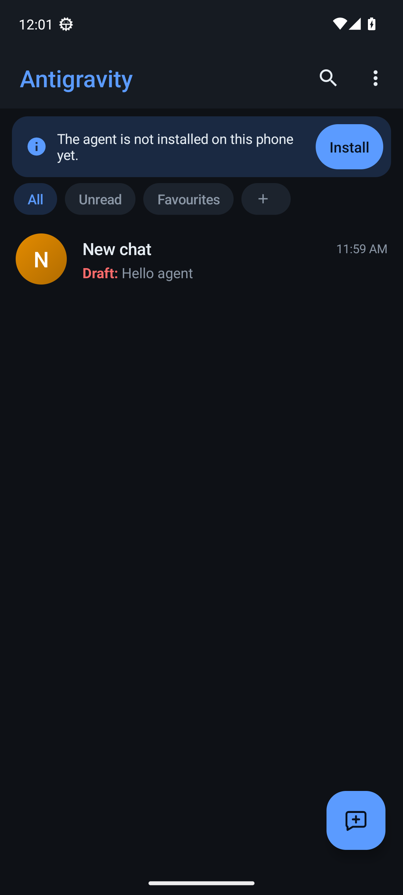

**017-16-chat-dark.png**

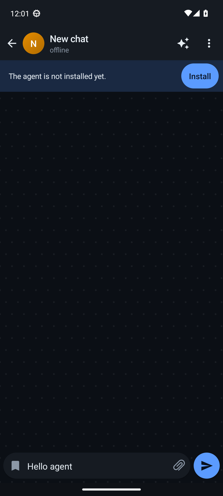
