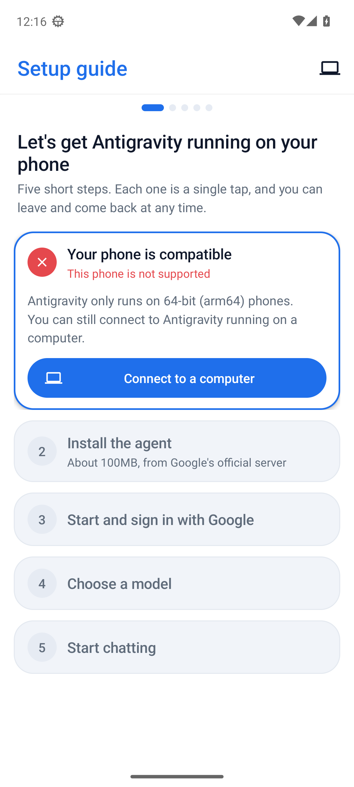
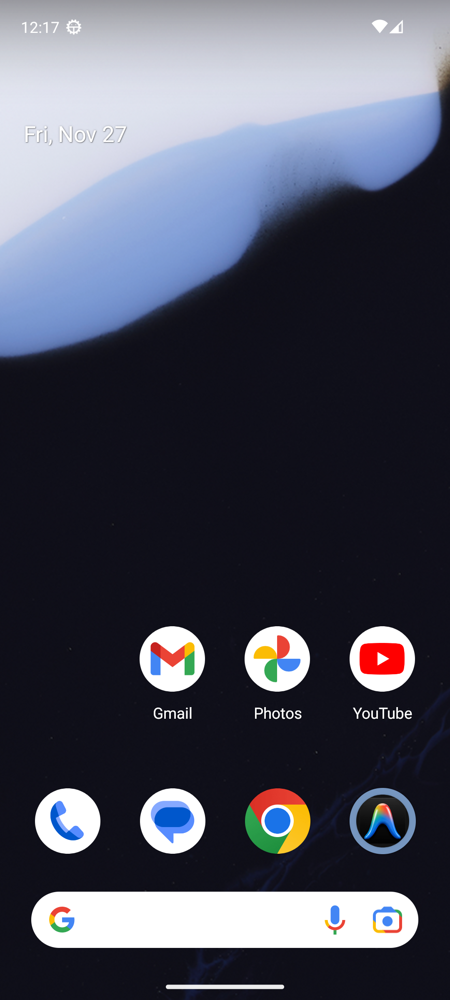
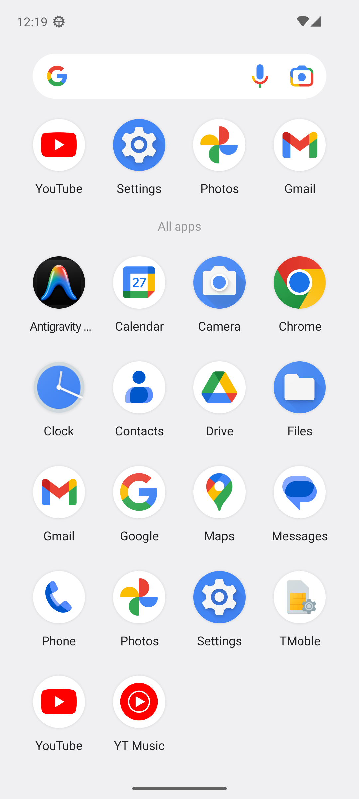
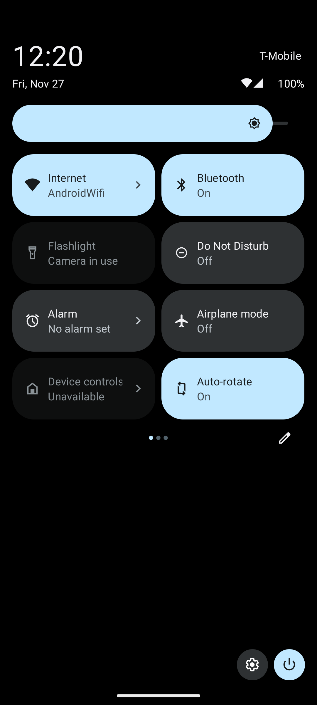
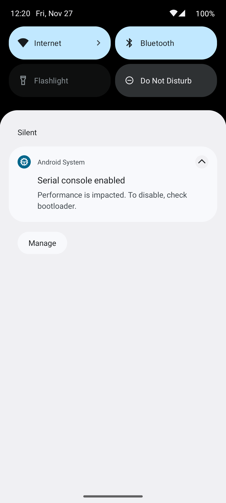

# UI test — antigravity-remote (scenario)

**Result:** ❌ FAILED  
**Package:** `com.londkirs.antigravityremote`  
**Device:** sdk_gphone64_x86_64 · Android 13 (API 33) · 1080x2400  
**Duration:** 378.8s

## Steps

| # | Action | Detail | Result | Time |
|---|---|---|---|---|
| 1 | launch | clear_data=True | ✅ | 3.21s |
| 2 | wait_for | text='Setup guide' | ❌ — element not found within 20s: text='Setup guide' | 21.05s |
| 3 | tap | desc='Connect to a computer instead' | ❌ — element not found within 10s: desc='Connect to a computer instead' | 10.1s |
| 4 | wait | seconds=1 | ✅ | 1.03s |
| 5 | launch |  | ✅ | 3.23s |
| 6 | wait | seconds=2 | ✅ | 2.03s |
| 7 | screenshot | name='01-home-tip' | ✅ | 2.25s |
| 8 | wait | seconds=2 | ✅ | 2.03s |
| 9 | tap | text='Got it' | ⚠️ — element not found within 10s: text='Got it' | 10.0s |
| 10 | screenshot | name='02-home-empty' | ✅ | 2.23s |
| 11 | tap | desc='New chat' | ❌ — element not found within 10s: desc='New chat' | 10.02s |
| 12 | wait | seconds=3 | ✅ | 3.03s |
| 13 | screenshot | name='03-chat-empty' | ✅ | 2.24s |
| 14 | wait | seconds=2 | ✅ | 2.03s |
| 15 | tap | text='Got it' | ⚠️ — element not found within 10s: text='Got it' | 12.64s |
| 16 | tap | text='Message' | ❌ — element not found within 10s: text='Message' | 12.67s |
| 17 | type | text='Message' | ❌ — element not found within 10s: text='Message' | 10.0s |
| 18 | screenshot | name='04b-keyboard' | ✅ | 2.25s |
| 19 | key | key='BACK' | ✅ | 0.85s |
| 20 | screenshot | name='04-chat-typed' | ✅ | 2.23s |
| 21 | tap | desc='Attach' | ❌ — element not found within 10s: desc='Attach' | 12.64s |
| 22 | wait | seconds=1 | ✅ | 1.03s |
| 23 | screenshot | name='05-attach-sheet' | ✅ | 2.24s |
| 24 | back |  | ✅ | 0.88s |
| 25 | tap | desc='More' | ❌ — element not found within 10s: desc='More' | 12.61s |
| 26 | wait | seconds=1 | ✅ | 1.03s |
| 27 | screenshot | name='06-chat-menu' | ✅ | 2.69s |
| 28 | tap | text='Chat info' | ❌ — element not found within 10s: text='Chat info' | 12.61s |
| 29 | wait | seconds=1 | ✅ | 1.03s |
| 30 | screenshot | name='07-chat-info' | ✅ | 2.7s |
| 31 | back |  | ✅ | 0.84s |
| 32 | back |  | ✅ | 0.84s |
| 33 | wait | seconds=1 | ✅ | 1.03s |
| 34 | wait | seconds=2 | ✅ | 2.03s |
| 35 | tap | text='Got it' | ⚠️ — element not found within 10s: text='Got it' | 12.6s |
| 36 | screenshot | name='08-home-draft' | ✅ | 2.7s |
| 37 | long_press | text='New chat' | ❌ — element not found within 10s: text='New chat' | 12.58s |
| 38 | screenshot | name='09-home-selection' | ✅ | 2.7s |
| 39 | back |  | ✅ | 0.84s |
| 40 | tap | desc='More' | ❌ — element not found within 10s: desc='More' | 12.59s |
| 41 | screenshot | name='10-home-menu' | ✅ | 2.71s |
| 42 | tap | text='Settings' | ❌ — element not found within 10s: text='Settings' | 12.57s |
| 43 | wait | seconds=1 | ✅ | 1.03s |
| 44 | screenshot | name='11-settings' | ✅ | 2.69s |
| 45 | scroll_to | text='App version' | ❌ — not found after scrolling: text='App version' | 27.49s |
| 46 | screenshot | name='12-settings-advanced' | ✅ | 2.26s |
| 47 | scroll_to | text='Theme' | ❌ — not found after scrolling: text='Theme' | 28.99s |
| 48 | tap | text='Theme' | ❌ — element not found within 10s: text='Theme' | 10.07s |
| 49 | wait | seconds=1 | ✅ | 1.03s |
| 50 | screenshot | name='13-theme-sheet' | ✅ | 2.27s |
| 51 | tap | text='Dark' | ❌ — element not found within 10s: text='Dark' | 10.05s |
| 52 | wait | seconds=2 | ✅ | 2.03s |
| 53 | screenshot | name='14-settings-dark' | ✅ | 2.28s |
| 54 | back |  | ✅ | 0.85s |
| 55 | wait | seconds=1 | ✅ | 1.03s |
| 56 | screenshot | name='15-home-dark' | ✅ | 2.27s |
| 57 | tap | text='New chat' | ❌ — element not found within 10s: text='New chat' | 12.65s |
| 58 | wait | seconds=2 | ✅ | 2.04s |
| 59 | screenshot | name='16-chat-dark' | ✅ | 2.24s |

## Screenshots

**001-step2-wait_for-FAILED.png**

**002-step3-tap-FAILED.png**

**003-01-home-tip.png**

**004-02-home-empty.png**

**005-step11-tap-FAILED.png**

**006-03-chat-empty.png**

**007-step16-tap-FAILED.png**

**008-step17-type-FAILED.png**

**009-04b-keyboard.png**

**010-04-chat-typed.png**

**011-step21-tap-FAILED.png**

**012-05-attach-sheet.png**

**013-step25-tap-FAILED.png**

**014-06-chat-menu.png**

**015-step28-tap-FAILED.png**

**016-07-chat-info.png**

**017-08-home-draft.png**

**018-step37-long_press-FAILED.png**

**019-09-home-selection.png**

**020-step40-tap-FAILED.png**

**021-10-home-menu.png**

**022-step42-tap-FAILED.png**

**023-11-settings.png**

**024-step45-scroll_to-FAILED.png**

**025-12-settings-advanced.png**

**026-step47-scroll_to-FAILED.png**

**027-step48-tap-FAILED.png**

**028-13-theme-sheet.png**

**029-step51-tap-FAILED.png**

**030-14-settings-dark.png**

**031-15-home-dark.png**

**032-step57-tap-FAILED.png**

**033-16-chat-dark.png**

