# UI test — antigravity-remote (scenario)

**Result:** ✅ PASSED  
**Package:** `com.londkirs.antigravityremote`  
**Device:** sdk_gphone64_x86_64 · Android 13 (API 33) · 1080x2400  
**Duration:** 166.0s

## Steps

| # | Action | Detail | Result | Time |
|---|---|---|---|---|
| 1 | launch | clear_data=True | ✅ | 6.32s |
| 2 | wait_for | text='מדריך הפעלה' | ✅ | 2.92s |
| 3 | tap | desc='חיבור למחשב במקום' | ✅ | 3.71s |
| 4 | wait | seconds=1 | ✅ | 1.37s |
| 5 | launch |  | ✅ | 4.76s |
| 6 | wait | seconds=2 | ✅ | 2.25s |
| 7 | screenshot | name='01-home-tip' | ✅ | 3.68s |
| 8 | wait | seconds=2 | ✅ | 2.56s |
| 9 | tap | text='הבנתי' | ✅ | 3.57s |
| 10 | screenshot | name='02-home-empty' | ✅ | 3.88s |
| 11 | tap | desc='שיחה חדשה' | ✅ | 4.17s |
| 12 | wait | seconds=3 | ✅ | 3.09s |
| 13 | screenshot | name='03-chat-empty' | ✅ | 3.87s |
| 14 | wait | seconds=2 | ✅ | 2.17s |
| 15 | tap | text='הבנתי' | ✅ | 3.8s |
| 16 | tap | text='הודעה' | ✅ | 3.81s |
| 17 | type | text='הודעה' | ✅ | 5.35s |
| 18 | screenshot | name='04b-keyboard' | ✅ | 3.48s |
| 19 | key | key='BACK' | ✅ | 1.11s |
| 20 | screenshot | name='04-chat-typed' | ✅ | 2.76s |
| 21 | tap | desc='צירוף' | ✅ | 3.98s |
| 22 | wait | seconds=1 | ✅ | 1.34s |
| 23 | screenshot | name='05-attach-sheet' | ✅ | 3.15s |
| 24 | back |  | ✅ | 1.04s |
| 25 | tap | desc='עוד' | ✅ | 3.67s |
| 26 | wait | seconds=1 | ✅ | 1.12s |
| 27 | screenshot | name='06-chat-menu' | ✅ | 3.07s |
| 28 | tap | text='פרטי השיחה' | ✅ | 3.68s |
| 29 | wait | seconds=1 | ✅ | 1.18s |
| 30 | screenshot | name='07-chat-info' | ✅ | 2.5s |
| 31 | back |  | ✅ | 1.0s |
| 32 | back |  | ✅ | 1.06s |
| 33 | wait | seconds=1 | ✅ | 1.13s |
| 34 | wait | seconds=2 | ✅ | 2.13s |
| 35 | tap | text='הבנתי' | ✅ | 3.46s |
| 36 | screenshot | name='08-home-draft' | ✅ | 2.46s |
| 37 | long_press | text='שיחה חדשה' | ✅ | 4.17s |
| 38 | screenshot | name='09-home-selection' | ✅ | 2.63s |
| 39 | back |  | ✅ | 1.15s |
| 40 | tap | desc='עוד' | ✅ | 3.24s |
| 41 | screenshot | name='10-home-menu' | ✅ | 2.34s |
| 42 | tap | text='הגדרות' | ✅ | 3.11s |
| 43 | wait | seconds=1 | ✅ | 1.14s |
| 44 | screenshot | name='11-settings' | ✅ | 2.36s |
| 45 | scroll_to | text='גרסת האפליקציה' | ✅ | 5.3s |
| 46 | screenshot | name='12-settings-advanced' | ✅ | 2.31s |
| 47 | scroll_to | text='ערכת נושא' | ✅ | 5.32s |
| 48 | tap | text='ערכת נושא' | ✅ | 3.07s |
| 49 | wait | seconds=1 | ✅ | 1.06s |
| 50 | screenshot | name='13-theme-sheet' | ✅ | 2.28s |
| 51 | tap | text='כהה' | ✅ | 3.07s |
| 52 | wait | seconds=2 | ✅ | 2.06s |
| 53 | screenshot | name='14-settings-dark' | ✅ | 2.3s |
| 54 | back |  | ✅ | 0.9s |
| 55 | wait | seconds=1 | ✅ | 1.06s |
| 56 | screenshot | name='15-home-dark' | ✅ | 2.37s |
| 57 | tap | text='שיחה חדשה' | ✅ | 3.12s |
| 58 | wait | seconds=2 | ✅ | 2.22s |
| 59 | screenshot | name='16-chat-dark' | ✅ | 2.31s |

## Screenshots

**001-01-home-tip.png**

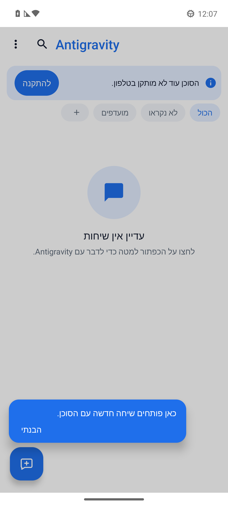

**002-02-home-empty.png**

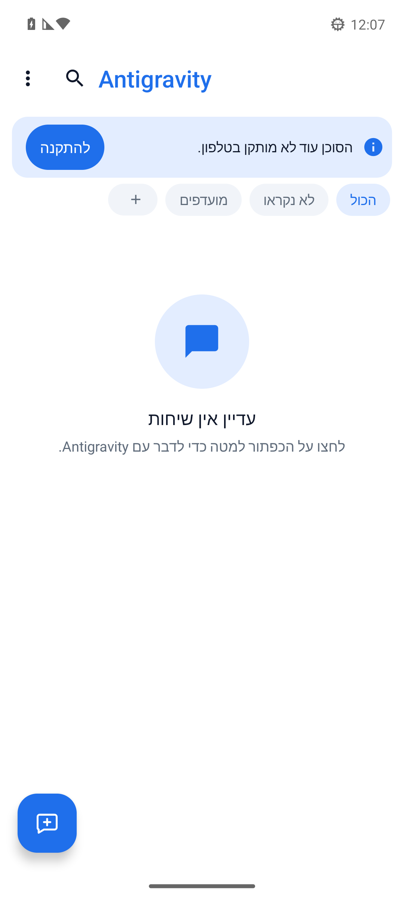

**003-03-chat-empty.png**

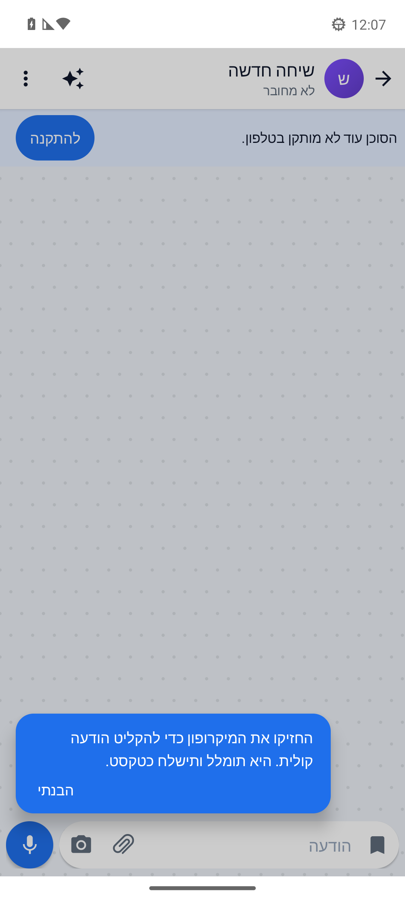

**004-04b-keyboard.png**

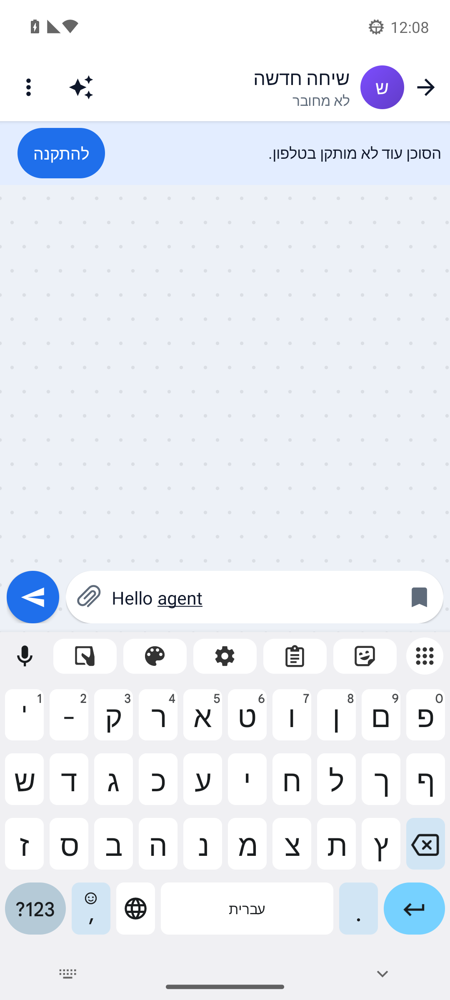

**005-04-chat-typed.png**

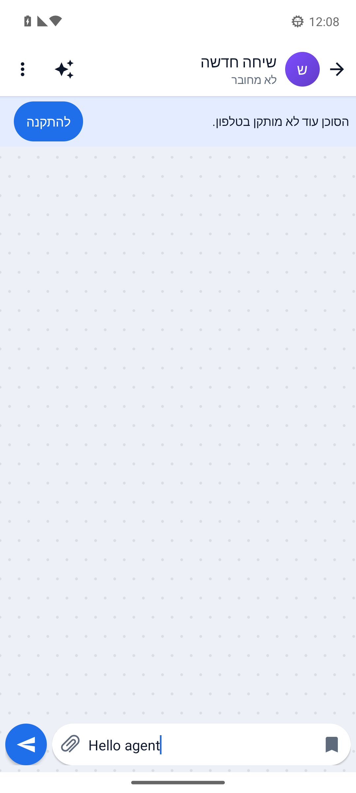

**006-05-attach-sheet.png**

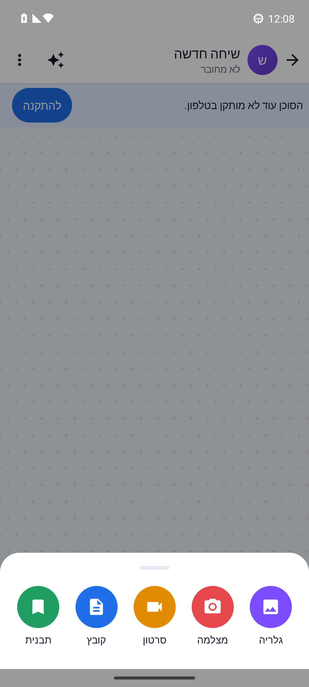

**007-06-chat-menu.png**

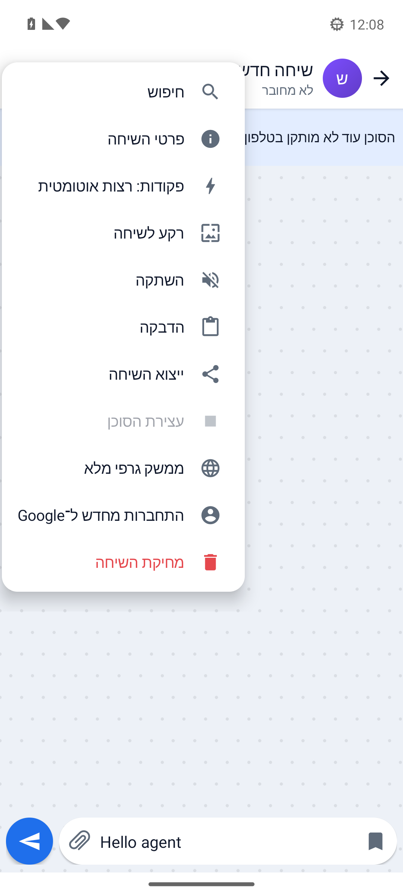

**008-07-chat-info.png**

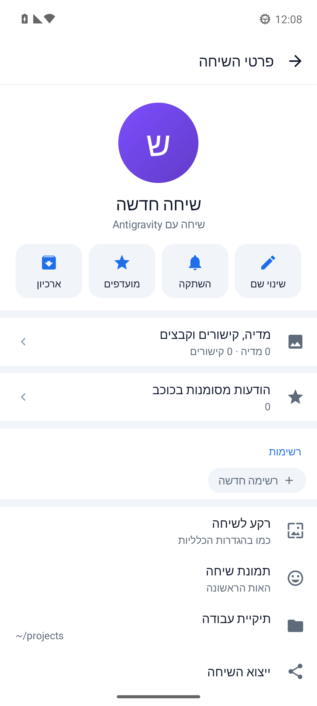

**009-08-home-draft.png**

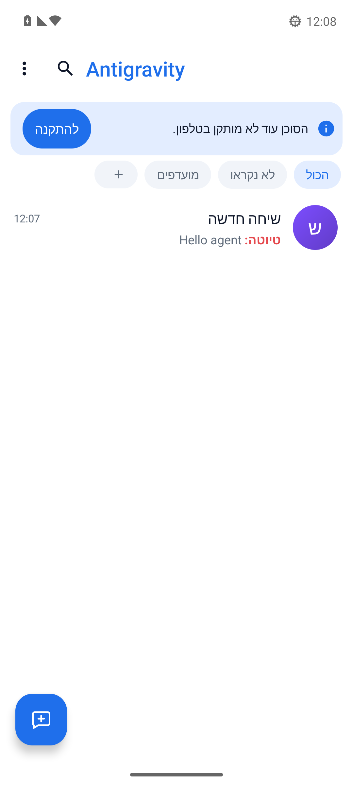

**010-09-home-selection.png**

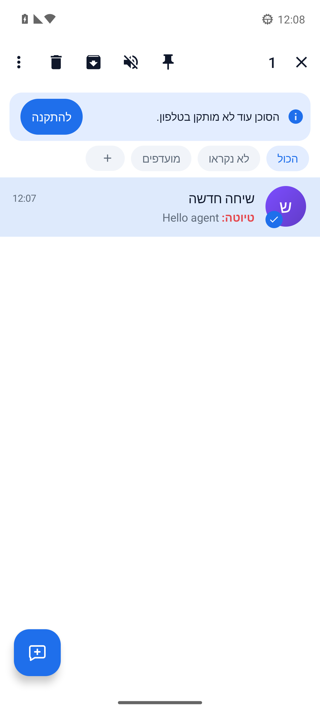

**011-10-home-menu.png**

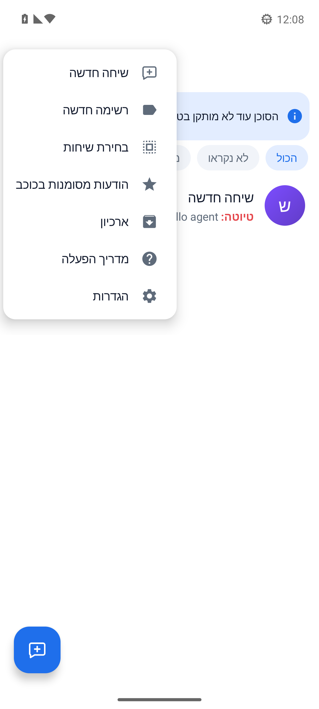

**012-11-settings.png**

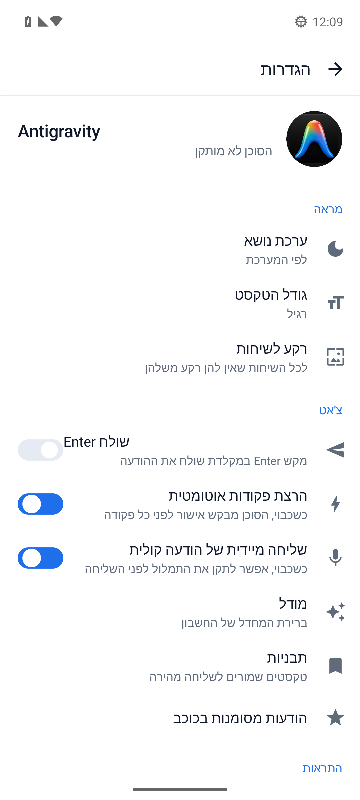

**013-12-settings-advanced.png**

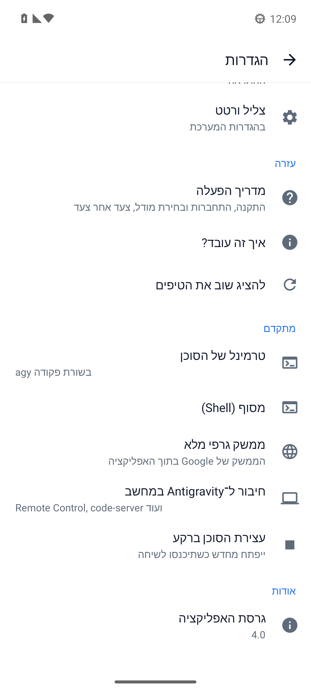

**014-13-theme-sheet.png**

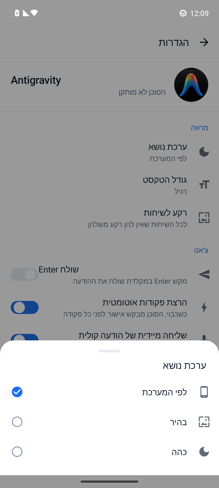

**015-14-settings-dark.png**

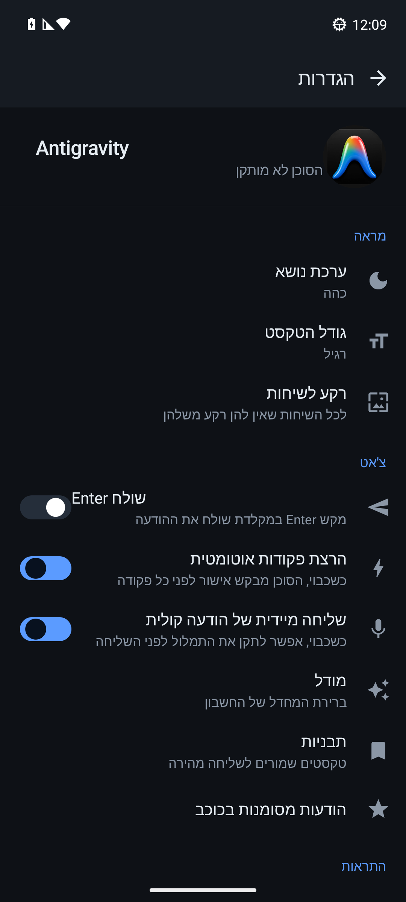

**016-15-home-dark.png**

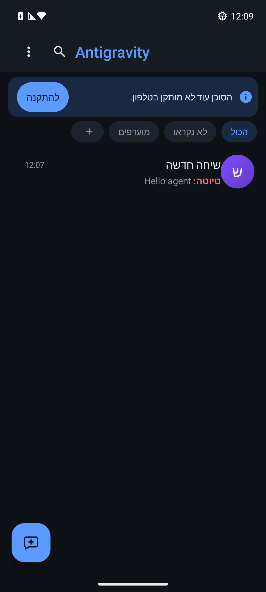

**017-16-chat-dark.png**

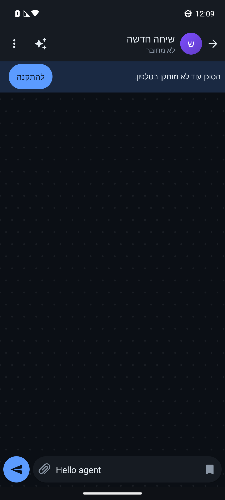
