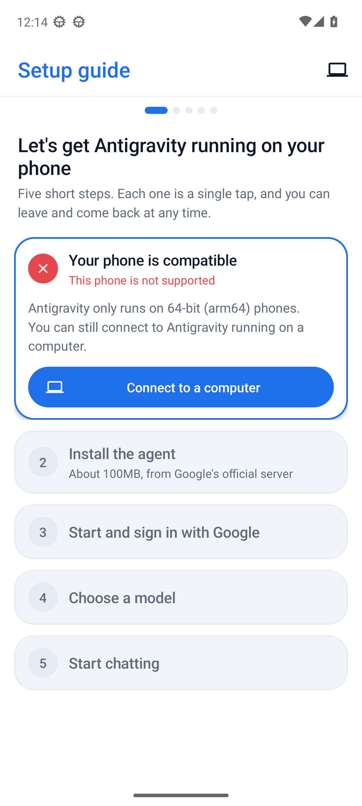
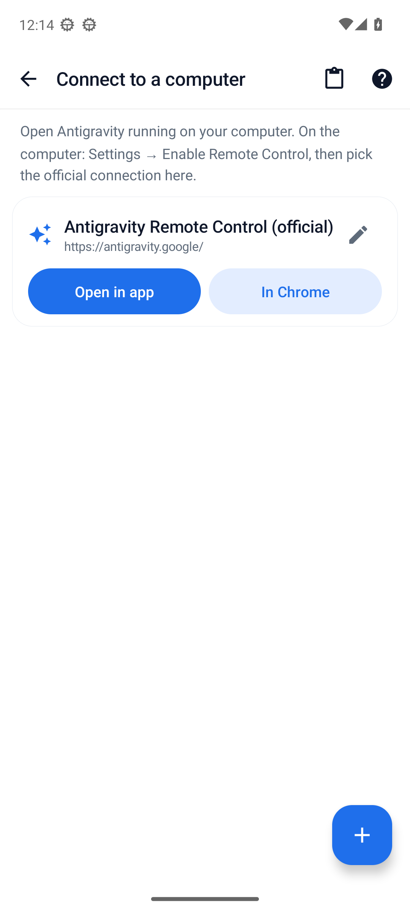
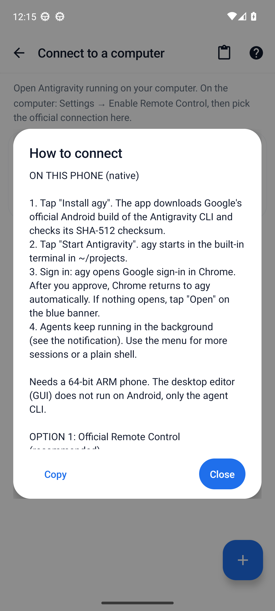
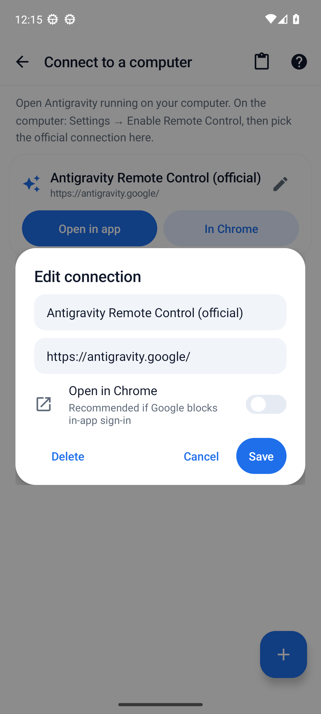
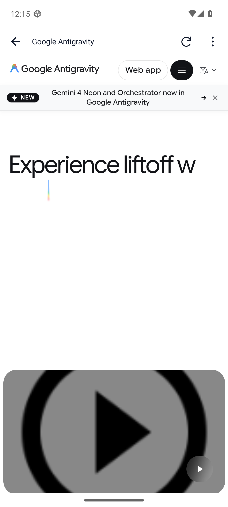
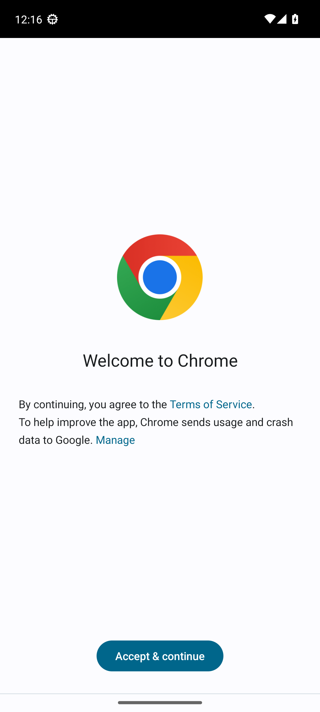
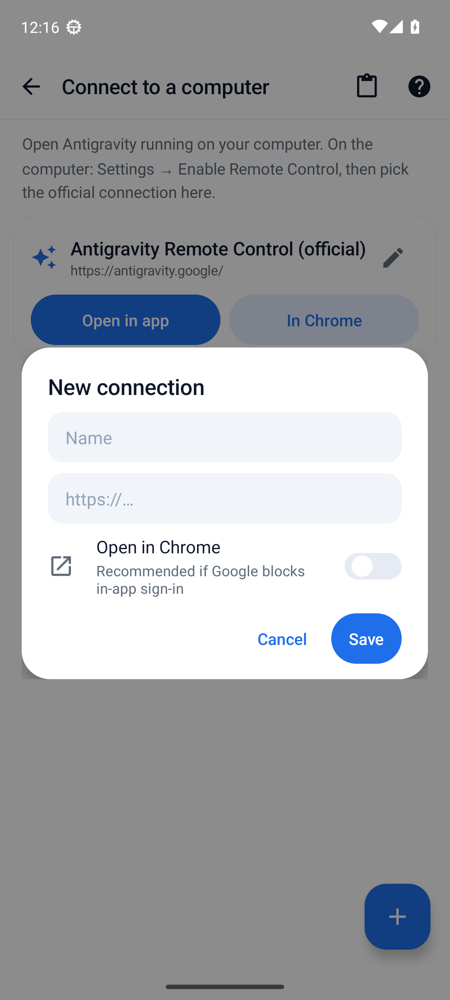

# UI test — antigravity-remote (explore)

**Result:** ✅ PASSED  
**Package:** `com.londkirs.antigravityremote`  
**Device:** sdk_gphone64_x86_64 · Android 13 (API 33) · 1080x2400  
**Duration:** 135.4s

## Steps

| # | Action | Detail | Result | Time |
|---|---|---|---|---|
| 1 | explore-tap | Connect to a computer instead | ✅ | 1.36s |
| 2 | explore-tap | Back | ✅ | 1.32s |
| 3 | explore-tap | Connect to a computer | ✅ | 1.39s |
| 4 | explore-tap | Paste a session link | ✅ | 1.36s |
| 5 | explore-tap | How to enable it on the computer | ✅ | 1.73s |
| 6 | explore-tap | Copy | ✅ | 1.68s |
| 7 | explore-tap | Edit | ✅ | 1.45s |
| 8 | explore-tap | Antigravity Remote Control (official) | ✅ | 2.4s |
| 9 | explore-tap | Antigravity Remote Control (official) | ✅ | 1.46s |
| 10 | explore-tap | https://antigravity.google/ | ✅ | 1.43s |
| 11 | explore-tap | Cancel | ✅ | 1.36s |
| 12 | explore-tap | Open in app | ✅ | 1.8s |
| 13 | explore-tap | Back | ✅ | 1.8s |
| 14 | explore-tap | In Chrome | ✅ | 1.97s |
| 15 | explore | left app to com.android.chrome | ✅ | 0s |
| 16 | explore-tap | New connection | ✅ | 1.53s |
| 17 | explore-tap | Name | ✅ | 2.05s |
| 18 | explore-tap | Name | ✅ | 1.39s |
| 19 | explore-tap | https://… | ✅ | 1.62s |
| 20 | explore-tap | Cancel | ✅ | 1.5s |

## Notes

- explore: 6 distinct screens, 19 elements tapped, 0 relaunches, 124s

## Screenshots

**001-screen-1.png**

**002-screen-2.png**

**003-screen-3.png**

**004-screen-4.png**

**005-screen-5.png**

**006-left-app-to-com-android-chrome.png**

**007-screen-6.png**

**008-final.png**

